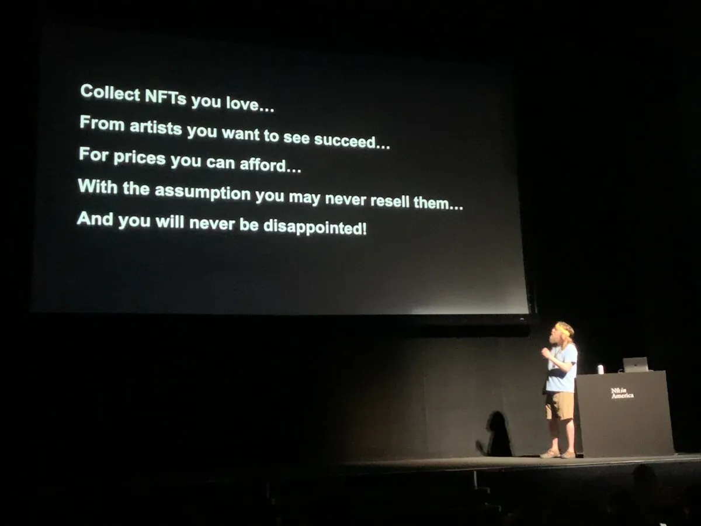
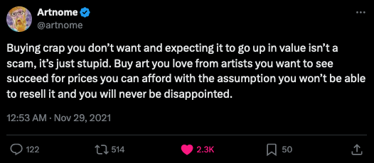
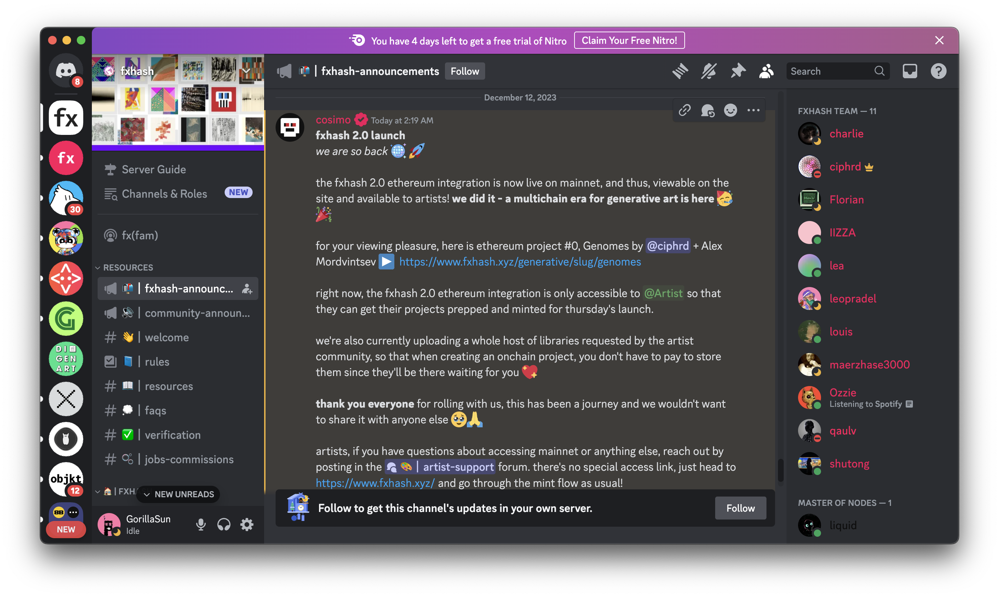

# Getting Started as a Collector

*A discussion of best practices for collecting NFTs on fxhash and elsewhere, the role of the collector in shaping a complete NFT eco-system, and strategies for acquiring a meaningful body of varied pie*

Blockchain technology has made it much more accessible to become an art collector today. Decentralized sales mechanisms have not only streamlined the distribution of digital art, they’ve also democratized the participation in a global art movement, making it possible for anyone to take part either as a creator, a collector, or both at the same time. In this resource we’ll tackle the role of the *collector* in the dynamic Web3 setting - collectors are in many ways vital to forming a complete NFT eco-system:

> [!NOTE]
> **(NFT) Collector**: An individual or entity that actively acquires and holds non-fungible tokens (NFTs) for various reasons, including personal enjoyment, investment potential, community engagement, or support for digital artists and creators. They play a crucial role in the NFT ecosystem by shaping market demand, influencing trends, and supporting the development of digital art and culture.

While collecting NFTs is in many ways easier and more accessible than being a collector in the traditional art world, this modern practice does however come with its own set of difficulties. In what follows we outline some guidelines and best practices for getting started as a new collector, and also provide some strategies for growing and accruing a meaningful collection of different works over time.

### Motivations for Collecting Art

Before providing advice on how to get started as a collector - it is also meaningful to assess one’s own internal motivations and desire for art ownership:

> [!NOTE]
>  Why do collectors collect Art? Why be a collector?

While the answer to these questions can be highly individual, the practice of collecting art is important for multiple reasons:

- **Supporting the Artists You Admire:** The simplest reason for collecting artworks, is that it financially supports the artists that have poured countless hours into honing their craft and creating unique pieces of expression.
- **Furthering a Cultural Dialogue and Exchange:** By purchasing works from living artists and by endorsing their endeavors, collectors can directly contribute to the dynamic evolution of art and culture, providing essential financial support that allows for experimentation and innovation. This fuels an evolving cultural landscape where new ideas and perspectives challenge and enrich existing norms.
- **Collecting is a Form of Expression in of Itself:** Collecting and building a collection of works can be a fulfilling personal endeavor in of itself. Not only to express a genuine appreciation for the art-form (when it comes to generative art on fxhash), but also because the act of collecting works can in itself be a form of expression - through which one can convey their own personal unique tastes and interests. Expressing interest in certain artworks, by certain artists, can often constitute a
- **Personal Enjoyment and a Desire for Ownership:** Art can evoke emotions, inspire thought, and spark creativity. Owning art allows for a deeper engagement with these experiences, enriching one's life on multiple levels.
- **Financial Incentives:** Beyond the aforementioned reasons, collecting art can also have financial incentives. Especially in the NFT setting in which it’s quite easy to acquire and re-sell tokens relatively rapidly and in larger volumes as compared to a traditional setting where this would be much more time-intensive and require scheduled events at auction houses.

And these are just a few reasons why it can be a fulfilling endeavor to collect art. Pivoting off of the last point though, what makes collecting digitally native tokens special and what’s the difference when compared to collecting art in a traditional setting?

> [!NOTE]
>  Why collect NFTs? What is the difference between holding a digital token vs. owning a physical artwork?

Beyond the aforementioned reasons, collecting in the NFT setting furthers the ongoing dialogue around this new digital medium and encourages the exploration of new technological ideas. We’ve already witnessed a number of breakthroughs through some innovative explorations of the artists - which would not have been possible without the ongoing support from collectors of all kind.

Whether you simply want to become a collector to show support to the creators that you admire, or have a firm belief in the future financial value of these digital tokens, is ultimately up to you - you might even have other personal motivations.

### Best Practices for Collecting on fxhash

Taking your first steps as a collector can be a daunting endeavor when you don’t know how and where to get started. Collecting doesn’t mean that you just blindly acquire different tokens on fxhash and other platforms, but rather involves doing your research and making informed decisions on which pieces you’d like to add to your growing collection - and in that regard there’s quite a few things that need to be considered.

We found that one of the best primers for collectors aiming to dive into fxhash, is the article by Lil Saturn titled [\*\*Searching for Gralis](https://gralis.substack.com/p/searching-for-gralis).\*\* The author adequately describes it as “the article I wish I had when I first started collecting on fxhash”. While the landscape has changed quite a bit in the past years since the article was published, most of the information that’s presented still holds true today:

> I believe long-form generative art is the biggest shift in the art space of this generation. And we have the rare opportunity to be living while it blossoms, we can take part in it, help shape it, and participate in the financial (yes, I said it) upside of this movement.

The article references another meaningful resource, and highlights a talk given by Jason Bailey, aka Artnome - one of the original enthusiasts, that recognized the value of NFTs early on, and has shown a long standing interest in generative art. Over the years he’s become a critically acclaimed writer and respect voice in the generative art space.

In one part of his presentations he breaks down collecting NFTs into 4 simple considerations:

*[Link to Tweet](https://twitter.com/artnome/status/1465106699052802049)*

We find that these are excellent guidelines to adhere to when collecting tokens, on fxhash, and on other platforms - **especially** if you’re just starting out:

- **Collect the art that you love:** before you collect one of the thousands of tokens on fxhash, via the primary or secondary market, ask yourself in what ways the particular piece you’re interested in resonates with you, and in a Mary Kondo-esque way, whether or not holding this digital token in your wallet will bring you joy.
- **Collect projects from artists you want to see succeed:** fxhash empowers big and small artists alike. Collecting from the creators that you’d like to see succeed is one of the best ways to support them.
- **Only collect for prices you can afford:** Decide how much you can comfortably expend for the purpose of collecting NFTs, without affecting your other financial obligations.
- **Assume that you will never re-sell your collected pieces and may never make a profit from them:** if you’re just starting out, never speculate that you’ll make a profit from any tokens that you collect. Although there is a possibility for the value of collected tokens to increase at some point in the future, there is never a guarantee on that happening. Furthermore, the value of a token can also not be accurately predicted in any manner - it is purely speculative.

Following these guidelines should make for an enjoyable collecting experience overall.

## Getting Started: Budgeting and Collecting Affordable Pieces

To start with the basics — **it’s important to set a Budget.** Determine how much you're willing and can afford to spend on your purchases, and really stick to that budget. This could mean that you set a monthly spending limit for yourself, or put a maximum limit on how much you want to spend on any single purchase. Setting a clear predetermined budget for yourself will help you avoid overspending in the long run.

Here you might be asking yourself the following questions: *how do you actually determine the value of a digital token? What makes one artwork worth more than another one? Why is there a difference in price between two tokens that look quite similar?*

> [!NOTE]
> While at first glance it might seem like the price tags placed on the artworks on fxhash are assigned in a somewhat arbitrary manner. It’s a bit like walking into a grocery store in a foreign country - items can have all sorts of different price points.
>
> **It can be difficult to assess the value of a digital token.** Make sure to check out The Value of Generative Art to get an idea what factors determine the specific prices of Generative Tokens on fxhash, then go from there and decide what an appropriate budget is for you.

When you don’t have a feel for the “price” of things yet - **start out small.** Start your collection with more affordable pieces. Many artists offer a range of sizes and editions, some cheaper than others—sometimes even as free mints. This makes it possible to start a collection without a significant financial commitment. Here’s some tips towards in that regard:

- **Explore the projects of Emerging Artists.** Instead of directly trying to compete in the big leagues, exploring the art of emerging generative artists can be a worthwhile endeavour, they frequently offer their work at more affordable price points compared to established names. Additionally, early works from rising artists can become more valuable over time - and your support plays a crucial role in this setting.
- **Minting during Community Events:** frequently the community will come together for special occasions, such as the fxhash anniversary just as an example, where artists will mint pieces revolving around central theme or shared topic; usually the projects minted during these events tend to be on the more affordable side of things. This is often one of the best times to kickstart your collection for cheap.
- **Consider Open/Larger Editions:** Some projects on fxhash are available in open editions for a very affordable price (sometimes even free), meaning that there is no limit to the number of copies that can be minted (these projects are generally time limited however). Although it makes the project less exclusive, it will allow you to quickly grow your collection.
- **Free Editions:** sometimes artists choose to release their projects free of charge, this is when you should strike and cop an edition for yourself.

Other times, **you can find many pieces being sold on the secondary market for a lesser price than the original minting price**. This is frequently due to these pieces having been acquired as speculative purchases in the first place - that’s where you swoop in and grab yourself a beautiful piece of generative art. Even if they might not be highly desirable, they might still be beautiful pieces to have in your collection.

> [!NOTE]
> Check out the discovery tools page where we list some of the tools that facilitate the discovery of specific projects on fxhash.

One other thing that’s important to mention here: **Get a feel for how things work.** Before you click buttons at random on fxhash, or on any other platform, make sure to take your time and properly understand how the different interfaces work, and what they’re used for.

### Growing your Collection

Once you’ve dipped your toes into collecting your very first few pieces, you’ll likely want to start thinking about how to go about growing your collection further and adding more pieces over time. Some considerations that can help do so in a guided manner are:

- **Setting Collection Goals**: this could include acquiring specific pieces with a specific aesthetic, creating a themed collection, or focusing on a particular style. Such goals give direction to collecting as a hobby and make it more rewarding. Over time you can then diversify and explore different aspects of your interests to prevent becoming burnt out.
- **Being patient and collecting strategically**: Building a collection doesn't have to happen all at once. Take your time to research different artists and projects, and wait for opportunities to acquire pieces that align with your taste and budget - as mentioned early, frequently there will be community events where you’re presented with a large influx of many pieces all at once.
- **Staying up-to-date**: Staying informed about the generative art market, pricing trends, and upcoming releases can go a long way when you’re a collector that’s on the hunt for adding affordable pieces to your collection. Becoming acquainted with the different artists, following up with their works in progress, and staying up to date with ongoing events helps in identifying pieces worth collecting early on. Having a complete picture of the different happenings in the space, and an understanding of the current overall state of the market will help you make informed decisions in that regard.

### Networking and Engaging with the Community

To follow up on the last point of the previous section, staying up-to-date with what’s going on is best done by getting in touch with your favorite artists as well as your fellow collectors. You’d be surprised to learn how happy many of the artists on fxhash are to talk about their practice and give you details about their process. Likewise, connecting with other collectors will allow you to engage in a discourse about the artworks you love, help you gain insights from individuals that may have more experience collecting art, and may have been in the game longer than you.

> [!TIP]
> One way to do this is by joining online communities and chat groups. Discord has established itself as the most popular communication channel in the Web3 setting. In the **fxhash discord** you’ll find artists and collectors alike, chatting and discussing all sorts of different topics. The fxhash team will also frequently broadcast updates via the announcement channel.
>
> If you haven’t joined yet, [**here’s an invite link to the fxhash discord.**](https://discord.gg/fxhash-900333075509149767)

Attending IRL events and galleries can be another great way to connect with others. fxhash hosts and participates in several events in different locations around the world over the course of the year, these are also usually announced on the fxhash social outlets as well as the discord.

That might be more or less difficult depending on your country of residence - but maybe you can factor in one of these events during your next vacation and make a pit-stop. There’s nothing that beats getting to know others during an IRL event, it can give you an idea of the people behind the online personas that you interact with on a daily basis and lets you connect with other passionate generative art enthusiasts.

### Towards Curation

Once you’ve accrued a significant number of pieces, you can also start thinking about creating your own curations. This can be a creative and expressive endeavor, allowing you to tell a visual story through your acquisitions, it can also be valuable to document your collection and write about the pieces that resonate with you the most. If this is something that sounds exciting to you—check out the Strategies for Curating Your Collection page of the docs.
