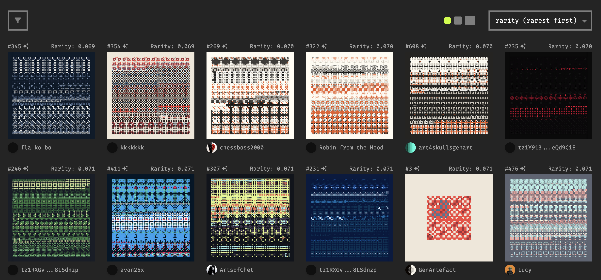
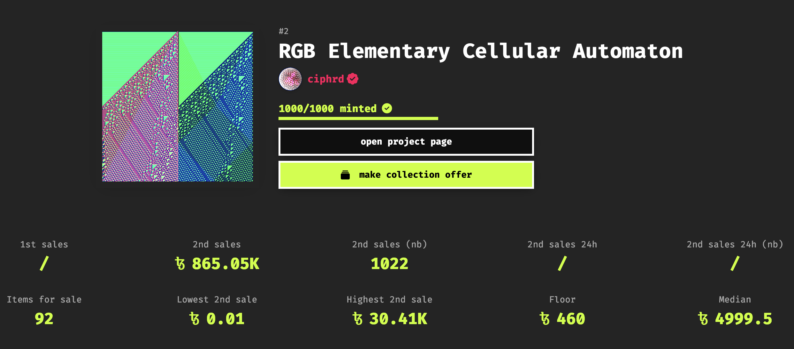
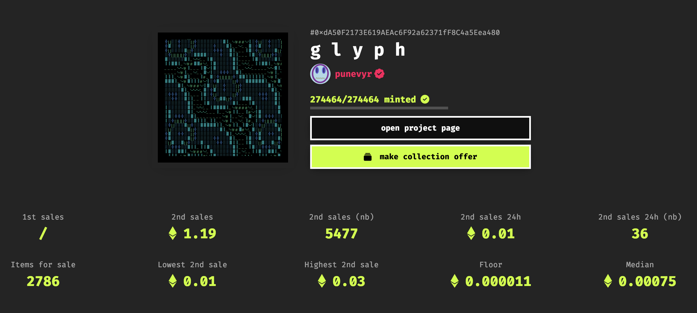

# Market Analysis & Dynamics

*An introduction to market dynamics, the influence thereof on the price of tokens on the secondary market, and an overview of relevant factors that play a role during the valuation of digital art token*

While we’ve previously tackled some of the factors that influence the valuation of individual generative artworks, it is also beneficial to discuss and understand the broader dynamics that arise when collectors compete for the acquiry and sale of tokens on the secondary market. These emergent dynamics are the driving forces play a significant role in determining the worth of digital assets on the blockchain:

> [!NOTE]
> **Market Dynamics:** The forces that shape the behavior and performance of a market. In the context of NFTs, it's the interplay of factors that determine the price, demand, and supply of these digital assets on the secondary market.

To a large extent the Web3 NFT markets mirror the dynamics of traditional markets, where supply, demand, and competition play a central role in how prices regulate themselves.

- **On the demand side**, factors such as hype, trends, perceived value, and speculation all play a role. NFTs associated with popular artists, projects, or communities often see higher demand and, consequently, higher prices.
- **On the supply side**, the edition size of a project, the rate at which creators release new projects, and the success of previous projects can equally impact the price of a token.

The interplay of these factors leads to a dynamic setting in which it becomes quite difficult to make predictions for the price of different tokens ahead of time. When it comes to generative art, as well as other art tokens on the blockchain, things get even more complicated as there’s other factors that also need to be considered - with blockchain based generative art being situated somewhere at the intersection of a financial and an art market, it borrows aspects from the two.

What further amplifies the difficulty of this is that the generative art market has become much more competitive in recent years; with several different platforms entering the playing field, pioneering with innovative sales mechanics, bringing in more and more artists to publish and distribute their creations in a blockchain native format. All of these developments have ultimately rendered the playing field much more involved.

In this kind of setting, *pricing* becomes a fairly challenging topic not only for artists but also for collectors. While artists need to specify an initial price point for their projects, collectors are in charge of determining and setting prices through their activities on the secondary market. We generally refer to this process as Price Discovery:

> [!NOTE]
> **Price Discovery**: Price discovery is the process by which the market determines the fair value of an asset. Unlike traditional markets where prices are established through historical data and comparable assets, the NFT market is relatively new and lacks such benchmarks. Its ever-evolving nature also plays into it, and makes price discovery a dynamic and often unpredictable process.

Although Web3 environments are commonly known to be volatile, the market does manage to reach a consensus on the pricing of tokens eventually. When purchasing NFTs, whether they are generative artworks originating from fxhash, or tokens minted on other marketplaces, it is important to have a good grasp on the different factors that can potentially influence the price points of these assets.

In what follows we'll examine some of these factors, and discuss why they might or might not influence the price fluctuations of tokens on the secondary market. By the end, you'll have a clearer picture of how the NFT market functions at large and be better equipped to make informed decisions on your future purchases and sales.

> [!CAUTION]
> Not financial advice. This resource’s sole aim is to educate

### Valuation of NFTs

While the initial minting price set by artists on the primary market can serve as a baseline, the real effective price of an token/asset is determined post-release on the secondary market. As a collector, it’s often beneficial to be able to make an educated guess and estimate on what this secondary price will be ahead of time - be it for speculative purposes, or in the quest for collecting *grails*. In a traditional setting we refer to this as *asset valuation*:

> [!NOTE]
> **Asset Valuation**: In the context of NFTs, **Valuation** refers to the process of estimating and/or determining the fair market value of a specific non-fungible token (NFT). It's the estimated monetary worth assigned to a unique digital asset based on various factors that influence its desirability and potential for appreciation.

This means that valuation provides a reference point for buyers and sellers, whereas price discovery confirms or challenges those valuations in the real world later on. Over time, as more transactions occur and data accumulates, valuations then become more accurate for different tokens.

Valuation estimates are generally not pitched haphazardly - there are a number of metrics that can be examined and leveraged for making an estimate of the market value of digital assets. This way collectors can gain a competitive edge.

### The Intrinsic Value of Tokens

The intrinsic characteristics and attributes of a specific token play an important role in its valuation - these are aspects of the digital token itself that make it more or less unique and desirable:

1. **Rarity and Traits**: Some tokens are intrinsically more valuable due to their rarity and unique traits. On fxhash token *features* (traits that are manually specified by the artist), are a direct indication on how rare or common a specific output is across the entirety of a minted collection. This is often a direct indicator that determines the rarity of an fxhash token.

   Mints sorted by rarity on a token’s project page.

   Sometimes traits can however also be emergent properties that accidentally manifest themselves as special aesthetic quirks in a generative artwork, which make these outputs stand out from the rest and often renders them more desirable.

   

   *Mints sorted by rarity on a token’s project page.*

2. **Historical Significance:** NFTs associated with historical moments, events, or cultural phenomena can hold significant value due to their unique place in time. For instance, the projects that were minted during the early days of fxhash are highly sought after.

   

   The phrase “Being Early” has a little bit of cult-status in the crypto world, while it is often used contemporarily to indicate that the NFT market is still very young, it is generally the case that NFTs minted early on a successful platform tend to become highly sought after - in part also due to the ensuing scarcity.

3. **Provenance as Value**: An NFT's history of ownership (provenance) can enhance its value, especially if it has been owned by prominent figures in the NFT community.

What is Provenance?

Provenance refers to the history of ownership and authenticity of a digital asset that is recorded on the blockchain. It's like a verifiable trail that documents the origin, ownership transfers, and any other significant interactions an asset has had throughout its existence.

1. **Utility and Functionality:** Some NFTs offer utility beyond mere aesthetics, such as access to exclusive events, memberships, or in-game assets, which in turn drive up demand and value. When it comes to art tokens (like GENTKs) ownership can often mean obtaining an allow list slot on an upcoming release from the same artist.

What is Utility?

In Web3, **utility** refers to the practical value or use cases that a digital asset or project offers beyond its speculative value. It's the answer to the question, "What can I actually *do* with this token/NFT/platform?"

1. **The “Grail” Factor:** Ultra-rare or one-of-a-kind NFTs can also sometimes become highly sought-after "grails" for collectors. NFTs can become grails when multiple of the aforementioned factors come together - but also due to other unpredictable reasons.

While these are some of the indicators for the eventual secondary price of projects, it always makes sense to examine NFTs on a per-project basis.

### **Influence of External and Social Factors**

Besides the intrinsic factors, the valuation of an NFT can also depend on external and social factors:

#### Creator Reputation

NFTs from established artists or creators with a strong track record tend to hold more value than those from emerging and lesser-established artists. While the term “reputation” may be a bit abstract in this setting, it can be quantified in some manners. For instance, a creator’s previous involvement in a particular scene/niche can often be a strong indicator for the future success of their projects.

For instance, when some of the generative art OGs (original greats), that have been formative and leading voices in the scene for many years and decades, minted their projects on fxhash they saw instant success. These projects also tend to maintain a high floor price over time.

Another example here is puneyvr’s project g l y p h - an open edition that ultimately ended up being the largest generative art collection, in terms of editions collected, in genart history. puneyvr being the very first artist to release a project on fxhash (after fxhash’s genesis mints) likely played a role in the success of the project:

Another tangible factor that plays into a “creator’s reputation”, can be the size of their following across different social media platforms.

**Community Engagement, Hype, and Trends**

Active and engaged communities around a project and/or a specific platform can increase the visibility and demand of a token, in turn driving up prices. In the same manner NFTs can become immensely popular due to sudden trends, celebrity endorsements, or viral social media campaigns, here we also often use the term FOMO.

> [!NOTE]
> FOMO (Fear Of Missing Out) is the anxiety or apprehension that one might miss out on a potentially lucrative or exciting opportunity within the rapidly evolving world of cryptocurrencies, NFTs, blockchain projects, or other decentralized technologies.

For example, if a project is being discussed at length prior to it’s release in certain chat groups and/or discord servers, it’s usually a good indicator that it will be a sought after collectible. Naturally, the tone of the conversation also matters here.

#### Marketplace & Platform

The platform on which NFTs are originally minted and later traded on can influence their value. More reputable and popular platforms generally lead higher liquidity and trust.

#### Scarcity & Liquidity

Limited edition and rarer NFTs are often highly sought after, which leads to driving up their perceived value. Similarly, NFTs traded on popular marketplaces with high trading volumes tend to have more stable and predictable pricing.

> [!NOTE]
> Liquidity in context of NFTs refers to the ease of buying or selling of specific NFTs at a fair market price without significant price impact.

### On Price Discovery and Floor Prices

After the release of a project collectors become more concerned with the floor prices of collection rather than the original minting price. Floor prices act like anchors, and provide a benchmark for the value for a given collection:

> [!NOTE]
> **Floor Price:** The floor price of an NFT collection is the lowest price at which an NFT within that collection is currently listed for sale. It represents the minimum amount you would need to pay to acquire an NFT from that specific collection.

The floor price of a collection is generally considered a quick indicator of value and used as a way to gauge the collection’s overall worth and popularity, the floor price is generally important for both buyers and sellers:

- **Buyers** can use floor prices as a starting point for evaluating the potential value of an edition and compare its price to others in the collection.
- **Sellers** might use the floor price as a reference for setting their own asking price, especially if their token additionally has unique traits or attributes.

If you’re an up and coming artist and are considering releasing your second or third NFT collection, you might just use the floor price of your first project as a baseline. From collectors’ point of view, the floor price will frequently be used in comparison to the initial minting price as an indicator for the popularity of acollection:

- **Floor Price > Mint Price - Positive Market Sentiment / Successful Release:** In this scenario the project had a successful launch and generated significant interest among collectors, suggesting a strong demand and positive sentiment towards the project, so much so that collectors are willing to pay a premium above the initial price.
- **Floor Price = Mint Price - Stable Demand:** There's enough interest to maintain the initial price but not enough to drive it significantly higher.
- **Floor Price < Mint Price - Low Interest / Oversupply:** When the price of tokens on the secondary is lower than the original minting price, it means that collectors overestimated the interest that the collection would generate upon release and are trying to recuperate a portion of their investment on primary.

Overall this means that a higher floor price generally suggests greater demand and perceived value, whereas a lower floor prices indicates the opposite. Most, if not all, NFT marketplaces display the floor price of a collection on individual collection pages. While floor prices provide a useful snapshot, they don't always reflect the true value of all NFTs within a collection. Rare or unique NFTs often sell for much higher prices than the floor price.

### Influence of Market Sentiments: Bear vs. Bull

Beyond some of the more tangible factors that we’ve enumerated above, there’s other factors that also affect the valuation of tokens, that might be a bit more elusive. The currently prevailing market sentiment is one such factor. The term market sentiment refers to the overall attitude of collectors and traders towards a particular asset, market, or the broader economy — in essence it's a collective feeling of optimism or pessimism that can significantly impact market behavior:

> [!NOTE]
> M**arket Sentiment**: in the NFT space reflects the collective psychological attitude and overall mood of investors and collectors towards the market. It is the prevailing emotional tone that influences buying and selling decisions, and can significantly impact the valuation of NFTs.

In context of cryptocurrencies you’ll frequently hear people say “I’m feeling bullish” or “The market feels bearish” to describe the current market sentiment:

- Being **Bullish** indicates an optimistic outlook on the market, where the involved actors (artists, collectors, crypto traders, etc..) expecting the overall market activity to pick up and charts to swing upwards.
- A **Bearish** sentiment indicates the opposite of a “bullish” outlook, where the general sentiment is pessimistic and things are expected to slow down in the foreseeable future. This can lead to increased selling activity, putting downward pressure on prices.

The etymology of the two terms is also interesting to point out here, as there’s several theories about their origin - one of them:

Origin of the terms Bull vs. Bear

There’s a couple of explanations for the origin of the two terms Bull and Bear market. Long ago, goods and services were exchanged for other goods and services. **Investors who sold bear skins they did not yet own were called bears because they expected a price decline**. Bull traders were considered the opposite of bears. They bought assets with the expectation that prices would rise.

Positive market sentiment can create a self-reinforcing cycle, with rising prices attracting more investors, further fueling demand and pushing prices even higher. Conversely, negative sentiment can lead to a downward spiral, with falling prices triggering panic selling, further depressing values. As for the factors that can influence the market sentiment, there’s a few to consider and often is a mixture of them that leads to a shift in the overall outlook:

- **News and Media:** Positive news coverage, successful NFT sales, or endorsements from celebrities can boost sentiment. Conversely, negative news like scams, hacks, or regulatory concerns can dampen it.
- **Social Media:** Trends, discussions, and the general buzz on platforms like Twitter and Discord can sway collector and investor emotions and, consequently, market sentiment.
- **Macroeconomic Trends:** The overall economic climate and developments in the cryptocurrency market can significantly impact sentiment in the NFT space.
- **Major Events:** Large-scale NFT auctions, conferences, or the launch of new platforms can generate excitement and positively influence sentiment.

Overall, NFT valuation is a complex and dynamic process, with a multitude of factors at play. While the eco-system is generally very volatile, understanding these different factors can help you make informed decisions as a collector and keep track of the happenings on the secondary market.
