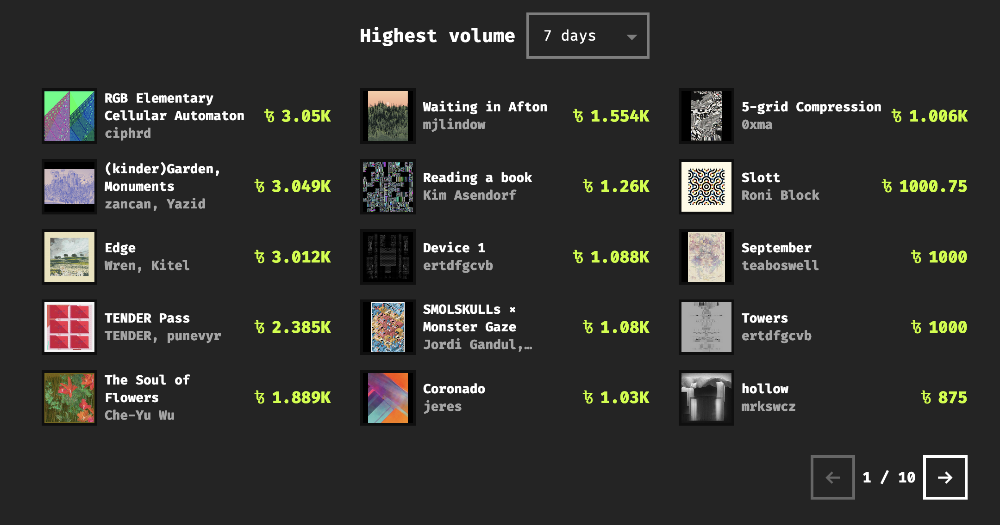
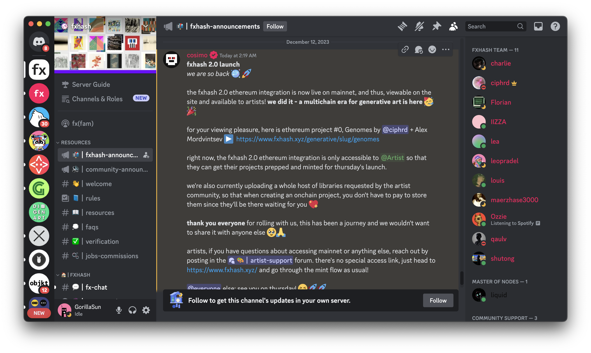
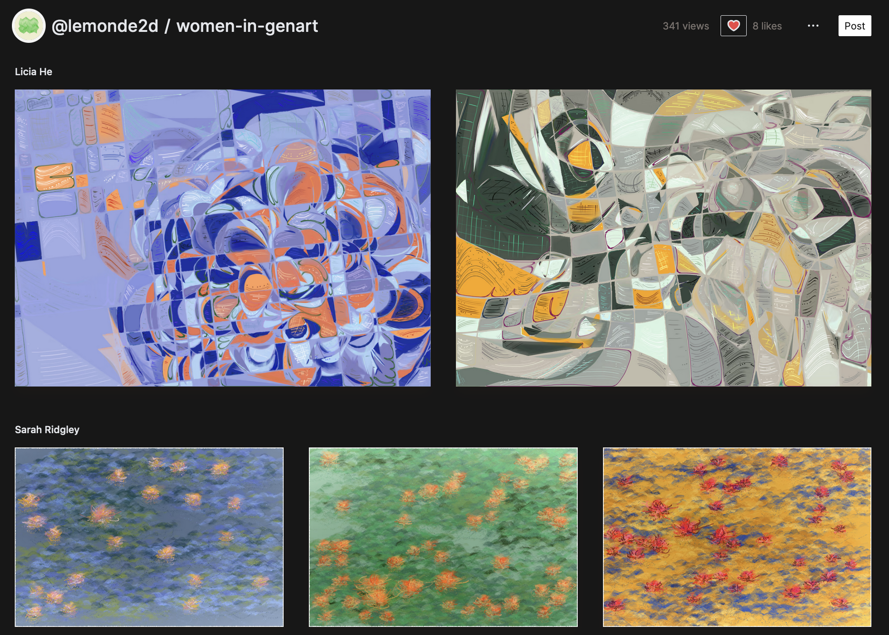
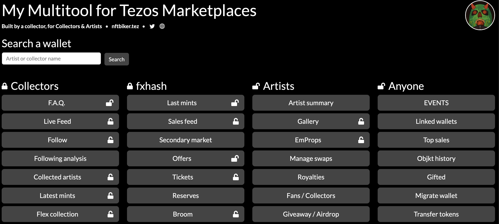
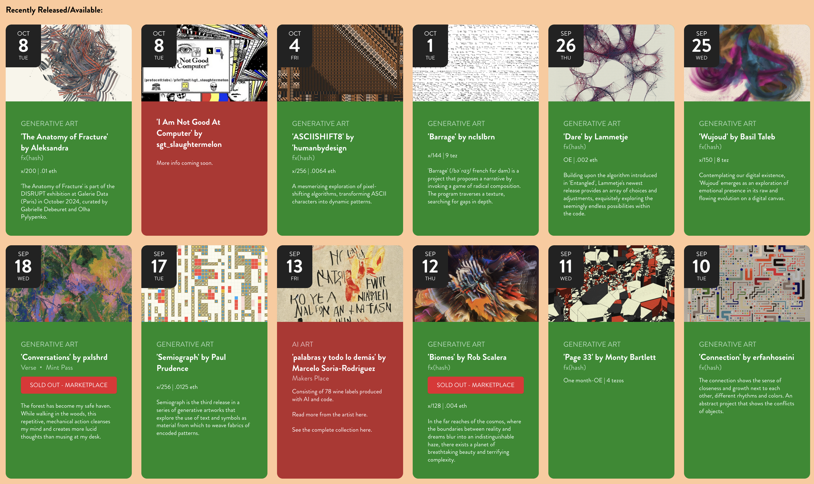

# Token Discovery Tools

*An overview of some of the different tools and methods that can be leveraged for the discovery of new and old works on fxhash.*

On fxhash there’s a constant influx of new works, as well as a varied catalogue of already created projects that might still be up for grabs - all that’s left to do is finding them. There’s a number of tools and resources to assist you in that regard, in no particular order:

1. **The fxhash Marketplace**: fxhash’s native marketplace allows you to browse listings and sort them by different criterias allowing you to discover some of the most sought after works throughout the history of fxhash, some of the recent smash hits, as well as recent listings:

   

2. **fxhash discord**: discord is a popular messaging app where communities can create their own servers around a specific topic. Currently the fxhash discord has hundreds of engaged members as is one of the best ways to interact with the community, to exchange ideas, discuss generative art and discover new projects.

   

   *Discord is a great way to interact with the fxhash community*

   - **Announcement channels**: in these two channels the fxhash team will announce all important things concerning the platform, such as upcoming events and new features when they become available.
   - **fx(fam)**: fx(fam) is a special community event that is held every so often, where collectors and artists can flock together around particular themes, such as hackathon workshops.
   - **Artist Studio Channel**: this channel is a special forum where artists can create their own threads and share their works in progress, make announcements and give each other feedback. Check in and see if your favorite artist has their own channel.

3. **Social Media**: most artists have their own social media accounts, on popular platforms like TwitterX, Instagram, most recently also Farcaster, and to some lesser extent on other platforms like Mastodon. Artist will often share their WIPs (works in progress) as social media posts and make announcements about regarding the release of these projects.

4. **TwitterX Spaces**: For special events fxhash will often also hold **TwitterX Spaces**; essentially a live audio stream for the purpose of announcements or discussing matters with guests and partners.

5. **Third Party Marketplaces**: there are other marketplaces that integrate the fxhash smart-contracts and in that manner enable the collecting and trading of fxhash projects. Some of them are:

   1. **Opensea**: opensea is the largest NFT marketplace that aggregates tokens from many blockchains and platforms. Ethereum projects minted on fxhash (mainnet and the Base L2) can be found on OpenSea. It does not currently have support for the Tezos blockchain.
   2. **Objkt.com**: similarly to opensea, [objkt.com](http://objkt.com) is a marketplace dedicated to the Tezos blockchain aggregating Tezos tokens from various different Tezos marketplaces. Tezos projects minted on fxhash can be found on Objkt.

6. **Deca Galleries**: Deca is a platform where users can create custom galleries to showcase NFTs from generative art platforms like fxhash, Art Blocks, etc. It is one of the best ways to curate your collection and group related pieces (conceptually or aesthetically). It also has social features where you can follow other collectors as well as your favorite artists, and keep others up to date with upcoming releases.

   

   1. **Independent Tools**: some creators build their own exploratory tools, some of them:

      - such as NFT Biker who’s created a number of tools to keep tract and interact with Tezos NFTs. One part of the toolkit is dedicated towards fxhash:

        

        *Some of NFTBiker’s tools help you keep track of the releases during specific events.*

      - The (art) Collector’s Corner by FluffHeadChaser where upcoming releases are continuously curated in form of a nice calendar:

        

        *[(art) Collector's Corner](https://www.artcollectorscorner.com/upcoming-1)*

7. **Podcasts and Newsletters**: with the vibrant community around fxhash many content creators began making fxhash related content, such as interviews with artists, discussions about features of the platform, coverage of events. Some content creators in that regard are the Waiting to Be Signed podcast, the Arbitrarily Deterministic podcast, Kaloh’s Newsletter, as well as many others.

8. **Tender Lists**: Tender is a curatorial platform that highlights iconic fxhash projects and creates curated drops with prolific artists in the space.
