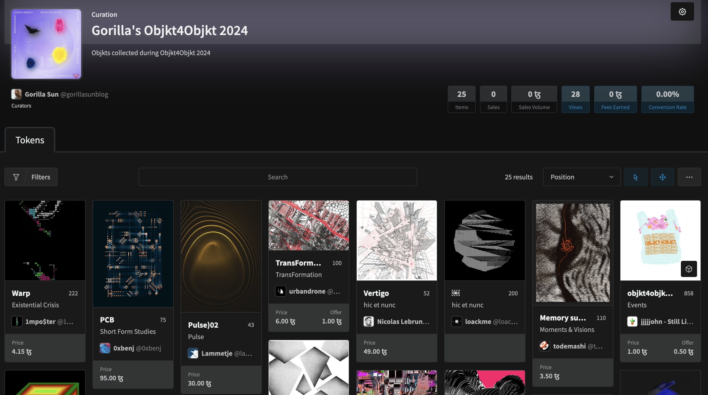

# Towards Curation

*In this page we explain the differences between collectors and curators, elaborate on the goals of creating curations, and give a run-down of some of the different tools that allow for the creation of*

While for collectors the focus lies on ownership, curators are more concerned with the presentation of their collection. Curators aim to elevate the individual works they’ve added to their collection beyond their simple existence as “acquisitions” and leveraging them as vehicles to paint and present different narratives:

> [!NOTE]
> W**hat is Art Curation?** Art curation involves the selection, organization, and presentation of artworks in a way that creates a meaningful and cohesive experience for viewers. Curators are individuals or professionals responsible for managing and arranging art collections, whether in museums, galleries, exhibitions, or other public spaces.
>
> Their role is to create a narrative or theme that ties the artworks together, creating a cohesive narrative, and making the individual works more accessible and engaging for the audience.

In this manner, art curators strive to tell stories, provoke thought, and spark dialogue through the careful presentation of art. This is often achieved by highlighting connections between works, contextualize the artworks within historical, cultural, or thematic frameworks, or by providing further context on the creation of the pieces and offering new perspectives on their interpretation. Additionally, curators play a vital role in preserving and promoting the artistic heritage that goes into making of individual artworks - which is crucial factor in the fast paced and ever-evolving NFT landscape.

In this sense, Web3 tech not only makes it much easier to be involved in the NFT art scene as a collector, but also creates new curatorial affordances. Hobbyist collectors can try their hand at art curation, while experts from the traditional art scene can exercise and leverage their experience in a digital framework. In what follows we will discuss what it means to be a curator in the Web3 setting and provide some guidance on getting started with this endeavor on your own.

### Curatorial Approaches

In the NFT setting, the distinction between collectors and curators becomes blurred: NFT collectors, just like traditional art collectors, may be motivated by financial incentives or personal interest. Due to the digital nature of NFTs, collectors can also easily showcase and present their collections online, further simplified by many of the collection management platforms already having built-in curation features.

There’s a number of different approaches for creating groupings of distinct pieces in your collection, both in the traditional and digital Web3 setting, some common methods towards that end are:

- **Thematic Curation:** Selecting artworks based on a specific theme, idea, or concept. In generative art this could be based on a similarity in visual aesthetics, similarity in underlying algorithmic principles that bring the generative outputs to life, or even similarity in the non-code concepts behind the artwork.
- **Comparative Curation:** Juxtaposing artworks from different artists, can highlight their similarities and/or differences. Again, this can be from an aesthetic or conceptual point of view.
- **Collaborative Curation:** Sometimes collectors, curators, artists, and/or community members band together to create a shared vision for an exhibition or collection, pitching pieces from their own collections. Curating an artwork doesn’t necessarily mean that you need to own it - you can still emotionally and intellectually engage with an artwork even if it is not part of your collection.
- **Experimental Curation:** Exploring new and unconventional ways of presenting art, often involving multimedia or interactive elements.

Naturally, there’s more to creating a curation than just grouping different artworks together and calling it a day, the accompanying context, story, and narrative is of equal importance.

### Tools for Creating NFT Curations

There are quite a few tools out there that allow you to create digital galleries, showcase the pieces in your collection, and create curations with ease:

1. [**Deca**](https://deca.art/)**:** Deca is arguably the most popular tool for curation purposes. It covers both ETH and Tezos NFTs. It allows you to create a number of different types of digital galleries; essentially represented as different kinds of canvas-like boards on which you can position the artworks in your collection in arbitrary manners, and further supplement them with written information of your own.

   It also provides advanced filtering tools to search your collection for particular pieces to include in these galleries. Deca also provides social features, allowing you to follow your favorite artists/collectors/curators, and also has some mechanics that game-ify the curation experience. As a dApp you can simply connect your wallet to the platform and get started creating your digital galleries.

2. [**Gallery**](https://gallery.so/home)**:** Gallery is another popular curation tool - covering several blockchains other than ETH and Tezos as well it’s also quickly become a community favorite. It functions similarly to Deca in that it allows you to group specific pieces in your collection and display them in form of a board. Furthermore, Gallery is currently also compatible with Farcaster - meaning that you can simply login to it via your Farcaster account. Beyond that Gallery also provides a convenient companion mobile app in which you can view your collection on the go.

3. **VR Exhibitions:** there’s a bunch of other tools that allow you to hang your digital collectibles in 3D VR spaces that users can visit and explore by traversing them like you would explore a video game.

4. **Objkt Curations**: is a Tezos only marketplace that also offers a curation tool. It is not as advanced as the other two on this list, as it only lets you make sub-groupings of your collected pieces:

   

5. **Physical Exhibitions:** If you have a physical location that allows for screens and displays, you could equivalently also host your very own physical exhibition.

Beyond this we also encourage you to write about your curatorial efforts with the fx(text) feature, allowing you to mint your writing as semi-fungible tokens, in which you can natively link/showcase fxhash pieces in your collection. You can learn more about fx(text) here.
