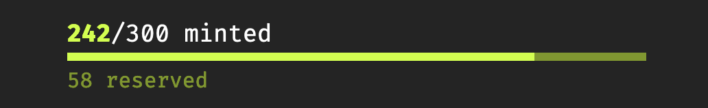
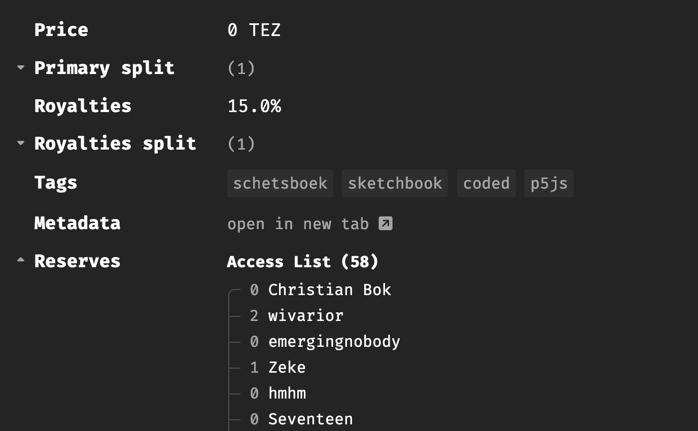
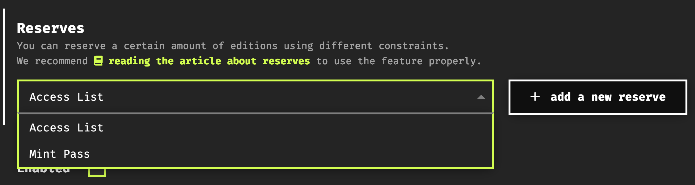
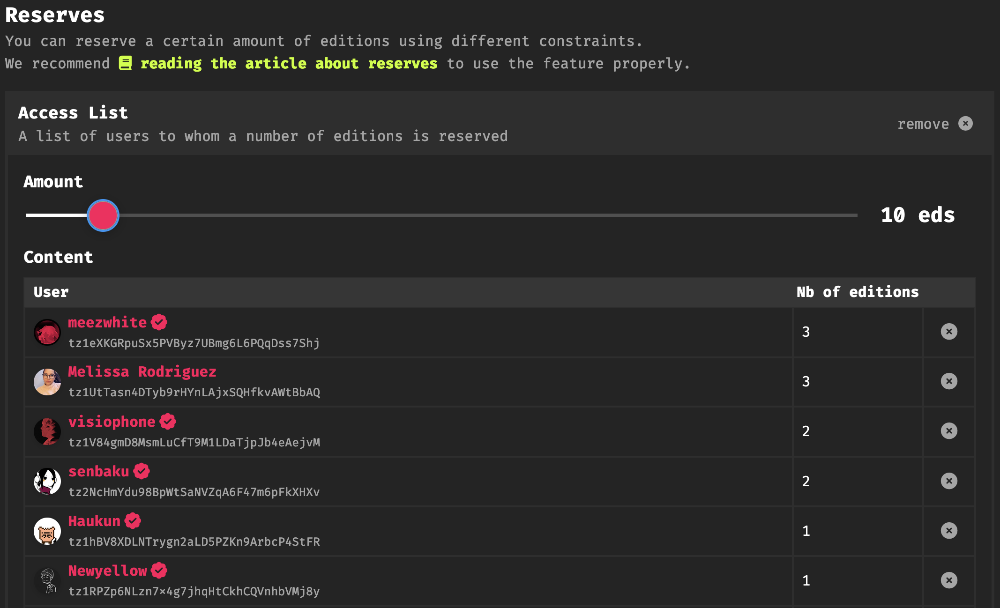
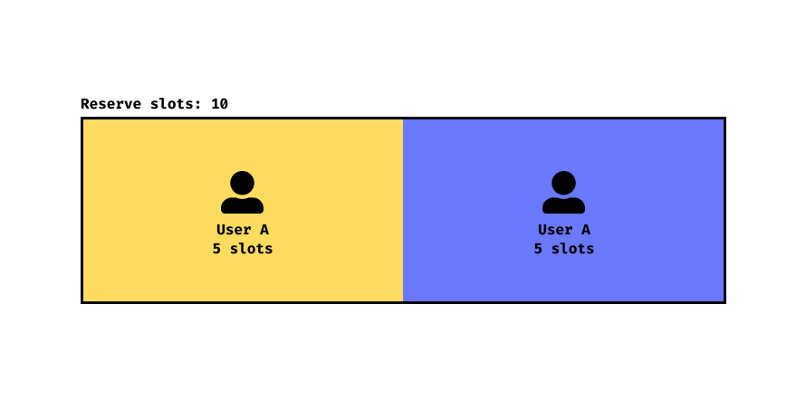
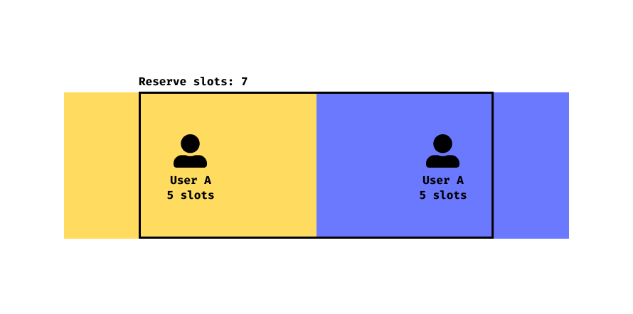
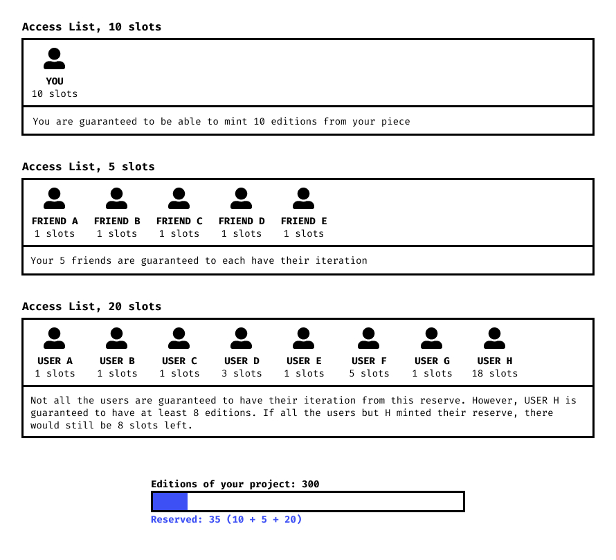

# Allow Lists & Reserves

*In this section we provide an overview of Reserves and Allows Lists, tools that allows artists to control the minting access to their projects on fxhash*

Allow Lists and reserves provide artists with a general-purpose framework for controlling the overall mint access to their generative projects:

> [!NOTE]
> **Allow List / Access List**: A list of artist approved wallet addresses that have exclusive access to a number of reserved editions/iterations from a generative project.

While the two terms “Allow List” and “Reserve” are frequently used interchangeably to refer to the same feature, they are actually not the same thing. As stated, an allow list refers to the actual list of wallet addresses that are eligible for minting from a reserve - where this reserve refers to the number of editions/iterations from the generative project that have been set aside, and can only exclusively be minted by the addresses on the allow list:

> [!NOTE]
> **Reserve:** A number of editions/iterations from the generative project that are set aside and only mintable by the wallet addresses on the allow list(s) set for the project.

The status bar that visualizes the minting progress on fxhash projects generally indicates whether a project has a reserve or not:

The interface will usually also display if you’re eligible for an iteration from the reserve. A more detailed view of the allow list(s) and the included wallet addresses can be found after the projects description:

Allow lists have some intricacies to them, that we'll address and discuss in this section.

> [!NOTE]
> **If you’re an artist looking to set up allow lists and reserves for your project**: you can find the information for it here. We recommend that you read through this section first however.

There’s currently two ways that artists can enable a reserve on their projects: `Access Lists` and `Mint Passes`. Here’s what this looks like from the minting interface when artists prepare their projects for publishing:

- **Access List:** with the term access list we’re essentially referring to an allow list, and as stated this is simply a list of wallet addresses that the artists can put together on their own. The fxhash interface makes it easy for the artist to either import this list from and external csv file, or fetch a list of holders of previous project. Only wallet addresses included on this access list can mint from the reserve.
- **Mint Pass:** often also referred to as a “token gate”, only holders of this mint pass have access to the reserve of the project. A mint pass usually comes in the form of a token/NFT minted on another platform.

New types and other forms of reserves will be added depending on the needs of artists and collectors. The interface also allows artists to set an arbitrary number of allows list in combination with mint passes for any given project.

## Understanding Reserves

The important thing to understand about reserves, is that they don’t necessarily guarantee a mint from a project for each address that’s included in an attached allow list, or alternatively a mint pass that grants mint access to a project - although it can be set up in that each collector has claim to one edition, most commonly there are less reserve slots than there are eligible addresses on the allow list and/or mint pass holders. **In this scenario, reserve slots are consumed in a First Come-First Served order.**

Additionally, another important point to consider os that artists can assign a varying number of slots for each wallet address on the allow list, besides configuring the total number of reserves. In the interface this is done simply by indicating the number of eligible slots next to the wallet address of the collector:

In this particular example, the overall edition size is 128, out of which 10 editions are reserved for wallet addresses on the allow list - moreover, some addresses on the allow list have more than one reserve slot - this means that the total number of reserves can be consumed without each address on the allow list obtaining an edition.

> [!TIP]
> In a nutshell, there can be more eligible wallet addresses than there reserve slots.

Reserves can thus be configured primarily in 2 ways:

- **One reserve slot for each eligible address, where each address has claim to one edition**: every allow listed user is guaranteed to mint an edition from the project.
- **Less reserve slots than eligible addresses and/or the total number of slot for each allow-listed address sums up to more than the overall number of reserve slots**: not every address is guaranteed to have access to an edition.

The second case gives rise to a number of different scenarios that we’ll have a look at now. Here’s a demonstration of the concept with an access list for 2 users, A and B:

In this first case, the number of total reserve slots is equal to the total number of eligible slots for the allow-listed users. Both users A and B are guaranteed to get their 5 editions.

In this second case, the number of slots of the reserve is smaller than the total number of slots given to the users in the access list. It means that neither A nor B are guaranteed to get their 5 editions. If User A mints 5 editions from the reserve first, user B will only be left with 2 editions. If we had set the number of reserve slots to 1, only A or B would have been able to get an edition from the reserve. Users that don’t manage to consume their reserve list spots can however always also mint from the publicly available editions, if any remain.

> [!NOTE]
> Reserves are very permissive (at least when created), and it's up to the artist to configure them properly accordingly.

## Reserves can be Stacked

As mentioned earlier, multiple reserves can be added to a project. Each reserve will save its slots for the eligible users–here is an example where multiple access lists are stacked to dictate how the final reserve of the project will be distributed among eligible users:

Notice that the access lists conveniently don’t affect each other and remain self contained. Providing artists with the ability to define multiple reserves allows for fine-grained control over the final distribution of the project.
