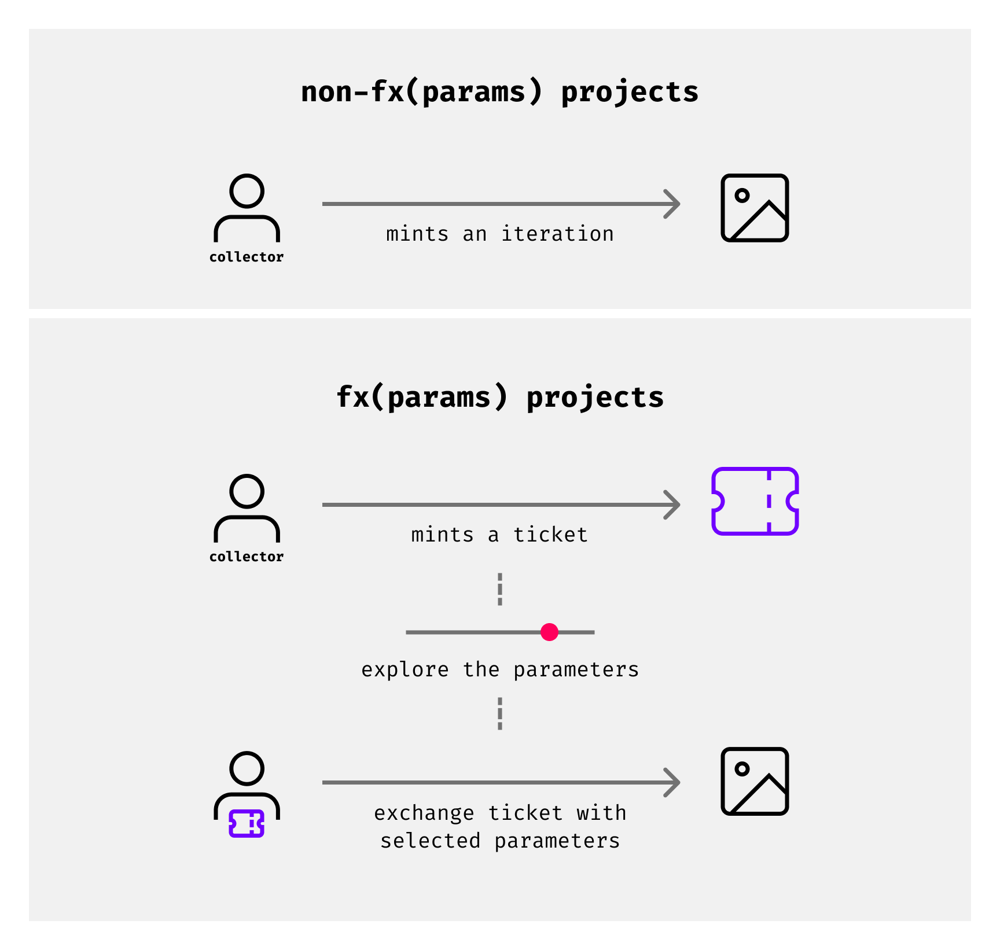
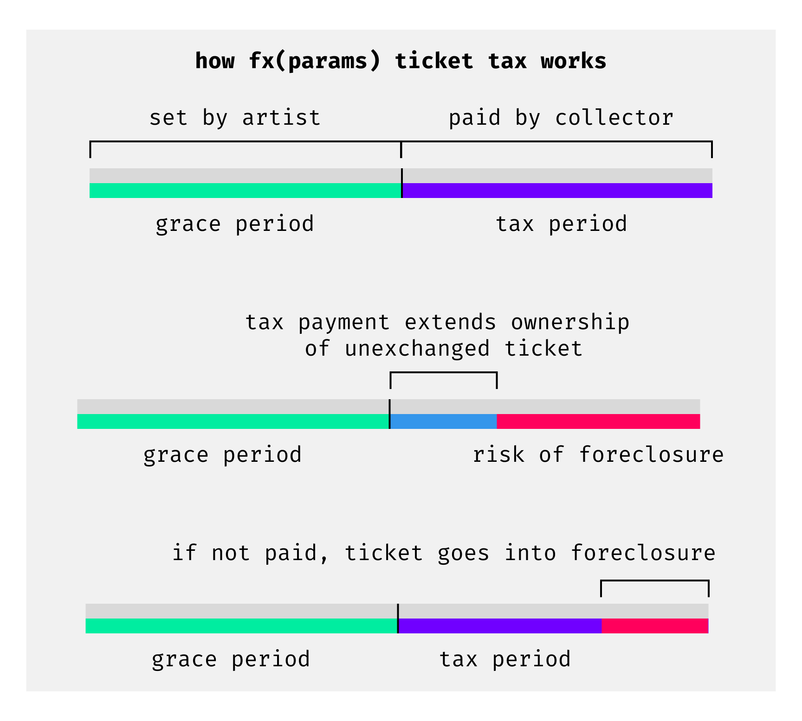

# fx(params) & the Ticketing System

*An overview of collector customizable fx(params) projects and the associated ticketing system for minting these projects.*

> [!NOTE]
> fx(params) was introduced by fxhash on March 20, 2023. It is currently a feature exclusive to the Tezos blockchain.

fx(params) is a different way for collecting GENTKs on fxhash, where the collector plays an active role in the configuration of the GENTKs appearance. fx(params) is the name of the module that enables artists to relinquish control over certain variables in their code and exposing them to the collector at mint time, such that collectors can modify and customise the artwork to their liking before collecting their unique iteration.

This customization process happens through a special minting interface, where collectors can modulate toggles and sliders to vary the values of those code variables to shape the artwork to their liking.

*The panel on the left side of the artwork is the fx(params) interface, where interaction with the sliders changes the appearance of the artwork. You can then lock in your final choices via the mint button on the bottom, with which the final GENTK is then created.*

However, fxhash also allows artists to create their own custom minting interfaces with code driven parameters, which greatly extends the possibilities of fx(params). Overall, fx(params) is intended to amplify artistic powers of expression and enables collectors to become co-creators of the art.

## The Ticketing System

Collecting a regular Generative Token that doesn't make use of fx(params), is simply done by clicking the mint button on the respective project page. Once the transaction is confirmed in the collector's wallet fxhash takes care of the rest and the collector receives their GENTK.

On fx(hash) things can get a bit hectic sometimes, when a popular artist publishes a project that is highly sought after, it can often happen that all editions of the Generative Token mint out in a matter of minutes or seconds. And this is perfectly fine for regular projects, but when it comes to Generative Tokens that make use of fx(params) this doesn't make sense.

Collectors would have to rush through the minting interface and throw together an output that they're only partially happy with if they want to get a chance at minting before all editions of a Generative Token mint out. This would sully the collectors' and artist's experience: collectors would not obtain outputs that they are happy with, and the collection would not come to life as it otherwise would have. On fxhash we collectors to be able to fully explore the parameter space of the project.

For this reason, a ticketing system is introduced. When you collect an edition of an fx(params) project, you obtain a mint ticket instead of having to immediately create the final output. This mint ticket can later be exchanged for your final GENTK after you’ve dialed in the parameters to your liking.

Delaying the actual creation of the GENTK until a later moment, while reserving claim to an output makes it such that collectors have ample time to explore the entire output space of the Generative Token, and allows them to carefully craft their desired output.

In this manner, the ticketing system solves the problem of minting races for fx(params) projects. However, at the same time introduces a different issue: what if collectors indefinitely hold tickets and never exchange them for their final GENTKs?

This is problematic because some collectors might forget about their tickets, or for whatever reason not use their tickets - which would lead to collections never fully minting out. To create a fair environment for both parties, a couple of new dynamics are introduced to protect both artist and collector.

## Holding a Mint Ticket

After an artist-defined grace period (X days), tickets become subject to a Harberger tax system. This tax mechanism requires ticket holders to pay a daily tax to maintain ownership of an un-exchanged ticket after the grace period has elapsed. If the collector chooses to not pay this tax, tickets are listed for sale on the fxhash marketplace.

In other words, once outside of the grace period, ticket holders have two options: pay a daily tax or exchange the ticket for an artwork. This means there is no option to keep the ticket off the market and that, as a ticket holder, you should constantly reassess the ticket’s market value to avoid paying a higher daily proportional tax than necessary.

With this tax system in place, we can facilitate and incentivize several important factors at once, such as maximizing the amount of tickets exchanged for artworks, the proper assessment of mint ticket value by collectors, and ensuring artists are compensated for collectors holding un-exchanged tickets.

### Grace period

The grace period is a duration of time defined by the artist wherein ticket holders can explore the generative algorithm and play with parameters without paying tax on the unexchanged ticket. Defining the length of the grace period allows artists to further refine and influence the collector’s exploratory process, giving them more or less time to exchange their ticket for an artwork before the daily proportional tax applies.

Grace periods can be as short as one day or longer than multiple lifetimes — it’s entirely up to the artist. When the grace period ends, the tax mechanism kicks in, requiring tickets to be listed on the market and subject to tax for as long as they remain unexchanged.

### Daily proportional tax

Once an unexchanged ticket falls outside of the grace period, a new set of requirements should be met by the ticket holder to maintain ownership of the ticket.

1. The ticket holder defines a price for the ticket (mint price by default), thereby listing it on the secondary market
2. A daily tax proportional to the ticket’s list price must be paid to retain ownership

These requirements entail that unexchanged tickets are always for sale and collectable by anyone — and that any salable ticket is subject to the daily tax. **If the ticket tax is not paid**, ownership is forfeited by the owner and the ticket is entered into foreclosure.

The yearly tax is roughly 51% of the ticket price defined by its owner. Moreover, all taxes collected from **fx(params)** projects are sent to their respective creators.

### Ticket foreclosure

When a ticket holder fails to pay the daily proportional tax, their ticket is forfeited and entered into foreclosure. During this process, the ticket is auctioned off beginning from its list price and decreases linearly over a 24hr period until it reaches a 0.1 XTZ resting price. Anyone can buy a ticket in foreclosure, including its previous owner.

When a ticket is claimed, either during the auction in its foreclosure or at the price defined by the previous owner, the full amount paid by the buyer is transferred to the previous owner. Only taxes are paid to the artists.

### Additional Information

Mint tickets are NFTs: they will appear in your wallet alongside your other NFTs, and you will be able to transfer them. However, mint tickets cannot be traded on other marketplaces: that's because the marketplace is written into the mint tickets Smart Contract.

If a ticket is transferred to another account, the recipient will be responsible for either paying the tax to keep ownership or exchanging the ticket for an iteration.

22MB

[Screen_Recording_2023-04-21_at_11_06_10_AM_AdobeExpress.mp4](https://3455566235-files.gitbook.io/~/files/v0/b/gitbook-x-prod.appspot.com/o/spaces%2FPMgz5PcqIbAPWwLF7xWn%2Fuploads%2FXRXon1TSEzoRxuI6UehK%2FScreen_Recording_2023-04-21_at_11_06_10_AM_AdobeExpress.mp4?alt=media&token=0ebc7d3a-7010-4636-b743-dabf251a2435)

- [Open](https://3455566235-files.gitbook.io/~/files/v0/b/gitbook-x-prod.appspot.com/o/spaces%2FPMgz5PcqIbAPWwLF7xWn%2Fuploads%2FXRXon1TSEzoRxuI6UehK%2FScreen_Recording_2023-04-21_at_11_06_10_AM_AdobeExpress.mp4?alt=media&token=0ebc7d3a-7010-4636-b743-dabf251a2435)

[Link to Discord Message about the Ticket Tax System](https://discord.com/channels/900333075509149767/909081044932788295/1099032459074613368)
