# Primary Market

*This section provides an overview of fxhash’s primary market functionalities, where collectors participate in the initial release of generative tokens, in addition to a run-down of the interfaces*

**fxhash's primary market is where new generative artworks are sold for the first time, directly from creators to collectors.** On fxhash, collected generative artworks are created at the moment of purchase: when a collector buys an edition from an artist's generator, a contract is initiated, and a new token is issued on the blockchain. In essence, the artists code is run, and new asset is issued on the blockchain. This token represents the artwork, establishes its provenance, and can be sold or traded later on, much like any regular NFT.

fxhash offers artists various ways to configure the sales mechanics for their generators, including setting token prices and controlling how collectors acquire them. For example, in addition to the standard method where collectors mint random iterations, fxhash also allows for custom minting experiences using **fxparams**.

In the following sections, we provide a detailed overview of the interfaces that facilitate primary sales on fxhash and explain the relevant UI elements, ensuring collectors have a clear understanding of their purchases.

### Exploring Projects on fxhash

While there’s a couple of different ways to scour for upcoming releases, either by following your favorite artists over on social media, or via third party discovery tools. However, fxhash's explore page provides the most direct way to do so, via an interface that provides filterable list of upcoming projects and currently minting ones.

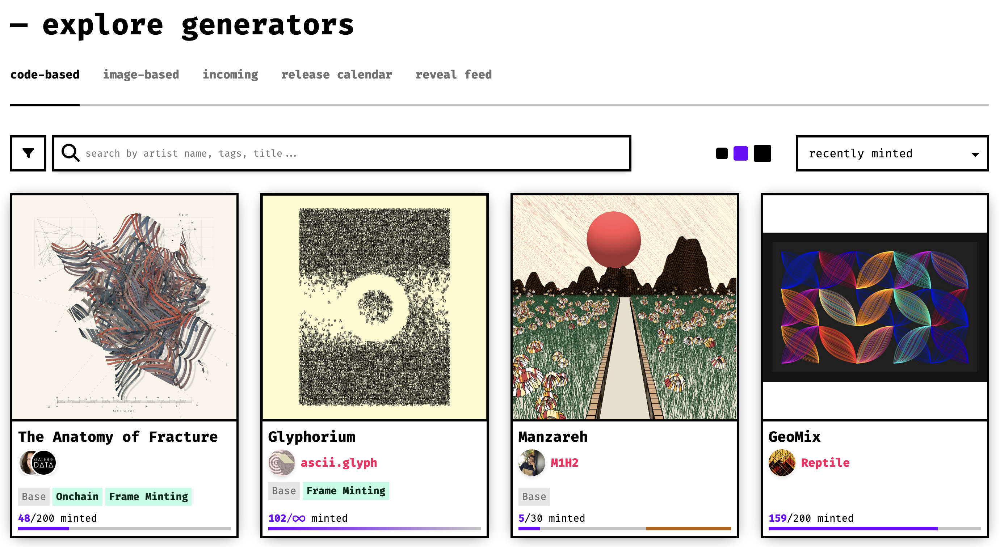

When you find a project that you’re interested in collecting, clicking on it will take you to its dedicated project page.

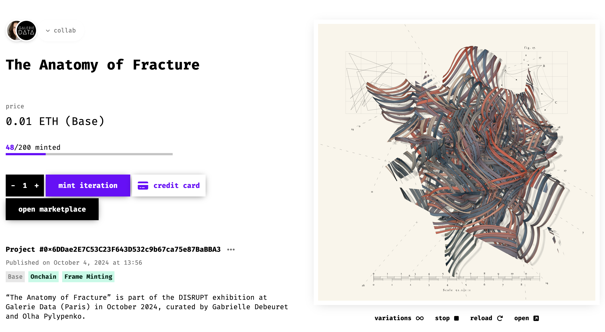

### Project Page Overview

fxhash automatically sets up an individual project page for each generator that is published on the platform (sometimes also referred to as minting page). This page displays all of the relevant information that the artist has configured, such as the project’s title, its price and pricing method, a description, as well as a preview of the artwork itself that’ll let you generate any number of preview variations:

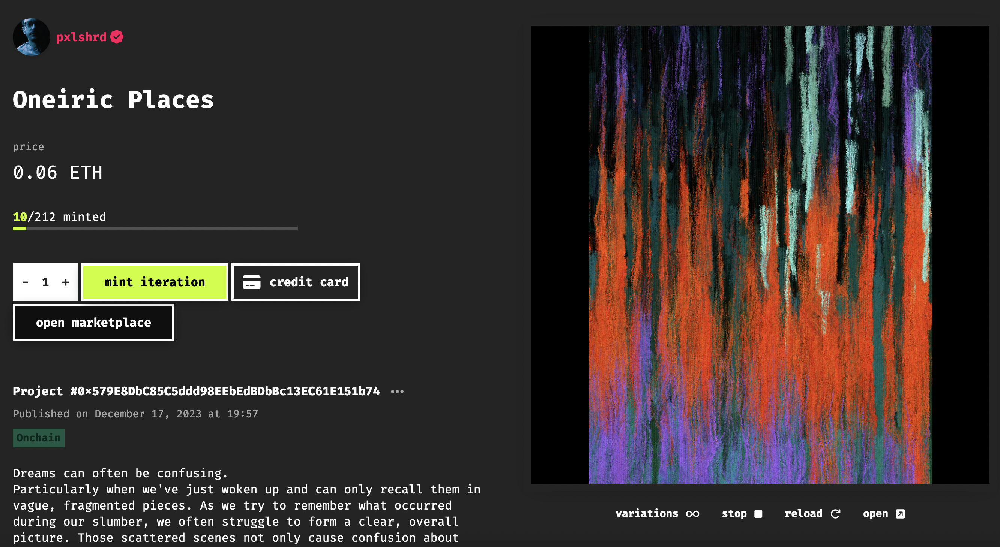

Collecting on primary is most commonly done from this project page; it is advised to go over the information displayed here prior to collecting. Here you’ll find information about the price of the project and some of the options for collecting it:

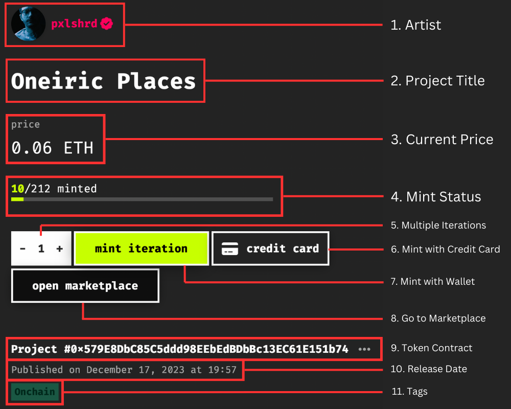

| # | Label | Description |
| --- | --- | --- |
| 1 | **Artist** | The profile icon and name of the project’s creator. Lets you navigate to the artist(s)' profile. |
| 2 | **Project Title** | Title of the project. Specified by the artist(s). |
| 3 | **Current Price** | The current price for collecting an iteration or mint ticket from the project. Learn more in the [Pricing Methods](https://www.notion.so/Collecting-on-fxhash-1-60c2f1d562274893be999b4cae2f71de?pvs=21) segment below. |
| 4 | **Mint Status** | An indicator visualizing how many iterations of the project have been sold already, and how close the project it is to ‘minting out’. |
| 5 | **Quantity Selector** | Lets you collect multiple iterations at once when you subsequently hit the ‘Mint Iteration’ or ‘Credit Card’ buttons. |
| 6 | **Credit Card** | fxhash also allows the purchase of GENTKs via credit card - more about this in the [Payment Methods section](https://www.notion.so/Collecting-on-the-Primary-Market-987c5ecefd65474099118ec447b9f959?pvs=21). |
| 7 | **Open Marketplace** | Navigates to a project's associated marketplace page that shows statistics about the primary and secondary sales,  besides listed editions. Merged with the project page in V2.0. |
| 8 | **Mint Iteration** | Triggers the collect transaction in your wallet. |
| 9 | **Project Number / Contract** | For Tezos-based projects this indicates the project number, whereas for Ethereum projects it indicates the contract address of the project.  *All Tezos projects are minted on the same fxhash marketplace contract, whereas ETH projects are minted on their own individual contracts.* |
| 10 | **Publishing Date** |  the original date the project was minted on the blockchain and published on fxhash. |
| 11 | **Labels** | Special indicators that artists need to toggle at the time of publishing their projects. |

#### Verified Artists

The profile icon and name of the project’s creator. Here it’s important to look out for the **checkmark** next to the artist’s name - it indicates that they have been verified by the fxhash team (you still need to do your due diligence in this regard and check that projects are actually original works).

If the project is a collaboration between multiple artists, the UI will indicate multiple profile icons:

#### Mint Status

An indicator visualizing how many iterations of the project have been sold already, and how close the project it is to ‘minting out’. While open editions are an option (meaning that collectors can mint indefinitely from the generator), artists often choose to limit the number of artworks that a generator can spawn.

A project is only considered “fully minted” or “minted out” once all its available editions have been collected. In the case of open editions, artists may or may not choose to put a limit after a certain amount of time has elapsed, or make them time-limited right from the get-go. There’s a number of different states that this indicator can come in, here are some examples:

1. This project is an edition of 100, of which 70 have been collected, and 30 are still available.

   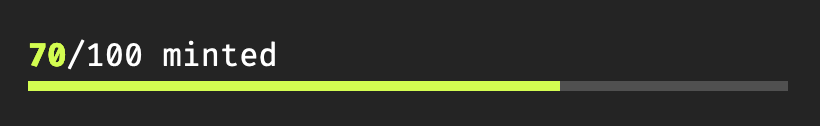

2. This project is fully minted - the checkmark indicates that no more iterations can be collected.

   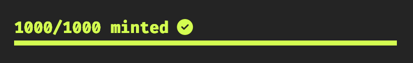

3. This project is an edition of 512, 256 of which have been collected and the other 256 have been burned (made unavailable by the artist)

   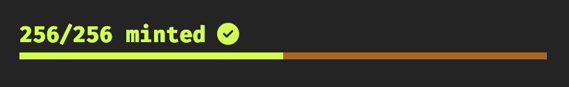

4. This project has an edition size of 120, half of which have been burned, 39 collected and 21 still available:

   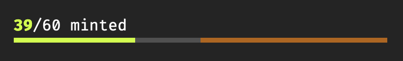

5. This project is an open edition, indicated by the infinity symbol - 8508 iterations have been collected.

   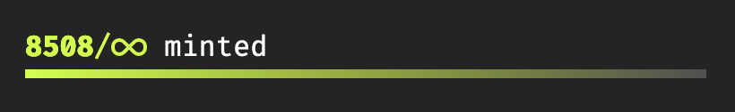

6. This project has two reserved editions, meaning that the artist(s) reserved these for specific collectors via an allows list or mint pass. You can learn more about [allow lists here](https://www.notion.so/Overview-of-Allow-Lists-and-Reserves-3f098767596143dc82a86aa6f7d9b1da?pvs=21).

   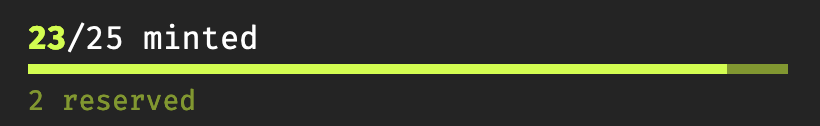

#### Mint Iteration / Ticket

This button will trigger the collect transaction in your wallet. If you don’t have a wallet connected yet it will ask for that instead - depending if it is a Tezos or Ethereum project it will trigger or ask you to connect a compatible wallet with the chain. You can learn more about [setting up your wallet here](https://www.notion.so/Creating-a-Wallet-0fc9a20804244658ac99007c2dcc0290?pvs=21) and [connecting it to fxhash here](https://www.notion.so/Creating-an-Account-afd87812432b47a4aceb87ea756e5164?pvs=21).

Before confirming this transaction always make sure that the gas fees are reasonable (mainly when collecting on mainnet ETH where gas fees can be significant sometimes).

**Project Number/Contract**

For Tezos projects this indicates the project number, whereas for Ethereum projects this will indicate the contract address of the project. This is because Tezos projects are all minted on the same fxhash marketplace contract, whereas ETH projects are minted on their own individual contracts.

#### Labels

Labels are special indicators that artists need to toggle at the time of publishing their projects. They are there to indicate certain aspects of the project, such as Epileptic Triggers if the project has flashing images, or a Sexual content label if the project involves this kind of imagery.

- Onchain/IPFS: whether a project is stored with ONCHFS or with IPFS.
- Epileptic Trigger
- Sexual Content
- Sensitive Content (blood, gore, …)
- Image Composition
- Animated
- Interactive
- Profile Picture Project (PFP)
- Audio
- Includes pre-rendered components
- Custom Minting Interface

### Sale Details

Scrolling a little further down, after the project’s description, additional information about how the primary and secondary proceeds of a project is distributed can be seen:

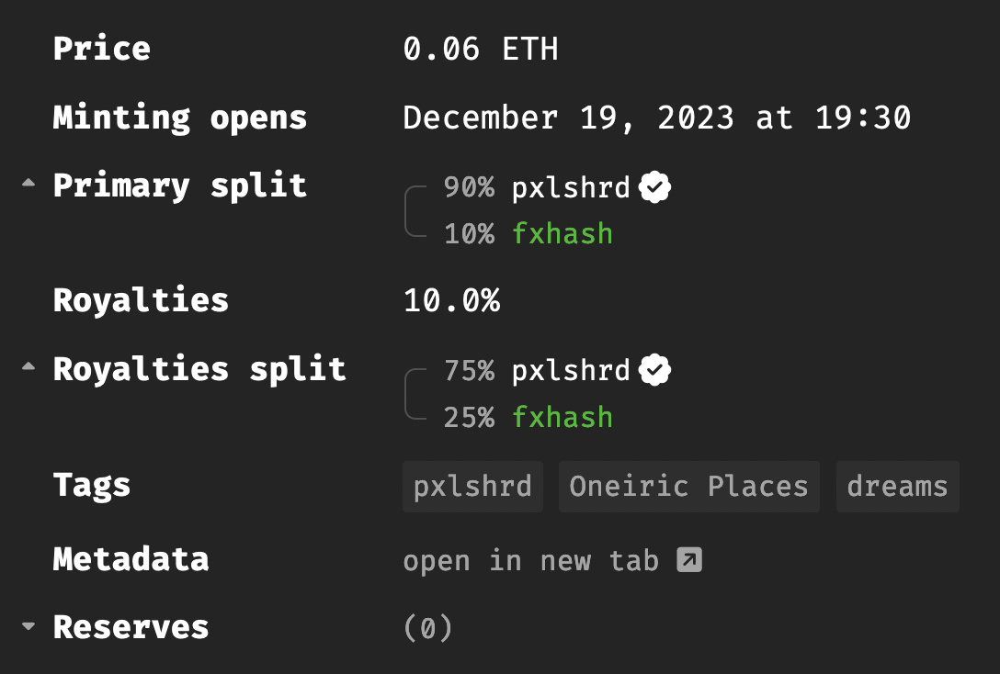

| **Price** | The price and currency for which an edition can be collected. |
| --- | --- |
| **Minting Opens** | Essentially the first date at which the project became available for minting. |
| **Primary Split** | This percentage determines how the initial proceeds of the sale are divided. It clarifies how much the artist receives from the **first purchase** of an iteration from their generative project. In this case it’s an Ethereum based project where 10% go towards fxhash. For Tezos projects this is 2.5%. |
| **Royalties** | Royalties dictate a percentage of resale generated revenue that goes back to the original artist - essentially the portion of the secondary proceeds that is sent back to the artist’s wallet. This provides ongoing compensation for the artist whenever an edition is sold on the secondary market - artists can set this value between 0% and 25%. |
| **Royalties Split** | This specifies how the royalty percentage is further divided, typically between the artist and the platform facilitating the sale. For Ethereum based projects the platform fee is set at 25% whereas there is no fee for Tezos based projects. |
| **Tags** | Artists can tag their projects with specific tags, which help with discoverability later on. |
| **Metadata** | The metadata that describes the project on the blockchain. |
| **Reserves** | Artists can set up a reserve/allow list for their projects. A reserve indicates a list of wallet addresses that are elligible for minting iterations that are not available to everyone - [reserves and allow lists are covered in more detail here](https://www.notion.so/Overview-of-Allow-Lists-and-Reserves-3f098767596143dc82a86aa6f7d9b1da?pvs=21). |

### Pricing Methods

1. **Fixed Price**: When artists set a fixed price, iterations can be collected for the exact price that is indicated on the project page. **Artists do have the ability to change this price after the project has been published, but this only affects un-minted iterations that are still available and doesn’t have any retroactive impact.**

2. **Dutch Auction**: Artists can also sell their Generative Tokens via dutch auctions. In a dutch auction the price of the project decreases over a given period of time, in set time intervals, until settling at a minimum asking price. Here’s an example:

   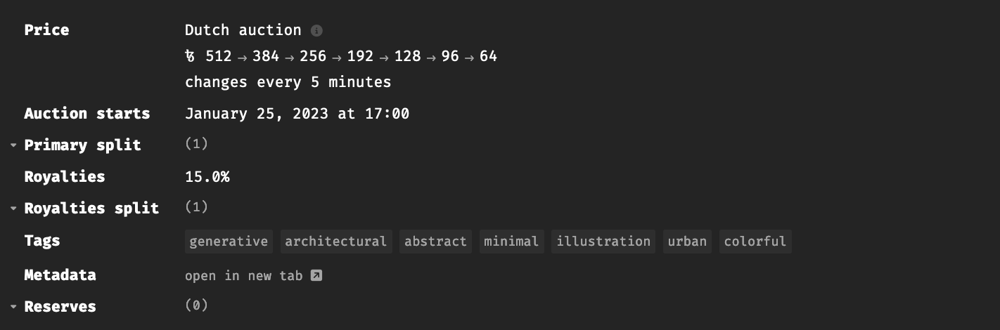

   This gives incentive to collectors to purchase at a higher price if they want to claim an iteration from the piece early on, to prevent missing out when iterations might mint out more quickly as the price decreases.

3. **Dutch Auction with Rebate**: Artists can also set Rebates on their Dutch Auctions. This means that early collectors who paid a higher price will get refunded for the difference with the final price at which the mint concludes. For instance, if a collector mints from the project for a price of 512 tez, then the project mints out at 256 tez, they get refunded for the difference, that is 256 tez.

> [!NOTE]
> One other thing of note, is that the indicated prices on fxhash do not include gas (networks) fees, which may vary at different times throughout the day and week. Your wallet will indicate the final price before asking you to confirm the transaction.

### Payment Methods

To acquire editions, fxhash currently provides two payment methods for collecting on fxhash.

1. **Wallet Mint**: The main way to collect editions from fxhash projects is by doing so directly via a connected software wallet - clicking on the ‘mint iteration’ button will generally trigger a compatible wallet (ETH or Tez) that you’ve set up your fxhash account with, and then ask you to confirm the transaction. The collected NFT should then show up in your collection after completion of the transaction.

2. **Credit Card Mint**: Because it is sometimes difficult to fund your wallets with crypto currency, fxhash also makes it possible to easily collect projects via Credit Card. Clicking on the ‘Credit Card’ button will trigger our current credit card payment provider **Wert** to effectuate the purchase - naturally you still need a wallet to receive the collected GETNK, hence if your wallet is not connected it will prompt you to do so now.

   After that you need input some information for KYC/compliance purposes, in addition to your card details. Before confirming the purchase, Wert will also indicate the gas (network) fee, and a processing fee (5% of the total):

   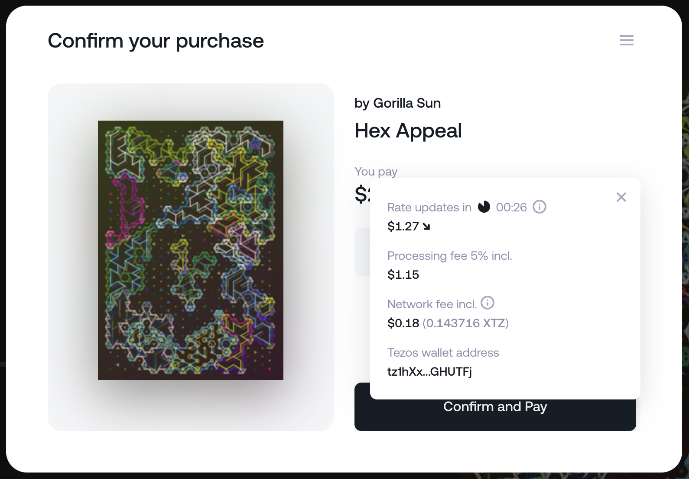

> [!NOTE]
> **A Note on the current Credit Card Payment Provider**: previously fxhash has relied on Winter as a credit card payment provider. Winter has recently been acquired by crossmint and will be integrated as one of their products. Winter will no longer be used as a CC payment option after end of March 2024 - Until crossmint fully integrates. In the interim fxhash will rely on Wert for this purpose.

Learn more about funding your wallets in the [Acquiring, Exchanging, and Managing Cryptocurrencis Section](https://www.notion.so/Acquiring-Exchanging-and-Managing-Cryptocurrencies-0151e53be7384929b3170eaf42b2eaa2?pvs=21).

### Custom Mint Experiences

fx(params) allows artists to set up an interactive minting experience, where collectors can customise the generative artwork, either via the standard fx(params) interface or a custom one before the final NFT is immutably written to the blockchain.

> [!NOTE]
> Depending on what kind of project it is, collecting a project will either yield a new, never seen before edition/iteration of the project directly in your wallet, or alternatively a mint ticket via which the final iteration can configured with the fx(params) feature. **We cover how fx(params) works from the collectors POV in** [**the page fx(params) and Mint Tickets here**](https://www.notion.so/fx-params-and-the-Ticketing-System-b214c68d6af143e08b4a40ec25b7328c?pvs=21)**.**
