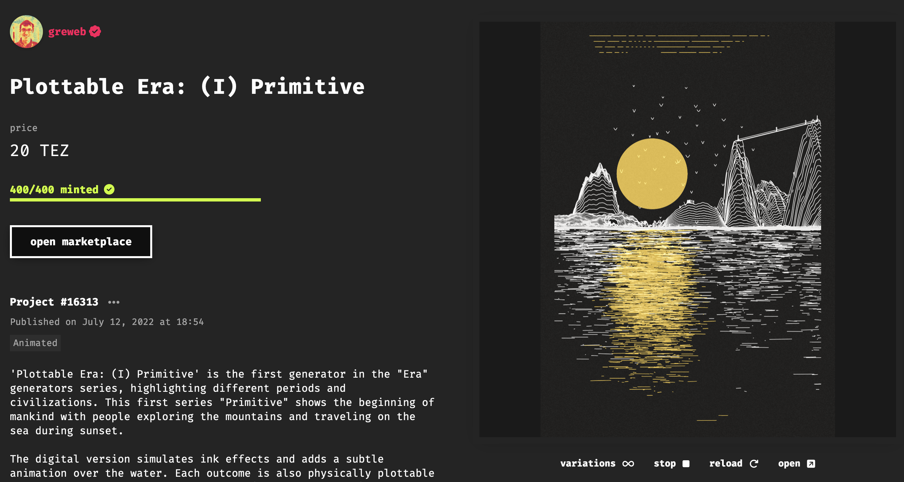
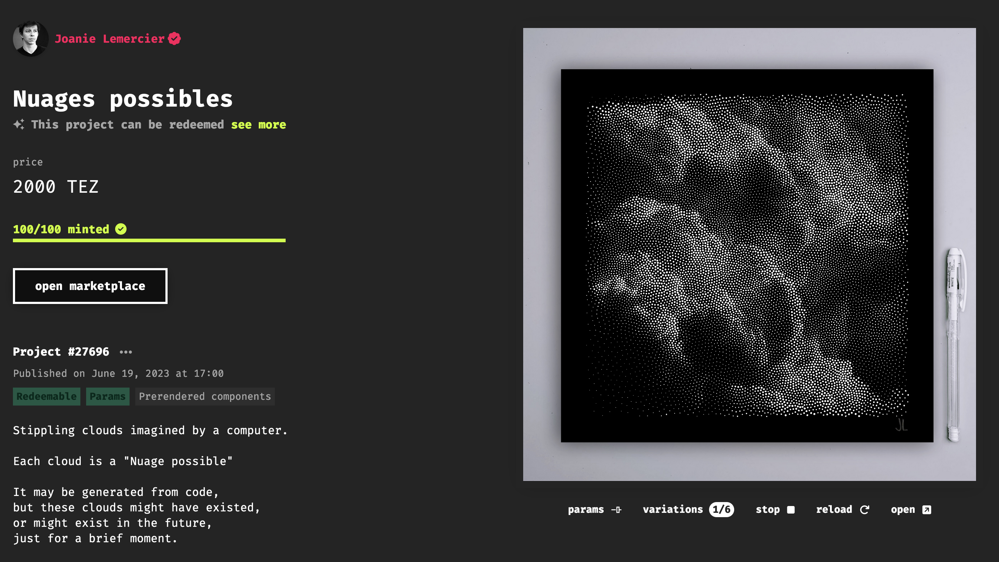
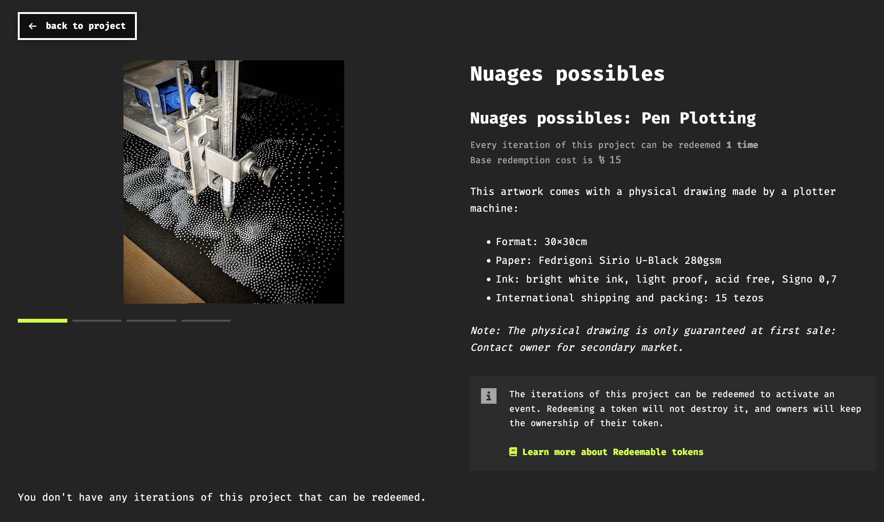

# Redeemables

*An overview of the redeemables feature on fxhash, that enables artists to distribute and send out physical representations of the minted iterations from their fxhash projects.*

Generative art doesn’t only exist on the digital canvas, but can often also take on a physical existence under the form of fine art prints, pen plots, 3D prints, laser cuts, and several other creative mediums.

With NFTs becoming a more popular medium for distributing generative art in a digital manner, there has naturally also been an increasing desire from artists, and collectors alike, to bridge between the digital and the physical and provide physical counterparts to the individually minted iterations for the generative projects on fxhash. Previously this had to be done manually through the artists’ website or an online form where collectors needed to enter their details and provide proof of payment in one way or another for the artist to prepare and send out the physical item.

An early example of this is the fxhash project Plottable Era by Greweb, where collectors could sign up to receiving a plotted version of the minted artwork through a form:

*[Link to Project](https://www.fxhash.xyz/generative/16313)*

This process is however a hassle for both the collectors and the artists, as it requires a number of extra steps. This is where fxhash redeemables come into play. To address the needs of artists and collectors, fxhash created an extension that can be attached onto any existing project, to facilitate the distribution of physical counterparts for the minted iterations of a generative project.

> [!NOTE]
> Redeemables are a feature that can be toggled on fxhash projects, that enables artists to distribute digital counterparts for their generative collections, and provides the necessary interface as well as smart contract tech to make it possible.

In essence, redeemables provide a secure on-chain method for artists to distribute physical counterparts to their generative artworks. Redeemable projects can be identified by the “This project can be redeemed” subheading underneath its title:

Clicking on see more opesn a new page where the artist can provide additional information about the physical item:

The price of the redeemable is sometimes already included in the cost of the initial collect transaction, but can also be offered in exchange for an up-price when the token is redeemed. Sometimes it is the case that not every collector is interested in obtaining what the redeemable offers (or might in some case not be eligible for it due to their geographical location).

Redeeming a token executes a smart-contract and triggers an on-chain redeem event. Redeeming a token does not destroy it, nor does it remove the token from your wallet or ownership (it’s not like using up a ticket). The token remains a digital collectible just as before, and remains trade-able, saleable, and transferable in its own right.

> [!WARNING]
> **Are redeemables an open feature?** Redeemables are rather complex and, for now, can only be created via our internal admin dashboard. Before releasing the feature to the public, we want to test it carefully and ensure we cover the basic use cases. We are open to receiving requests if you want to experiment with redeemables.

***Interested in creating your own redeemable, or have a cool idea for the feature?*** You can ping us on discord (@fxhash team) or send a mail at [partnerships@fxhash.xyz](https://web.archive.org/web/20231003061517/mailto:partnerships@fxhash.xyz)

> [!NOTE]
> **Redeemables were introduced to fxhash on the 20th June, 2023**
