# Secondary Market

*An overview of the necessary interfaces for collecting on fxhash’s Secondary Market, outlining the different trading mechanisms and collecting methods that make it possible to exchange existing GENTKs*

**The Secondary Market refers to the fxhash marketplace where collectors can buy, sell, and trade already minted iterations amongst themselves.**

Once a an edition of a project is minted, it can commence its lifecycle on the secondary market. Minted editions become their own standalone NFTs, tradeable just like any other non-fungible token on the blockchain. This allows fxhash to provide a secondary marketplace in which collectors can trade among each other, resell their acquisitions, or acquire desired pieces from other collectors.

In this way collectors to expand their collections in a targeted manner, hunt down specific artworks that they’d like to own, or scour for select pieces that align with pre-defined collection themes or desired aesthetic qualities. In certain cases, some collectors collect exclusively on the secondary market. fxhash provides the necessary interfaces to facilitate these transactions. In this section we provide an overview of the relevant UI elements, and explain the different methods to sell and acquire tokens on the secondary market.

## The Main Marketplace Page

The main entry point to fxhash’s secondary market is the general Marketplace page - it can be accessed from the homepage:

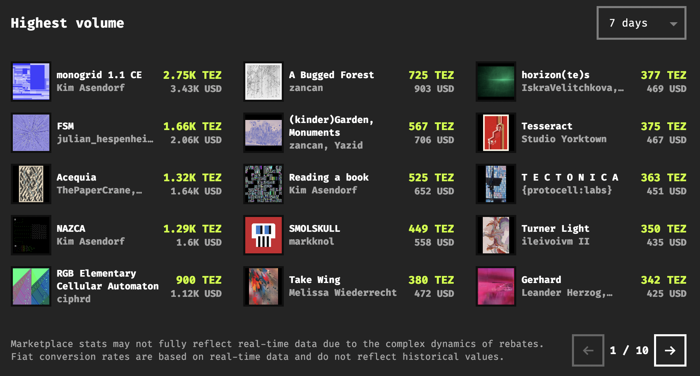

*[The Marketplace](https://www.fxhash.xyz/marketplace)*

It provides a leader-board of projects that have had sales activity within a recent time-frame. Which can be further filter via the drop down menu. The numbers indicated on the leaderboard here refer to the sales volume a project has received:

> [!NOTE]
> **Trading Volume**: The term volume is one of the key metrics used to gauge the activity for a given NFT marketplace or a specific NFT project. It indicates how frequently tokens are being bought and sold, and represents the total value traded within a specific time-frame.

Scrolling down a more detailed view of the different iterations that have been sold and/or been listed recently across the entirety of the fxhash platform can be seen:

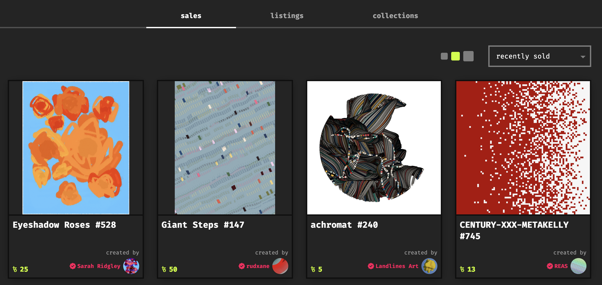

## Individual Marketplace Pages

Each project on fxhash also has its own individual marketplace page from which all of its secondary activity can be tracked. These individual marketplace pages, just like the main marketplace page, aggregate sales and trading statistics at the very top:

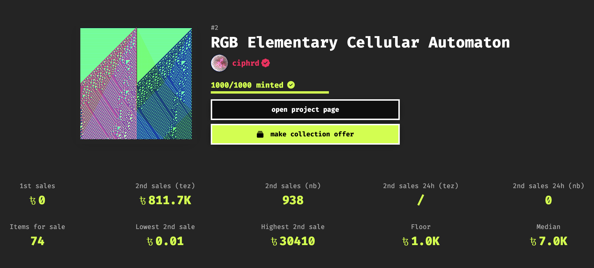

*A project’s marketplace page can be accessed via the ‘open marketplace’ button on a project’s main page. Returning to the main minting page of a project can be done via the ‘open project page’ button.*

Scrolling down, below these statistics you will find a number of tabs that let you explore other secondary market functionalities for a particular collection. On fxhash the word **collection** is a grouping term that indicates the entirety of all editions that are minted from a single project.

The first tab titled “*listed”* shows all iterations that are currently listed for sale by holders. The indicated price on the listings is the asking price that collectors are willing to sell it for immediately - if you find an iteration that you would like to acquire for your own collection, make sure to compare its listing price with the current floor price in the above statistics to get a feel for where it falls compared to the average asking price.

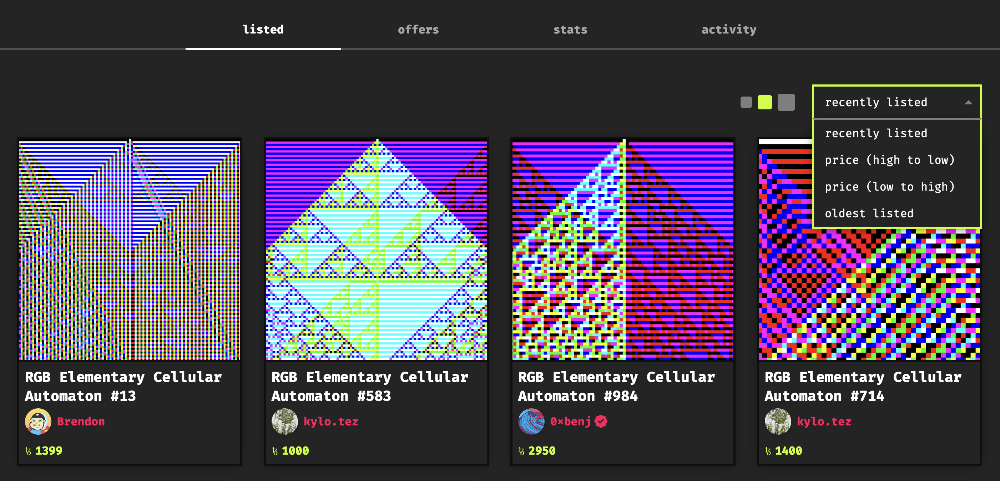

*You can also sort the listed iterations by different criteria from the drop-down list.*

If that price seems reasonable, you can then click on the desired Edition/Iteration which will navigate you to it’s individual token page - yes, fxhash also creates individual pages for each edition of a project. Here you would then simply click “purchase token”, which will then trigger a transaction that you’ll have to confirm to finalize the purchase:

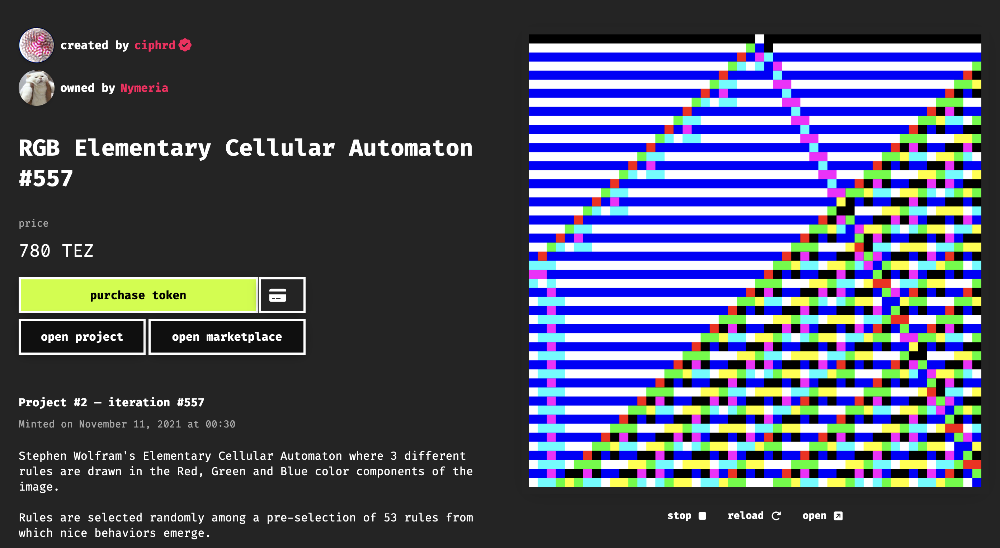

The stats and activity tabs are two other useful views. The stats tab for example, visualises the cummulative trading activity of a project over a given period of time, filterable by different metrics. This can provide an indicator if there is ongoing interest in a particular project:

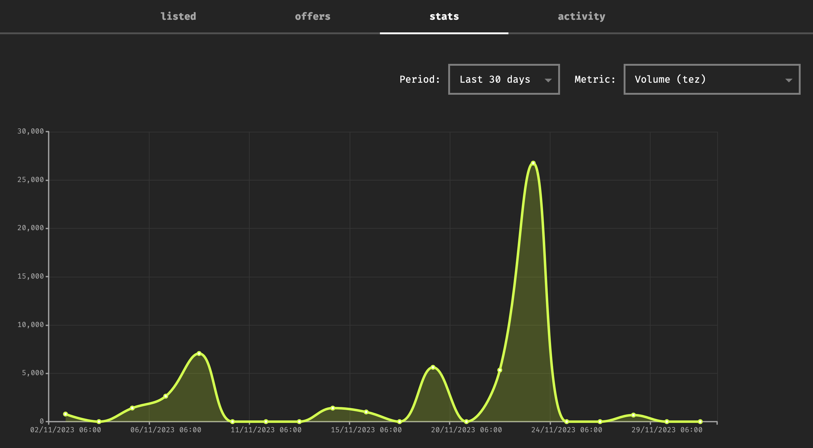

In contrast, the ‘activity’ tab simply shows the most recent trades that have been effectuated on some of the project’s iterations:

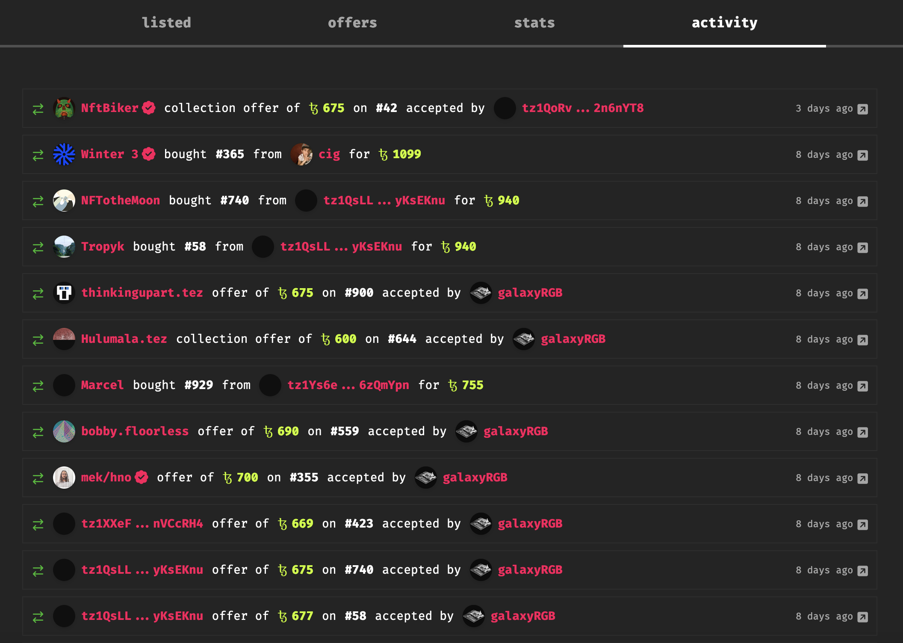

## Collection and Iteration Offers

The Offers tab is a bit more involved. If you find a particular artwork that you would like to have in your collection, but isn’t actually listed on the secondary market by its current holder - or for a price that you might consider too high - fxhash also lets you make a direct offer:

> [!NOTE]
> **Offers:** On fxhash collectors can propose a price for purchasing iterations that are not listed on the secondary market. fxhash then relays this **Offer** to the current holder(s) who can decide if they want to sell for that price or just ignore the offer.

There’s two types of offers that can be made on fxhash:

1. **Iteration Offers:** interested collectors can propose a purchasing price for an individual iteration. The interface for this can be found on the individual iteration’s page. This will require you to input a price before clicking on the ‘make offer’ button and confirming the transaction from your connected wallet:

   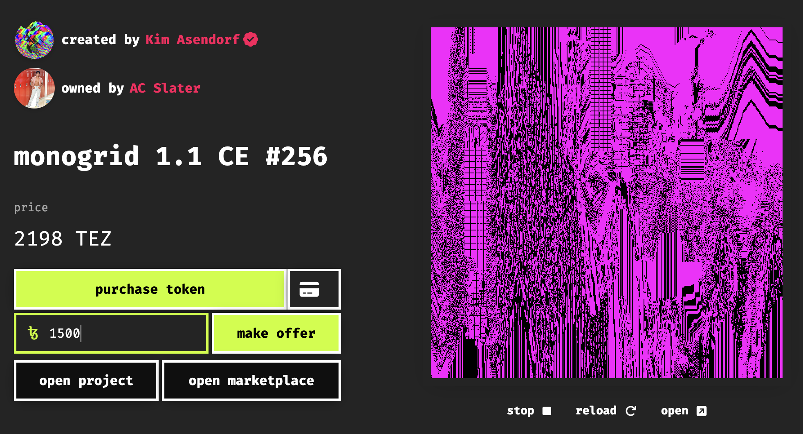

2. **Collection Offer:** an offer made for the entire collection, where any one of the holders of a project’s iterations can accept the offer - in this scenario the collector that makes the offer doesn’t care about which iteration they could possibly receive from the collection. Collection offers are made from the marketplace page of an project.

   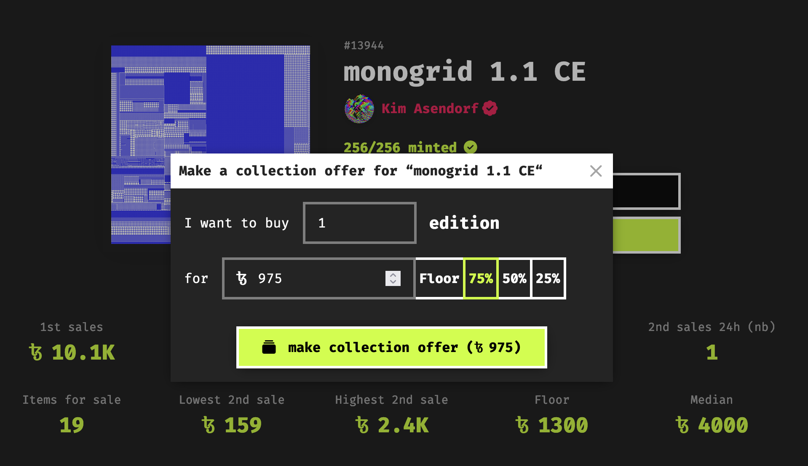

Here you simply indicate how many editions you want to collect and what price you’d like to offer for collecting an iteration - here you can conveniently select a percentage of the Floor price.

> [!NOTE]
> The lowest price at which an NFT can currently be purchased from a specific collection on a marketplace. This price point changes dynamically based on the listings and sales activity within the collection.

If you have collected pieces on fxhash, you might also receive offers yourself. You can view these under the dashboard tab of your profile that displays all of your inbound and outgoing offers - there is also a slider that lets you filter offers that lie beneath a certain percentage of the floor price:

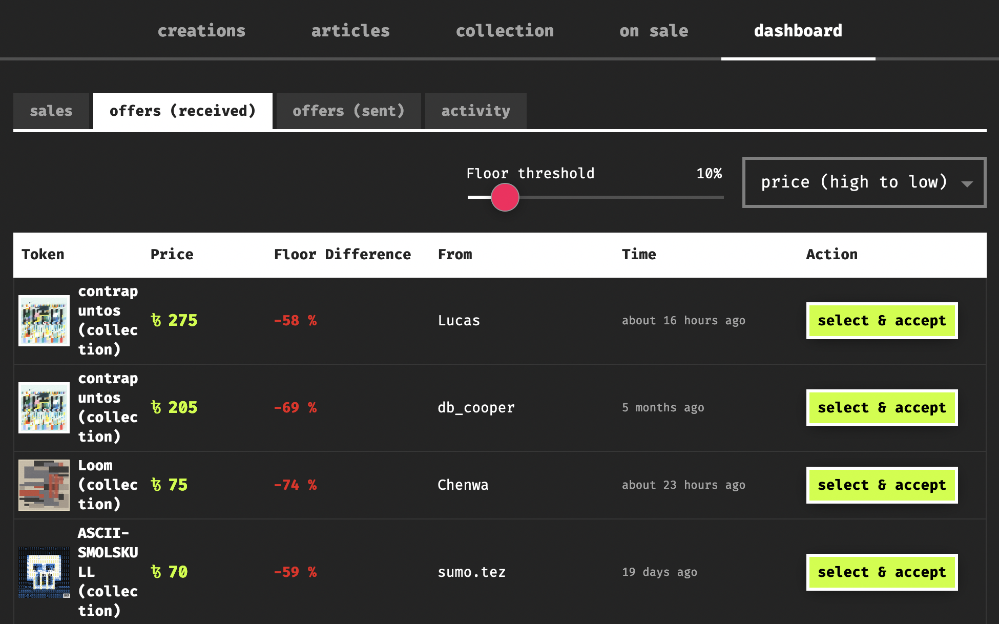

## Viewing your Collection and Listing Iterations on the Secondary

Similarly to viewing your offers, you can view your collection under the ‘collection’ tab of your profile:

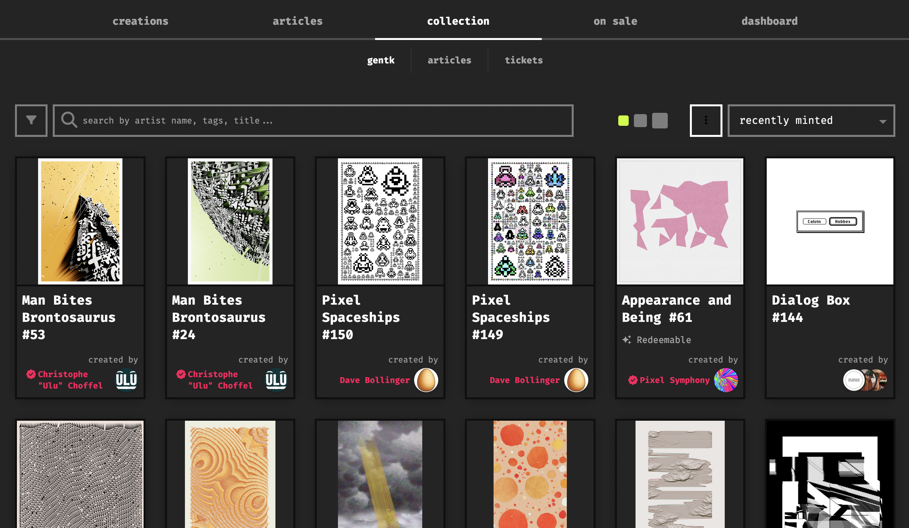

Clicking on any of your collected pieces here will take you to a new page where it will reveal a button labeled *list for trade* via which you can list the GENTK on the secondary market. This requires you to input a price and confirm a transaction in your wallet as well:

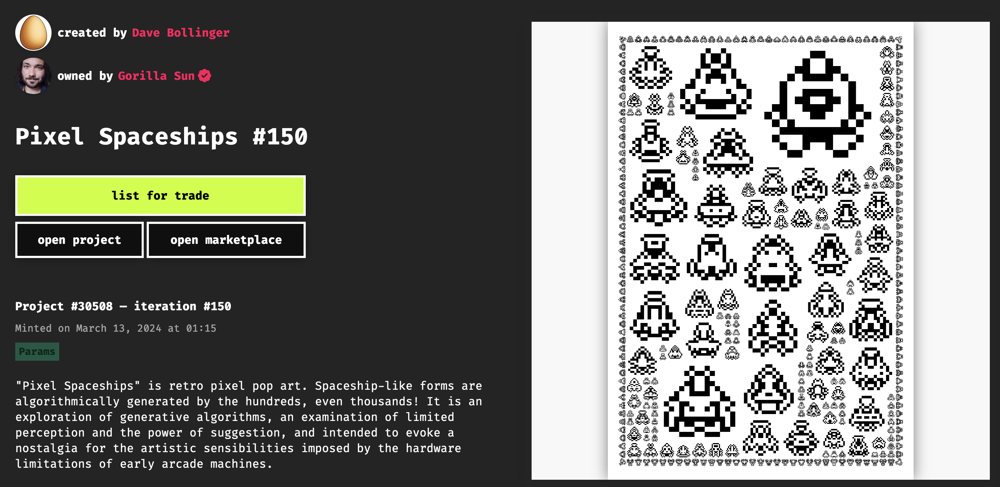

## Addendum

fxhash’s secondary market does not only have a transactional function, but also fosters a sense of community amongst the collectors, and generative art enthusiasts in general; token holders can engage in dialogue with one another, fostering a shared appreciation for generative art, and discussing the different aspects that make or break different generative tokens.

 If you’re planning on engaging with the secondary market, make sure to check out the other documentations pages on this topic:

- [The Value of Generative Art](https://www.notion.so/The-Value-of-Generative-Art-f9a55c00f4344150acb0786a102b89cd?pvs=21)
- [Market Analysis and Dynamics](https://www.notion.so/Market-Analysis-Understanding-Market-Dynamics-8acc7cd202c84cc3a8a08999b4240426?pvs=21)
