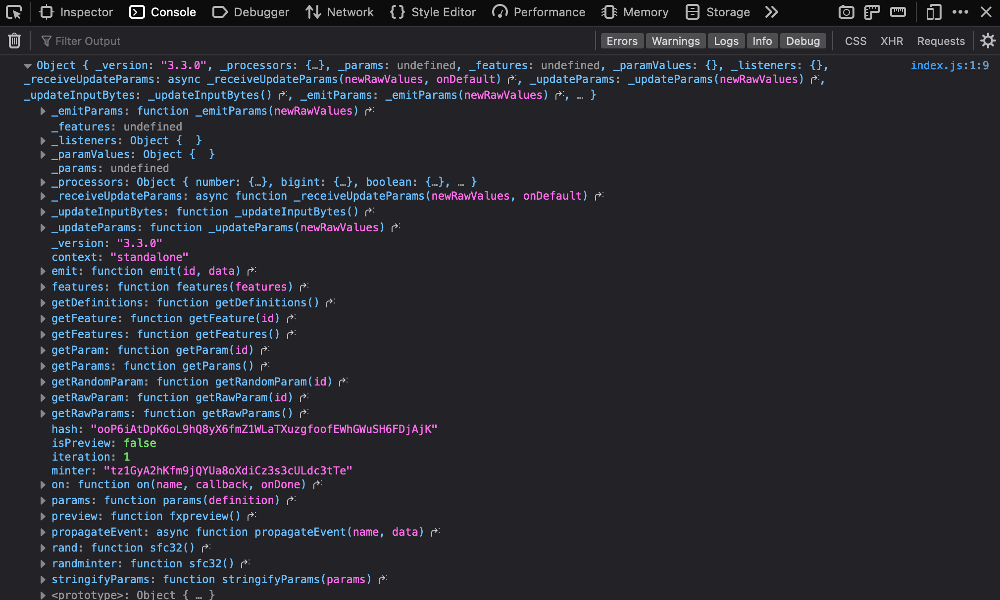

# API Overview

*Overview of the fxhash project SDK and API*

In the previous sections we've had a look at the structure of an fxhash project, introduced the boilerplate as a minimal starting point for new projects and also had a first look at the CLI as an alternative method to setting up blank projects.

Both the boilerplate and the CLI are a part of the fxhash Project SDK—essentially a number of resources that fxhash provides, with the aim of facilitating the development and creation of projects for the platform. This encompasses this documentation, the CLI, the Boilerplate, and most importantly the fxhash.js script. This script file is also referred to as an API.

In other words, the fxhash *API* is simply a fancy term to refer to the functions that the fxhash.js script exposes within the scope of an fxhash project. These functions provide useful functionality for artists to build deterministic generative artworks that work properly and are platform compatible once uploaded to fx(hash).

<details>
<summary><strong>What is an</strong> <strong>SDK?</strong></summary>

SDK is an abbreviation for the term Software Development Kit, an SDK usually represents a bundle of code, tools, and documentation provided by the creators of a platform for third party developers, and is aimed at aiding them in creating software that is compatible with the platform.

</details>

<details>
<summary><strong>What is an API?</strong></summary>

The abbreviation API stands for Application Programming Interface, and refers to the code part of an SDK. It's a software-to-software interface that allows developers to build platform specific software. APIs usually provide numerous functionalities that are useful and sometimes necessary for the purpose of compatibility.

</details>

How does this API work? Why do we need to use it? And moreover, how do we use it? All of these questions should be answered by the end of this page. If you’re more experienced, know what an API is, and simply want to have an overview of the different functions it provides you can jump to the following [page](api-reference.md)[for an reference of the general API](api-reference.md), and [this page for a reference of the fxparams module of the API](fxparams-api-reference.md).

### **Why do we need to use the API?**

[Projects on fxhash are deterministic generative artworks that can reliably re-generate the same output when the same input hash is used injected into their code.](../../knowledge-base/quickstart/genart-on-the-blockchain.md)

**The fxhash API is a code library designed for developing deterministic generative systems. It provides a pseudo random number generator (PRNG) that can be used as the primary source of randomness throughout a generative token's code. Moreover, it automatically seeds this pseudo random number generator with the hash that is injected into the code.**

Furthermore, depending on what kind of token you want to develop, and depending on how the randomness should behave, the SDK provides a couple of options for that as well. It provides a number of functions to generate different kinds of random numbers and/or make random decisions throughout the code.

> [!WARNING]
> Technically, the PRNG provided by the API isn't mandatory - as an artist you can also equivalently implement your own PRNG function, under the condition that it is seeded correctly with the hash that the API script injects into your code.
>
> **The hash is therefore the only part of the API that is required.** We strongly recommended to use the API however, in this manner you can focus on building your generative artwork rather than spending time on programming a PRNG.

### **What does the** `fxhash.js` **script file do?**

When we had a look at [the structure of an fx(hash) project](../project-setup-and-development/project-structure.md) and introduced [the boilerplate](../project-setup-and-development/project-template.md), we’ve seen that the `index.html` should reference the `fxhash.js` script within it’s `head` tag. By doing so the `fxhash.js` script is run when the webpage is viewed in a browser. Although there is a lot of code inside of the fx(hash) script file, the main purpose of it is the creation an `$fx` object and attaching it to the `window` object as a property.

> [!NOTE]
> **What is the window Object?**
>
> In JavaScript, the `window` object represents the global context for a web page or a browser environment. It is the top-level object that contains global variables and functions accessible throughout the entire JavaScript runtime in a web page. Attaching new properties/variables makes them accessible throughout the scope of all scripts, which is why the `$fx` API object is attached as such a property.

This `$fx` object is essentially a container for the functions of the fxhash project API, making them available for usage in the artist script, namely the `index.js` file.

### W**hat is this** `$fx` **object?**

If you’ve already installed the CLI and created a new blank fxhash project, we can see for ourselves what this `$fx` object is. While keeping all of the files unchanged, we’ll only delete the contents of the `index.js` file, and replace it with a single line of code that logs this `$fx` object to the console:

```javascript
console.log($fx) // logging the $fx object to the console
```

If we now open the `index.html` in our browser, we'll get a blank, white browser window (because we deleted the previous code), but if we check the console however, we'll see that something has been logged:



*The $fx object that is instantiated by the fxhash.js script, logged to the browser console.*

This is the content of the `$fx` object created by the `fxhash.js` script. There's a bunch of stuff inside of it: a number of properties, functions, and other objects. All of these are now accessible in the artist script and available for our convenience to build a generative artwork with.

> [!NOTE]
> **What is an Object in programming?**
>
> Objects in programming are usually containers for variables and functions. The contained variables and functions are referred to as member variables and methods respectively. They can be accessed and invoked using the dot notation, for example `$fx.rand()` invokes the `rand()` function contained inside the `$fx` object.

One last note here, it is not recommended to change the code inside of the `fxhash.js` script for your generative token to work properly:

> [!CAUTION]
> **You should not change or edit the code inside of fxhash.js for your GENTK to function properly.**

A complete run-down of all API functions can be found in the [API Overview](api-overview.md) A detailed explanation of these functions can be found in the [API Reference](api-reference.md).
