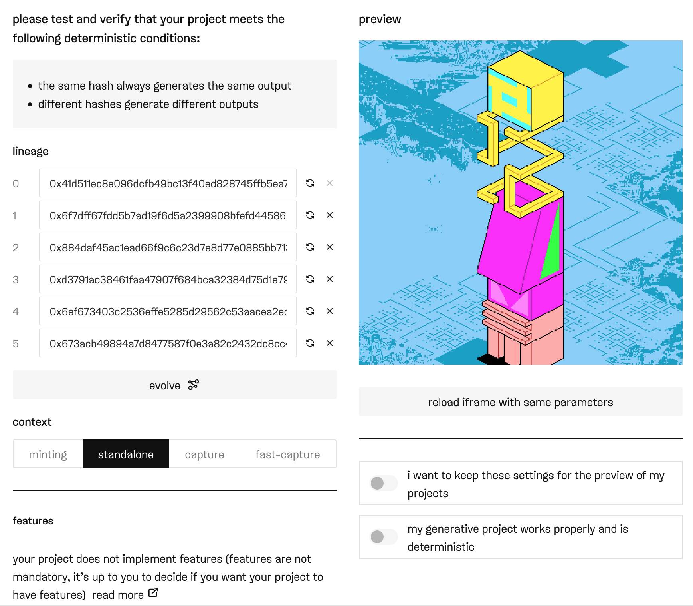
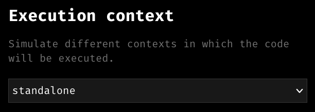
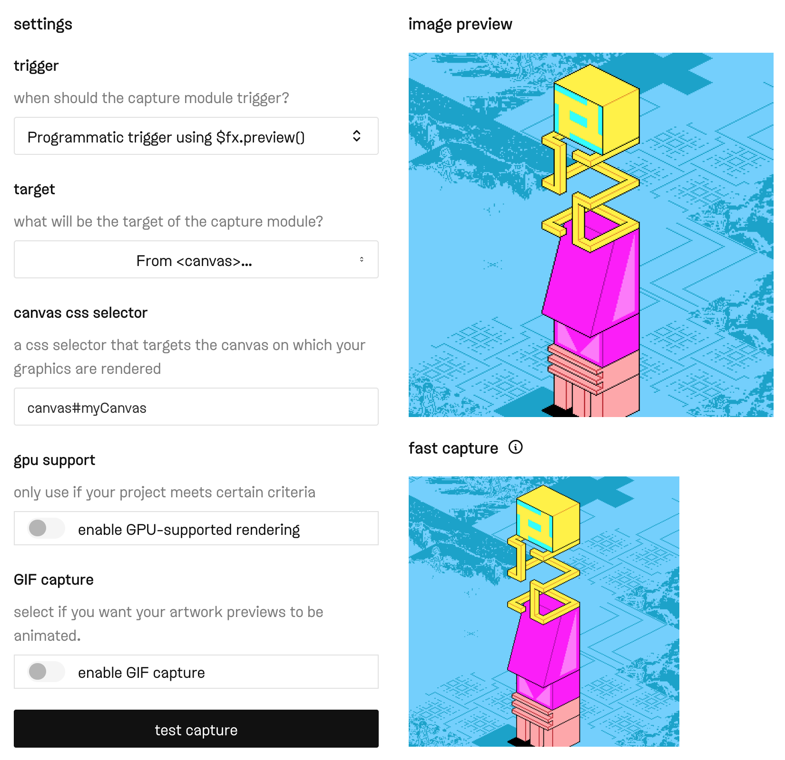
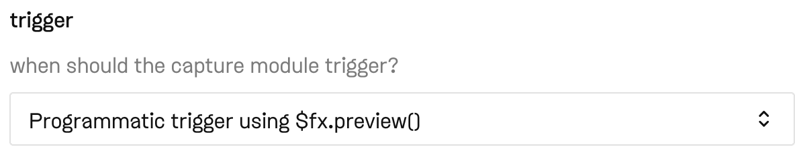
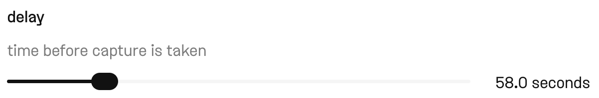
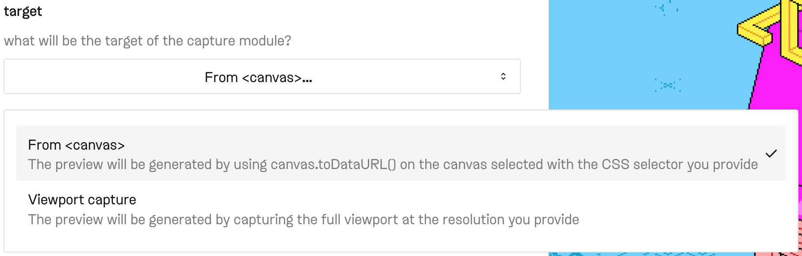
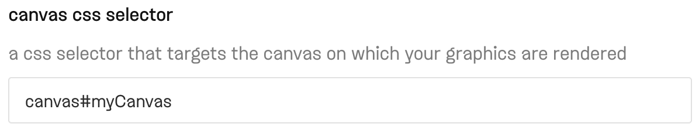
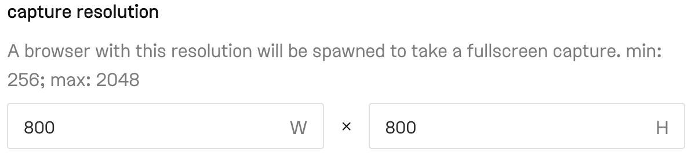
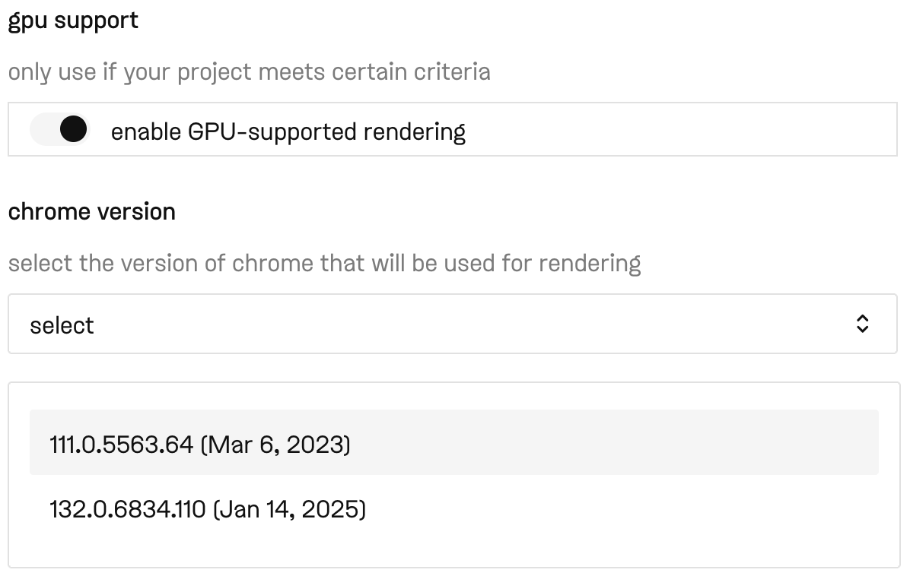
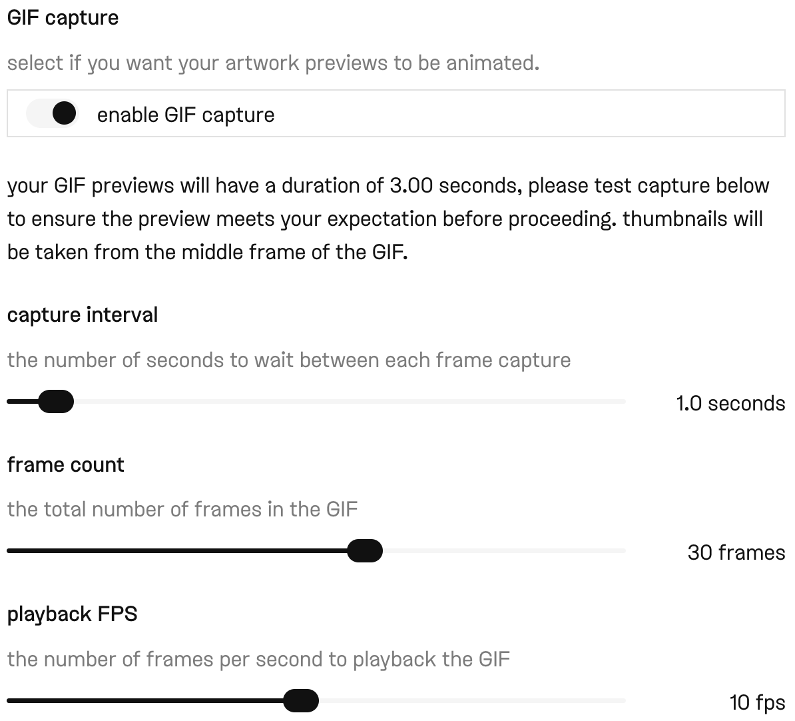

# Capture Contexts & Preview Settings

*An overview of the different capture contexts and capture settings*

The fxhash API exposes a `$fx.context` flag—a `string` value that specifies in which execution context fxhash is running your code. The `$fx.context` variable can currently assume one of four values:

| $fx.context | description |
| --- | --- |
| `standalone` | When fxhash runs your project's code directly in the browser—"live mode". |
| `capture` | When fxhash runs your code on the backend to generate an image/GIF preview to display on the frontend. |
| `fast-capture` | A new context that lets you generate a preliminary preview to display before the actual preview image is generated—useful for intensive projects that require a couple of seconds to render. In essence this can be your custom "waiting to be signed" preview image. |
| `minting` | When fxhash runs your project's code in the fxparams minting interface. |

### How to use $fx.context in your project code

Since the `$fx.context` property is a flag that indicates the context in which the code is executed—in most cases you will want to have a conditional block in your code that checks for the different contexts and then renders the artwork according to the use-case:

```
if ($fx.context === "fast-capture") {
    // generate your fast-capture placeholder image here
    // then trigger the capture with $fx.preview()
    $fx.preview()
} else if ($fx.context === "capture") {
    // generate the preview image that you want to display on fxhash
    // then trigger the capture with $fx.preview()
    $fx.preview()
} else {
    // here goes what you intend to display when your  
    // code is run and viewed directly in the browser
}
```

This is useful when you want to display your artwork differently in each context. If your artwork display the same everywhere, you can simply not use `$fx.context` at all, and invoke the preview when the artwork has finished rendering.

Capture contexts work the same way in both long-form and open-form projects—during the check-files step of the creation flow you can toggle between the different contexts to check that they are working properly and the way you have intended with your code.



fxlens will also let you set this execution context to verify that your code is working properly.



### Capture & Preview Settings

In the `configure-capture` step of the creation flow, you will set up how fxhash creates the preview images of the artworks that your code generates, whenever a collectors mints or evolves a new edition:



*For this project we are using the $fx.preview() function*

There’s two different methods for triggering the capture module:

- **Programmatically with** `$fx.preview()`**:** The capture module will wait until your code calls the `fxpreview()` function. As soon as it is invoked, the capture will be triggered. The placement of this function in your code is up to you, but usually it should be placed towards the end of your code, when all of the graphics have been rendered. If the piece is animated you might want to trigger it after the initial frame has been drawn.

  

  If your project is loading asynchronous requests from the project's folder, **always consider that these resources may be slow to load**—please always use `fxpreview()` to trigger the capture in this case.

- **Automatically after a fixed delay:** a fixed time delay indicates that the capture module should trigger automatically after a certain amount of time after the project is loaded. Selecting this option will make a slider appear where you can set how many seconds the capture should wait before triggering, up to 300 seconds.

  

> [!WARNING]
> **The capture module will automatically take a capture after 300 seconds have passed after your project was loaded in the browser. Hence it is important that the rendering of your graphics completes within this timeframe, otherwise it might lead to undesirable preview images.**

In the case of our example token we’re using the programmatic trigger since it is a static artwork where we want to trigger the capture after all shapes have been rendered to the canvas. After setting the capture trigger we also need to indicate the target of this capture; this can be a canvas element, or the entire viewport.



In this example we only want to capture the canvas element, and not the entire viewport—selecting the `From <canvas>` option will reveal a third input field that lets us point the capture module to the HTML canvas element we want to capture:



Otherwise, if you choose to capture the entire viewport, you can specifiy the dimensions of the viewport at the time of capture (the size of the browser window essentially, in which your code runs):



### Using GPU accelerated captures

**If your project requires a GPU to render, you should use enable GPU-supported rendering for your capture.**



Booting up the GPU capture can be slow however, and can take up to a couple of minutes to finish rendering.

### GIF captures

We now also support GIF preview captures, that enable animated thumbnails for collected editions of your project. Currently GIF captures are limited in that fxhash will simply record your selected target or viewport for a set number of frames and at a specified interval—rather than programmatically triggering individual frame captures from your code (but this is in the works!)

When toggling on GIF capture for your project, you don't need to trigger `$fx.preview()`, it will simply start recording from when your code runs.



In other settings where GIF previews are not available, the middle frame of the GIF will be used a thumbnail. For example, if the GIF has 20 frames, it will use the 10th frame as a thumbnail.

### Notes about the `fast-capture` context

There are a few limitations to the `fast-capture` context:

- The GPU is disabled during fast-captures
- GIF captures are not available as fast-captures

This is simply because both of these capture methods can not be generated very quickly—if this doesn't suit your project, you can either ignore the fast-capture context or build a creative intermediary preview into your artwork that reveals something about the artwork before the actual preview is rendered.

Additionaly, the fast-capture will also be taken according to the capture trigger method you have selected for your project:

- If you're using `$fx.preview()` as a trigger method, simply call `$fx.preview()` when you want the fast capture to be taken—preferably as early as possible—in a `fast-capture` clause in your code.
- If you're taking the capture after a timed delay, the fast capture will trigger when the selected delay has elapsed, or at a maximum of 1 second.

And in case you are using the GIF capture for your previews, you still need to call `$fx.preview()` as a fast-capture trigger.
