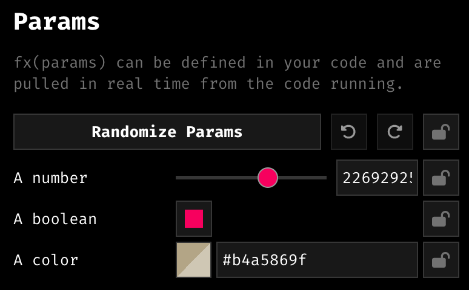
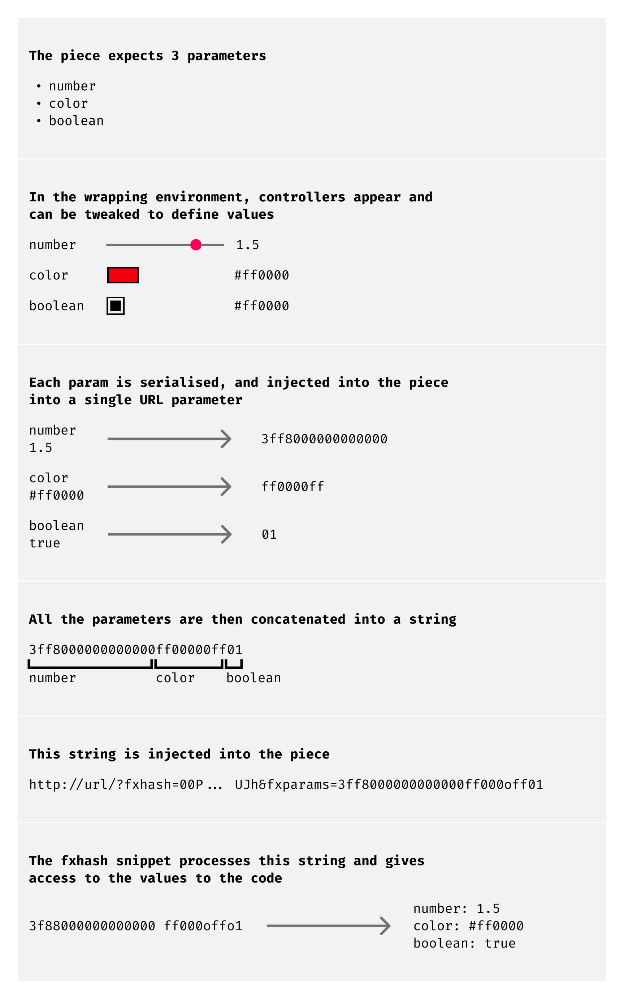

# fxparams module

*An introduction to the fx(params) module.*

> [!CAUTION]
> ⚠️ **fx(params) is not currently supported on mainnet ETH or Base ETH based projects. It is however planned at some point in the future.**

Traditionally, projects on fx(hash) generate random outputs for their collectors. This means that collectors have no prior knowledge as to what the iteration they will receive look like beforehand. This is because the hash that is used to seed the PRNG of the generative artwork, can not be known in advance. **With fx(params) this paradigm changes.**

> [!NOTE]
> **What is fx(params)?**
>
> fx(params) is an alternative method to building and collecting generative art on fx(hash).
>
> Instead of entirely leaving all aspects of the minted iteration up to randomness, the artist can now choose certain parameters that they would like to expose and give the collector control over at mint time.
>
> fx(params) is the name of the module in the fx(hash) API that gives artists the tools to expose a set of parameters and custom minting interfaces for the collectors to modulate and play with before minting/collecting their own individually customised iterations.

From the collectors point of view, this changes a couple of things. Instead of directly collecting an iteration from a project, when a project that makes use of fx(params) is collected they obtain a mint ticket instead. This mint ticket is essentially a voucher that they can exchange for an iteration of the project.

This system is in place to give collectors the time to customise their iteration without having to worry about running out of time and the project completely minting out. Once a mint ticket is secured, the collector can then take their time crafting their own unique individual iteration. You can read more about this in the collector guides.

From the artist's point of view, to create an fx(params) piece, they will need to make use of the fx(params) module of the API. In this section we will give an overview of the module and explain how to use it. A detailed explanation of the different functions that this module provides can be found in the [fx(params) API Reference](fxparams-api-reference.md).

### Using the fx(params) Module of the API

Creating an fx(hash) project that makes use of fx(params) boils down to using the respective functions in the API such that certain variables in the code are exposed as collector tweakable parameters. The most important function in the API to this end is:

```js
$fx.params(definitions) // API function that creates the parameters in the interface
```

Invoking the `$fx.params()` function in your code informs fx(hash) that the project is intended to be an fx(params) piece. Equally important is that **this function requires an input in form of an array that defines the desired parameters such that they can be created in the interface by fx(hash).** During local development of your project these parameters will also appear in fx(lens).

For the purpose of an fx(params) piece, the definitions array needs to follow a specific structure:

```
definitions = [
{
	id: "number_id",
	name: "A number",
	type: "number",
},
{
	id: "boolean_id",
	name: "A boolean",
	type: "boolean",
},
{
	id: "color_id",
	name: "A color",
	type: "color",
},
]
```

In essence this array is a list of objects, each of which represents an individual parameter. We'll talk more about the content of these objects in a second. Another effect of the `$fx.params()` function is that it feeds the parameter values back into our generative artwork’s code, such that these values can be used for the purpose of shaping the rendered graphics.

Hence, if we were to copy the above snippet of code into the `index.js` of a blank fx(hash) project and then boot up fx(lens) (via the CLI with `fxhash dev`), we would see the following controllers show up in the interface:



To recap, the effect of `$fx.params()` is twofold:

- It informs fx(hash) of the parameters that should be exposed in the minting interface. (during local development these parameters should appear in the fx(lens) interface)
- It exposes the value of these parameters in our code, such that the generative artwork’s characteristics can be based off of them.

### **Parameter Definitions**

The objects contained in the definitions array that we pass as an input to the `$fx.params()` function needs to follow a strict shape. In essence they are objects containing a number of key/value pairs that describe the controllers in the interface, such as the label next to the controller, the type of controller it is, the value it modulates, and the possible values that it can assume.

That is why we call these objects Parameter definitions, they essentially define (describe) the parameter controllers in the interface:

> [!NOTE]
> **What is a** **Parameter Definition?**
>
> In the context of fx(hash), a Parameter definition is a small Javascript object that contains a number of properties (key/value pairs) that define specific parameters. These parameter definitions describe the appearance of the parameter controller in the interface, and how they should be referenced within the artists’ code.
>
> Parameter definitions always require an id and a type, where the id is needed to later retrieve this parameter in the artist's code, and the type, as the name suggests, is required to specify what kind of parameter it is.
>
> Parameter definitions also have optional properties, such as a name, that the artist can assign and will be displayed as a label in the controller interface. Another `options` property can be appended depending on the type of the parameter.

Here's an example of such a parameter definition object:

```jsx
**{
	id: "number_id",   // required
	name: "A number",  // optional
	type: "number",    // required
	options: {         // optional
		min: -10,
		max: 10,
		step: 0.1,
	},
}**
```

Some of the key/value pairs are optional, others are mandatory. The structure of these key/value pairs need to follow a strict set of *specifications*, you can find a detailed overview of these specifications in the [Parameter Definition Specifications](parameter-definition-specs.md) page.

### **How does fx(hash) inject Parameters?**

Just like the iteration hash, parameters are passed into a generative token as a URL parameter, not individually, but under the form of a single serialised string that concatenates all of the parameters. The API then de-serializes this string splitting it into individual values and mapping them to their respective variables, such that they can be accessed throughout the code:



It would not be convenient at all to input this string manually, as such we recommend using [fx(lens)](../project-setup-and-development/fxlens.md) to work on your fx(hash) projects. fx(lens) comes with built-in tools and hot-reloading to facilitate iterating on your project and manipulating the various parameters as you define those in your code.

### Retrieving Parameter Values within the Artist’s Code

The snippet API exposes a set of utility functions which lets artists retrieve the active value of the parameters - these functions need to be called after the parameters have been defined with `$fx.params()`:

- `$fx.getParam('parameter_id')`: gets the value of a single parameter by its id
- `$fx.getParams()`: gets all the parameter values as an object
- `$fx.getRawParam('parameter_id')`: gets the raw value of a single parameter as a hexadecimal string

The `$fx.getParam()` function for example lets us fetch the active value of a parameter by its id (as a string value) - ‘active value’ here means the value that the parameter is set to by its respective controller in the interface (fx(lens) or minting interface):

```jsx
const paramValue = $fx.getParam('number_id')
```

### Update Modes

So far, we’ve seen fx(params) as collector tweak-able variables that control certain aspects of the generated artwork. What’s more, is that fx(hash) also gives the artists control over how these parameters are updated - they don’t have to necessarily be updated from the control panel, but can also be modulated via the code itself.

The parameter definitions have a special property called ‘update’ which allows the artist to control how this parameter is updated.

The default update mode is `page-reload` and describes the known behaviour of updating the parameter by performing a full page-reload of the project. Meaning that the entire code of the generative artwork needs to be re-run to apply this parameter change. The are other options for update property, that behave differently and don’t require a full refresh of the project page.

For instance, when setting the update mode of a parameter to `sync`, the change of this parameter via its respective controller would not trigger a full page reload and update the parameter value in real-time:

```jsx
{
  id: "number_id",
  name: "A number/float64",
  type: "number",
  update: "sync", // <-- new update property
},
```

Updates on parameters with `update: "sync"` are received in the background in real-time. Naturally this also requires the artist to structure their code differently for this parameter change to be applied. When using the `sync` update mode, the artwork code needs to be actively redrawn inside of a loop that can respond when such a synced parameter is changed, (e.g. via `requestAnimationFrame`), in that manner the code can receive those changes during the runtime of this loop.

For even more advanced use cases, e.g. if you want to only re-render your artwork when the values of your parameters are changing, you can use the new event listeners described in the section on [`$fx.on`](https://www.fxhash.xyz/doc/artist/snippet-api#fxoneventid-handler-ondone), which is detailed in the [fx(params) API reference](fxparams-api-reference.md).

### Code-driven parameters

> [!NOTE]
> **What are Code Driven Parameters?**
>
> Code driven parameters are special interactive parameters that are controlled via the artists’ code rather than controllers in the interface. Similarly to the `sync` update mode, the parameters are also updated in real time without reloading the artwork, with the difference that they’re updated from within the code rather than the controller interface.
>
> This allows for much more intricate ways of collector collaboration, where in some instances they can directly interact with the artwork, can get hands on for customisation purposes, and artists can even set up custom minting interfaces.

Besides the `sync` update mode, another mode is `code-driven`, which is by far the most interesting and versatile one. `page-reload` and `sync` both rely on a signal and change in the external UI to update the parameter value. The `code-driven` update mode breaks this principle, and gives artists the ability to change the value of a parameter from the code, enabling completely customised minting experiences.

`code-driven` parameters can’t be updated from the UI and have to be controlled via the `$fx.on()` and `$fx.emit()` functions. Additionally we also need to make use of the `$fx.context` property to detect if the code is executed during mint time, in which we would execute additional code that accounts for the update of the code-driven parameter, or in the other contexts where this behaviour is not needed.

The following code snippt exemplifies a `code-driven` approach:

```
// defining parameters two code-driven parameters
// that are uneditable from ui, and will be controlled by the code!!
$fx.params([
  {
    id: "size",
    name: "Size",
    type: "number",
    update: "code-driven",
  },
  {
    id: "x_pos",
    name: "X position",
    type: "number",
    update: "code-driven",
  },
])

// this is the draw loop in which we render the graphics
// and listen for changes of the code-driven parameters
function draw() {
  // resetting the fx.rand function is important to ensure every time it's
  // called, the same values will be generated
  $fx.rand.reset()

  // GRAHPICS ARE DRAWN HERE
}

// this renders an interactive UI in the minting context
function drawUI() {
  // draw UI here
}

// depending on the execution context, 2 different codes are executed

// when the code is executed in a "minting" context
// we run the first clause of the condition
if ($fx.context === "minting") {
  // we draw the piece, and the UI on top
  draw()
  drawUI()

  // updating the parameter from the code - this would be called when some input
  // is registered, such as clicking the mouse for example
  window.addEventListener("click", () => {
    $fx.emit("params:update", {
      size: Math.random(), // anything here, it will update the parameter value
    })
  })

  // when the params are updated we re-draw the graphics and the UI
  $fx.on(
    "params:update",
    // we do nothing when the event is received
    () => {},
    // once the params are updated and available, we trigger a re-draw
    () => {
      draw()
      drawUI()
    }
  )
}
// the piece is ran by itself, for the final output or for the capture
else {
  // we just draw
  draw()
}
```

*This is an example of an implementation. You are free to follow the patterns of your choice.*
