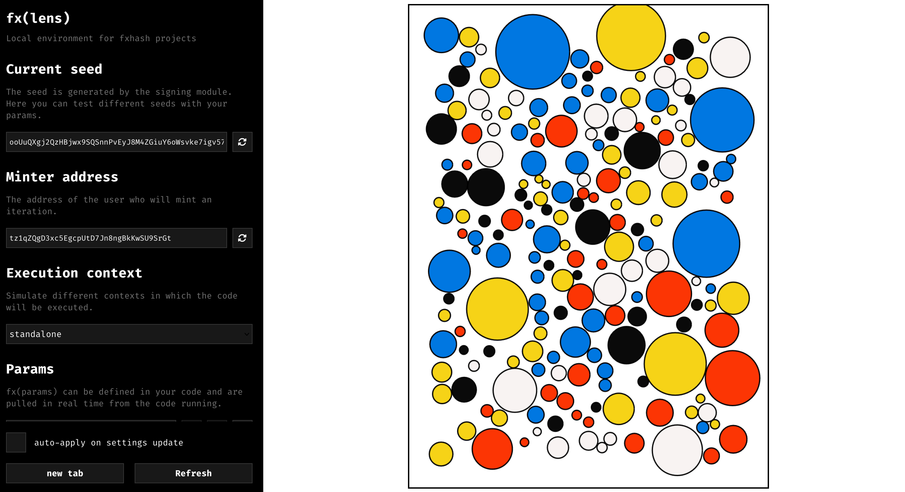
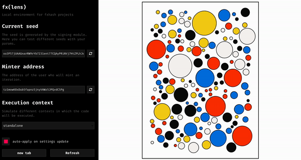
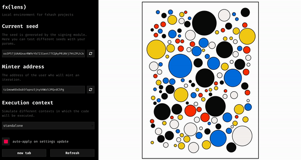
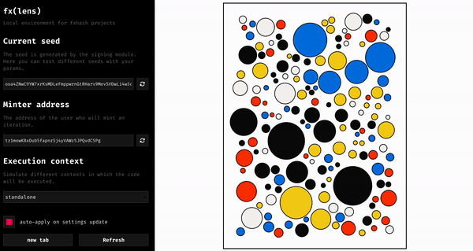

# Deterministic Randomness

*Notes on using the fxhash PRNG and how to create deterministic generative tokens.*

Besides being displayed correctly, the absolutely most important aspect of a GENTK is that it is entirely deterministic, and that it always produces the same output for the same input hash, no matter the circumstances under which it is run.

In this section we will have a look at an example of a generative artwork, explain how it needs to be modified to become an fxhash compatible piece, and conclude by discussing some of the common causes that might break the determinism of a piece.

### A Preliminary Example

Let's have a look at an example, a simple circle packing sketch:

> **CodePen demo:** <https://codepen.io/gorillasu/pen/VwgWwNg>

This is a simple generative artwork that produces a different circle packing layout each time that it is rerun. Here’s the code that powers this piece:

**index.html**

```html
<!DOCTYPE html>
<html>
	<head>
		<title>simple</title>
		<meta charset="utf-8" />
		<script src="./fxhash.js"></script>
		<link rel="stylesheet" href="./styles.css" />
	</head>
		<body>
		<div id="canvasContainer">
			<canvas id="myCanvas" width="900" height="1200"></canvas>
		</div>
		<script src="./index.js"></script>
	</body>
</html>
```

**styles.css**

```css
body {
	/* override the default margin of the html body */
	margin: 0;
}

#canvasContainer {
	height: 100vh;
	width: 100vw;

	display: flex;
	align-items: center;
	justify-content: center;
}

#myCanvas {
	max-width: 100%;
	max-height: 100%;
	border: 2px solid black;
}
```

**index.js**

```javascript
const canvasWidth = 900; // same as original canvas width
const canvasHeight = 1200; // same as original canvas height
const PAD = 75

const palette = ["#0a0a0a", "#f7f3f2", "#0077e1", "#f5d216", "#fc3503"]

// JavaScript code to draw a blue rectangle on the canvas
const canvas = document.getElementById('myCanvas');
const ctx = canvas.getContext('2d');

function getRandomNum(min, max) {
  return Math.random() * (max - min) + min;
}

let circs = []

for(let n = 0; n < 5000; n++){
  let randX = getRandomNum(PAD, canvasWidth-PAD)
  let randY = getRandomNum(PAD, canvasHeight-PAD)
  let randRadius = getRandomNum(10, 100)

  let placeable = true

  for(let i = 0; i < circs.length; i++){
    let xDistance = randX - circs[i].x
    let yDistance = randY - circs[i].y

    let cDistance = Math.sqrt(xDistance*xDistance + yDistance*yDistance)

    if(cDistance < randRadius+circs[i].radius+5){
      placeable = false
    }
  }

  if(placeable){
    circs.push({x: randX, y: randY, radius: randRadius})
  }
}

for(let i = 0; i < circs.length; i++){
  let c = circs[i]

  ctx.lineWidth = 3

  ctx.moveTo(c.x+c.radius, c.y)
  ctx.beginPath()
  ctx.fillStyle = palette[Math.floor(Math.random() * palette.length)];
  ctx.ellipse(c.x, c.y, c.radius, c.radius, 0, 0, Math.PI*2)
  ctx.fill()
  ctx.stroke()
}

//canvas.style.width ='100%';
const resizeCanvas = function(event) {
  var containerWidth = window.innerWidth;
  var containerHeight = window.innerHeight;

  var ratio = containerWidth / canvasWidth;
  if(canvasHeight * ratio > containerHeight) {
    ratio = containerHeight / canvasHeight;
  }

  canvas.style.width = canvasWidth * ratio-20+"px";
  canvas.style.height = canvasHeight * ratio-20+"px";
}

window.addEventListener('resize', resizeCanvas, true);
resizeCanvas()
```

Let's boot this generative artwork up with fx(lens) to turn it into a deterministic fxhash project. Fx(lens) will allows us manual control over the input hash and lets us test that if our piece is in fact deterministic or not. Go ahead and create a new project, copy over the previous code into the corresponding project files, and boot up fx(lens) - you should see the following in your browser:



Naturally you will obtain a visually different circle packing configuration because the sketch isn’t deterministic yet, nor will you have the same hash. Let's talk for a second about circle packing procedures and how they use randomness, this will help us understand what modifications we need to make.

In essence a circle packing algorithm is a very simple algorithm that tries to randomly distribute circles on a surface (the canvas) in such a manner that they don't overlap. This is generally done by storing the positional information of these circles in an array that we can reference when placing new circles. If a new circle (that we're trying to place) overlaps with any of the circles in that array (if it is stored in the array it means that it already exists on the canvas), we simply discard this new circle and try to place a different circle at a different location on the canvas.

In this procedure, **RNG comes into play during the selection of the circle coordinates and their radii**. These are chosen at random from specific ranges:

```jsx
function getRandomNum(min, max) {
  return Math.random() * (max - min) + min;
}

// PAD is a parameter chosen by us - margin to the canvas boundaries
let randX = getRandomNum(PAD, canvasWidth-PAD)
let randY = getRandomNum(PAD, canvasHeight-PAD)
let randRadius = getRandomNum(10, 100)
```

Here we created a little helper function that allows us to generate a random number within a given range. This function makes use of the Math library that comes with Javascript by default and provides an RNG out of the box. This RNG is not seeded and will produce different random numbers each time that we run our code.

We want it to however produce the same sequence of random numbers, given the input hash that the fxhash script injects into our code. To this end we need to replace this default random function with the `$fx.rand()` function that is based off of the seeded fxhash PRNG:

```jsx
function getRandomNum(min, max) {
  return $fx.rand() * (max - min) + min;
}
```

Now let's run our code again in fx(lens) by hitting the refresh button, while keeping the same hash. It should produce the exact same circle packing configuration each time we refresh:



If the placement of the circles stays consistent then it means that the placement procedure is now deterministic and depends on the input hash, refreshing with the hash fixed should always produce the same circle placement - changing the hash should produce a new composition:



Why do the colors of the circles change when we refresh? Because we aren't using the $fx.rand() function for that aspect of the procedure - if we select the colors using $fx.rand() then the sketch should now be entirely deterministic:



This is to show that all random number generation, or random selection processes in our code need to be done with the `$fx.rand()` function. Otherwise some aspects of the generated output will not be deterministic.

### Common Pitfalls

It is important to understand how seeded PRNGs function and how they create deterministic sequences of numbers. Let's assume that we have some generative token that invokes the `$fx.rand()` function exactly three times:

```
$fx.rand() // 0.25

// other code happens

$fx.rand() // 0.88

// other code happens

$fx.rand() // 0.124
```

These three random calls will produce three random values. Given the same hash, these three random calls will always produce the same three random values.

Assume that for some arbitrary reason another part of the code invokes the $fx.rand() function in between the first and the second invocation, this would shift the entire sequence of random numbers:

```
$fx.rand() // 0.25

/*
	some other part of the code invokes $fx.rand() - 0.88
*/

$fx.rand() // 0.124

// other code happens

$fx.rand() // 0.87
```

This would shift and alter the entire subsequent random number sequence leading to a different output. The most common reason for this is basing the number of random calls on external factors, for instance when we have an `$fx.rand()` call within a loop that isn’t guaranteed to run an exact number of times. In our circle packing procedure we hard coded the number of iterations to a value of 5000 attempts. Another common pitfall, is basing the number of random calls off of the browser window’s dimensions that might vary on different devices, or leaving random calls within the code that are not based off of fxhash’s PRNG. Sometimes floating number imprecision can also lead to this issue.

**The important notion here is that the number of random calls in the GENTKs code needs to be consistent.** **Hence, no part of the code should make an unpredictable number of random calls, it would break the determinism of the piece.**

**In most cases, non-deterministic outputs are the result or external factors influencing the code. If this is the case, you should scan your code for such external factors, it might not always be immediately obvious what the problem is.**

### Using other PRNGs

Some libraries provide their own random number generators that can be seeded, for instance, the PRNG used in P5 can be set via the `randomSeed()` function. This function however requires as input a number and not an alphanumeric hash. An easy workaround for this is by using the fxhash PRNG to generate an intial deterministic number and then feeding it into P5s r`andomSeed()` function:

```jsx
let p5Seed = $fx.rand() * 999999
randomSeed(p5Seed)

random() // p5's random number generator is now deterministic
```

We also briefly mentioned earlier that it is possible to create your own PRNG. You would just need to make sure that you seed this PRNG correctly.
