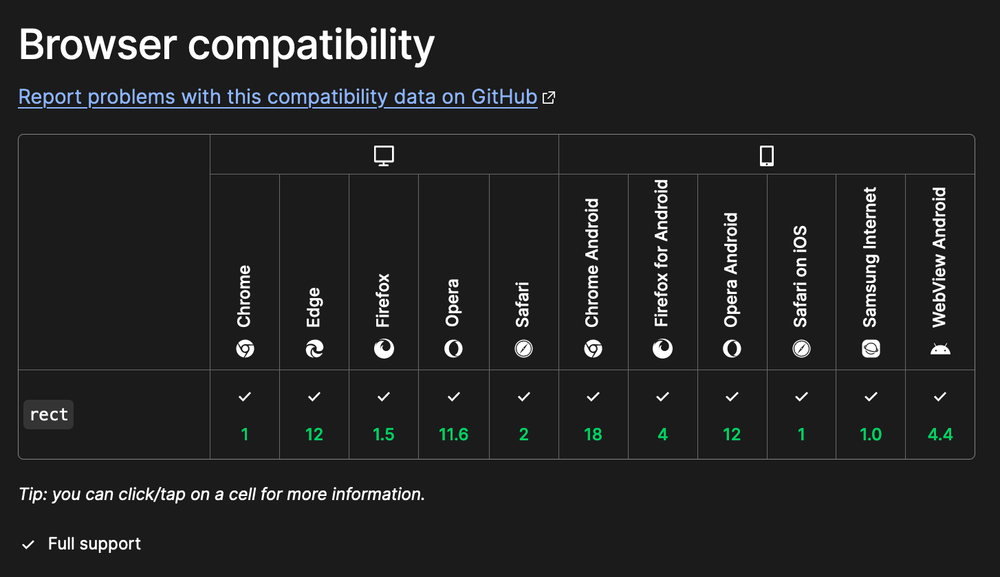

# Testing Browser Compatibility

*A note on testing your fxhash project and ensuring that it is compatible with most modern browsers.*

One thing that you want to do often and frequently while developing your fxhash project, is testing it across different browsers and different devices. Because different browsers are developed by different organisations and may be built in a way such that they interpret web standards differently, there can be variations in how a website or web application is displayed and behaves across different browsers.

Browser compatibility is particularly important for web developers and designers because it ensures that users have a consistent and reliable experience regardless of the browser they choose to use. This is also important in the case of an fxhash project, we want the code that generates our artwork to run consistently on every browser with no variance.

> [!NOTE]
> What is **Browser compatibility?**
>
> Refers to the ability of a website or web application to function correctly and consistently across different web browsers.

Some newer features of Javascript, CSS, and HTML might not be implemented or supported yet in certain browsers, if your code happens to use one of these features and is run in a browser that doesn’t support them, it is likely that your generative artwork will not display correctly or not display at all.

Since it is not possible to anticipate what browser your collectors/audience may be using, you should make sure that your project is compatible with at least the popular modern browsers. Although you can indicate that your project might not work on specific browsers, it is good practice to make the project compatible across all browsers.

One useful resource for this purpose are the MDN web docs which we have already mentioned a couple times throughout the docs. When looking up a specific function, scrolling down towards the bottom of the documentations page will reveal a compatibility table that shows if different browsers support that feature:

Not all browsers are created equal, for instance, although the canvas element is supported by all browsers, not all functions provided by the rendering context are. Hence, you should always test your project in different browser, as well as on different devices, as that may cause additional problems. It is better to catch bugs and errors early on, rather than after having minted the project.
