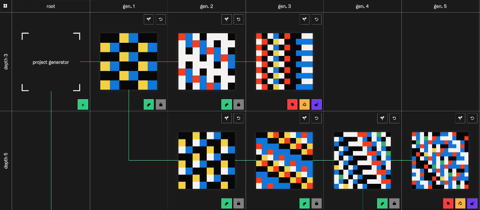
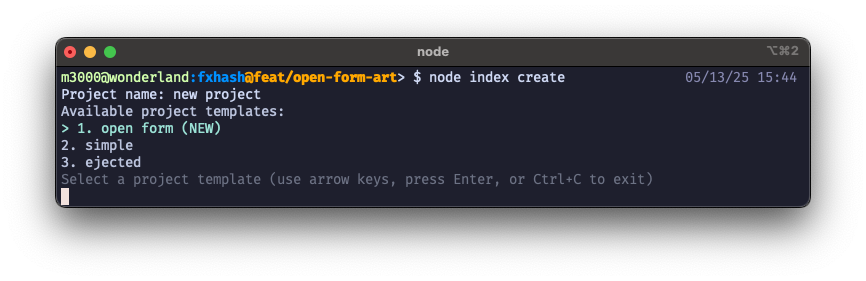
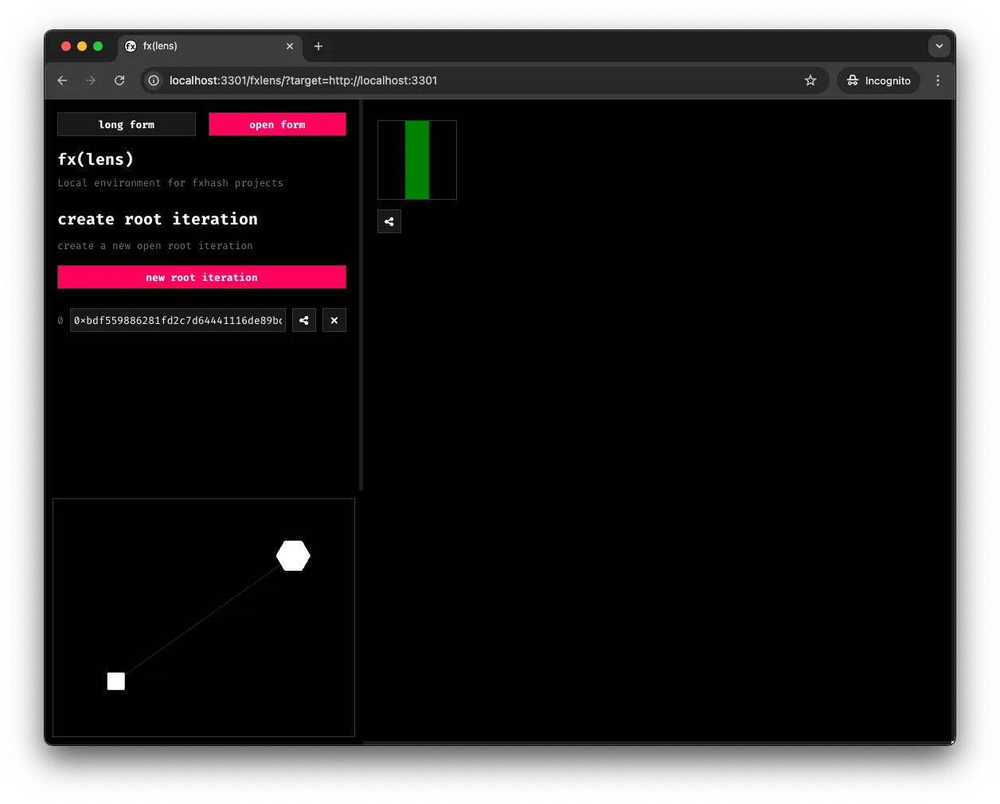
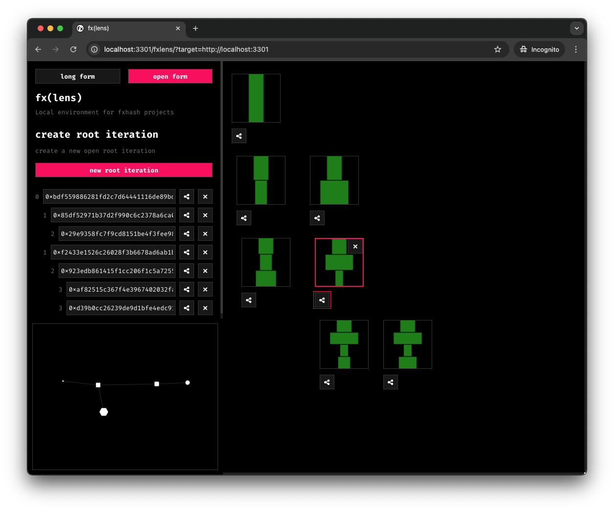
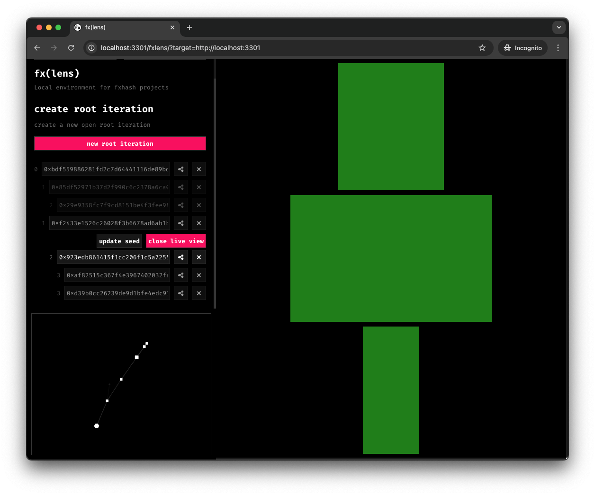
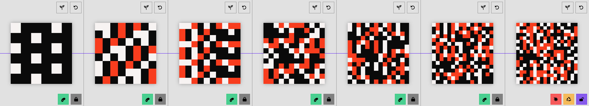
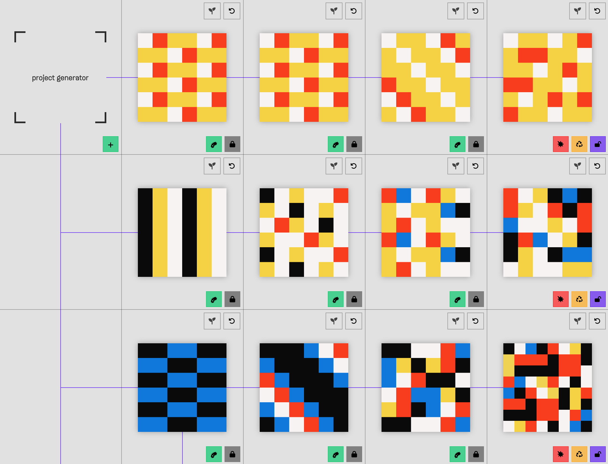
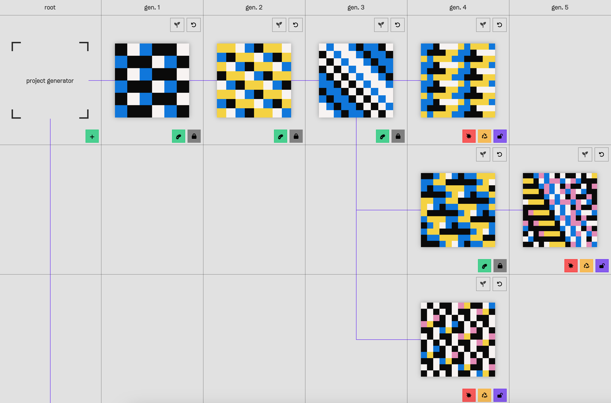

# Programming Open-form Genart

*Practicable notes on seeding open-form generative artworks and crafting interesting projects*

*Building the deterministic randomness of an open-form generative artwork is different from the traditional manner of building a long-form generative artwork. Before tackling this technical resource, learn more open-form genart here.*

---

Similarly to long-form projects, open-form generative artworks still need to be **deterministically random**: the art generating script **should always produce the same output for the same input seed/hash that it derives its randomness off of**.

The difference with open-form generative art, is that **the art generating script now receives an array of hash strings as input**, rather than a single input hash.



**This array is an ordered list of all the elapsed hash strings** associated with the individual tokens that form an evolution lineage.

- New editions collected at the root of a project behave like editions minted from a regular long-form project, they have a simple input hash.
- Editions that are evolved from other editions, receive their own proper new input hash, as well as the hash of their parent, as well as the parent's parent, and so on. In form of an array.
- The last entry in this array is the current edition's assigned hash string.

As an artist this means that you are now designing a new kind of generative algorithm that leverages multiple randomness generators—each seeded by one of the hash strings in the input array.

> [!NOTE]
> Conceptually, open-form projects are systems of systems: each minted edition can be thought of as a generator in its own right that serves as a template to spawn new child editions.

Before diving into the technical details, check out the open-form simulator below to get a feel for how this works—and try it out for yourself [here](https://redesign--seedexplorer.netlify.app/):

> **Video:** [Screen Recording 2025-05-08 at 14.55.30.mp4](../../assets/STorQ8DNpuB6NKkyJWp7-Screen_Recording_2025-05-08_at_14.55.30.mp4)

## API Reference

Developing an open-form genart project introduces a number of new fields in the API:

| Function | Function Signature | Purpose/Effect |
| --- | --- | --- |
| `$fx.lineage` | `string[]` | An array of hash strings. One for each of the parents in an evolved edition's lineage of parent tokens. |
| `$fx.depth` | `number` | Simply a number that represents the number of parents a minted edition has. |
| `$fx.randAt: (depth: number)` | `number` | A random number that's generated by a PRNG seeded by the individual lineage hashes at a given depth. |

### $fx.lineage

Open-form genart introduces a new URL schema where an evolved edition receives all of its parent hashes `{url}?fxhash={hash}#lineage={parent-hash-0},{parent-hash-1},{parent-hash-2}`, in addition to its own hash. In the API you can access the individual parent hashes through the `$fx.lineage` array:

```
$fx.lineage = [{parent-hash-0}, {parent-hash-1}, {parent-hash-2}, {hash}]
```

**Note that in this array, the last hash in the array is the current edition's hash.**

### $fx.depth

The depth of the current iteration. It encodes the number of parents an iteration has.\
It is always equal to `$fx.lineage.length - 1`

```
$fx.depth: number
```

### $fx.randAt()

In regular long-form projects `$fx.rand()` provides a deterministc PRNG that's seeded an individual input hash. Through `$fx.randAt()` you now have access to multiple PRNGs—one for each of the hashes in a token's lineage, accessible by passing the hash's index into the function.

> [!WARNING]
> **$fx.randAt will throw an error ("Invalid depth") if you try to access a PRNG that doesn't exist.**

> [!TIP]
> `$fx.randAt($fx.depth)` and `$fx.rand()` point to the same PRNG, meaning that `$fx.rand()` is simply the PRNG seeded by the last hash in the lineage, which is basically the latest and current hash. Additionally for `$fx.depth == 0`  we have `$fx.rand()`, `$fx.randAt(0)`, and `$fx.randAt($fx.depth)` all pointing to the same PRNG.

The individual randomness generators provided through `$fx.randAt()` are independent of each other. Their invocation of one does not advance the random state of another. For example, the two following examples are identical—the ordering of `$fx.randAt()` only matters for each individual depth index:

```
$fx.randAt(0) // prints 0.11
$fx.randAt(1) // prints 0.83
$fx.randAt(0) // prints 0.52
```

is identical to:

```
$fx.randAt(0) // prints 0.11
$fx.randAt(0) // prints 0.52
$fx.randAt(1) // prints 0.83
```

Each PRNG can also be reset in the following manner:

```
$fx.rand() // 0.4928672278765589
$fx.randAt($fx.depth) // 0.40502416901290417
$fx.randAt.reset($fx.depth)
$fx.rand() // 0.4928672278765589
$fx.randAt($fx.depth) // 0.40502416901290417
```

### Seeding your own PRNGs with $fx.createFxRandom

Besides the new open-form specific API fields there is now also a new `$fx.createFxRandom` function that lets you instantiate your own PRNGs, based on an input hash. This is useful when you want to create an isolated randomness generator, for a specific function or class in your code. Make sure that you check the determinism of your code when doing so, and that the input hash that you are basing this custom PRNG off of is generated in a deterministic manner in your code. This custom PRNG returned behaves just like the regular PRNG fxhash provides.

```javascript
let customHash = "0x31613e9006c9de9a9ccfcfa263b6b42e1404f3abefcf73e8df2f320c7497852c"
let customRNG = $fx.createFxRandom(customHash)

customRNG() // 0.4928672278765589
```

### Caution with $fx.randminter & params in open-form projects

> [!CAUTION]
> While the entirety of the fxhash API is exposed within all projects, the $fx.randminter and params fields are not compatible with open-form projects. Hence these parts of the API should not be used, only the fields outlined in this resource. Otherwise the project will behave in a non deterministic manner.

## Developing open-form projects locally with fxlens

If you've previously developed a long-form project for fxhash and are familiar with the CLI and fx(lens), getting started on developing an open-form project is as simple as running `npx fxhash create` from your terminal. A new **open-form** template option will be available.



Then navigate into the new directory `cd <your_project_folder>` and run `npx fxhash dev`, which will boot up fx(lens) in your browser.

> [!NOTE]
> If it's your first time developing a project for fxhash, [learn all about setting up an fxhash project and the fx(lens) local dev environment here](../project-setup-and-development/README.md).

The structure of an open-form artwork has not changed, it is an index HTML file, an optional CSS style sheet, and a script file that now needs to be configured using the new open-form API. **Your project can still not make networked requests or load in packages from URLs.**

> [!CAUTION]
> In case you plan to develop and release a regular long-form project in the coming days prior to open-form genart going live on fxhash, you need to prevent the SDK from being updated when running the `fxhash dev` command that launches fxlens from the terminal.
>
> > [!NOTE]
> > `npx fxhash dev --noUpdate` : adding the --noUpdate frag prevents updates from being installed when starting the dev server through the terminal.
>
> You can also revert to the previous version of the CLI/SDK with the update command and specifying the correct version:
>
> > [!NOTE]
> > `npx fxhash update --sdkVersion=0.0.13` : installs the last version of the sdk that has no open-form features.

The local dev environment fx(lens) got a new tab that lets you change between the existing “long form” and the new “open form” modes. The UI will help you to explore the lineages of your generative art project. You will see a list of all the hashes. A visual representation of each edition in the lineage. Aswell as a graph visualization of the current tree of generations.



The individual artworks displayed in the open-form UI are captures and not live running artworks. This is done to avoid potential performance problems in case of the generative artwork requiring heavier computations. When evolving lineages in quick succession through the UI captures are queued are queued in the background, meaning that there's always only one live instance of your artwork running at a given time. [html2canvas - Screenshots with JavaScript](https://html2canvas.hertzen.com/) is used for creating the capture—triggered just as normally when you call `$fx.preview()` in your code.

In case you experience problems with captures—please reach out on discord. We are still improving the local capture pipeline.



By selecting one edition from the tree or graph you will enter the already known live mode of the edition. The graph will highlight the lineage of the node. You can now experiment with different hashes of the edition. In case the edition already has children, these updates will then be propagated accordingly.



## Programming open-form genart

In what follows we provide a couple of examples on how to configure randomness in your open-form project, showcasing how `$fx.randAt` in combination with `$fx.depth` can be used for practical purposes. There are a couple of major ways to design open-form mechanics:

1. **Depth-based Traits**: aspects of the artwork that are directly tied to an minted/evolved edition's depth.
2. **Root Traits:** a common characteristic based off of the hash string of an edition minted at the root of an open-form project (first in a lineage).
3. **Inherited Traits (Re-generating Parent Randomness)**: evolved editions inherit traits by recreating/reproducing the random steps parent editions have previously computed.
4. **Random Mutations**: random traits that appear in evolved editions after a certain depth is reached.
5. **Completely Random Traits**: using the seed of the current edition (final seed in the seed list).

### Depth-based Traits

The simplest new mechanic in open-form genart to create an interesting, evolving artwork is by tying visual, or other parameters, of the artwork to the corresponding depth that it's minted at.

For example, in the open-form simulator, the resolution of the pixel grid (its width and height) can increase as the depth of the longer a token's lineage is.



And in your code you'd simply use the `$fx.depth` parameter that's exposed by the API to make this happen.

```javascript
// grid dimensions increase by 2 squares every evolution
const gridWidth = 6 + $fx.depth*2
const gridHeight = 6 + $fx.depth*2

// draw your artwork here
```

One idea here could be tying an obvious visual characteristic of the artwork to the depth, so that it's immediately evident what depth the artwork belongs to.

### Root Randomness

Editions minted at the root of a project (that aren't evolved from another edition and don't have a parent) behave like editions collected from a regular long-form generative artwork.  In root mints `$fx.rand()`, `$fx.randAt(0)`, and `$fx.randAt($fx.depth)` will all point to the same PRNG. From an open-form design point-of-view, this *root randomness* can be used to set lineage defining characteristics.

For example, let's use this *root* randomness to select a color palette to be used in whatever graphics we draw next:

```javascript
// three distinct color palettes
const palettes = [
    ["#0a0a0a", "#f7f3f2", "#0077e1"],
    ["#f7f3f2", "#0077e1", "#f5d216"],
    ["#0077e1", "#f5d216", "#fc3503"]
]

// use root randomness to pick a palette
const palette = palettes[Math.floor($fx.randAt(0) * palettes.length)]

// draw some art here using the palette
```

Keep in mind that the hash string at index 0 of the hash list will be the same for all evolutions/child tokens derived from this root edition. This means that using `$fx.randAt(0)` in this manner will use same randomness to make a palette selection, whether it's the root edition, or the tenth edition down the lineage—the same palette will be picked.

In other terms, the root randomness (randomness derived from the index 0 hash) can be used to select lineage defining characteristics. As a simple visual example, this could be the color palette, giving each lineage of the open-form project a unique characteristic:



This same concept applies to using `$fx.randAt()` at any depth, in case you want a certain behavior to emerge at a specific depth.

### Re-generating Randomness: Trait Inheritance

There is no direct way to pass values from parent editions to child evolutions. However, this is likely a common type of behavior that most projects will aim to implement; where editions pass on traits, characteristics, and variables to their evolutions.

**To achieve this kind of inheritance the open-form script should be designed in such a manner that the evolved editions reproduce the randomness (random selections and randomly generated numbers) that parent tokens have previously computed.**

In practice, this simply boils down to looping over the lineage PRNGs, recomputing the previously made random decisions, and then adding to it with the current edition's randomness. More concretely, we would simply call `$fx.randAt` in a loop, from `0` up until the current `$fx.depth`.

In the following example we are simply constructing a sentence, such that we add a new randomly selected word with each evolution.

```javascript
const words = ['this', 'is', 'a', 'random', 'string']
let phrase = ''

// loop over the hash list
for(let n = 0; n < $fx.depth; n++){
    // add a word to the phrase at random
    phrase += ' ' + words[Math.floor($fx.randAt(n) * words.length)]
}
```

Assuming that our artwork revolves around this constructed sentence in some manner, evolutions will inherit the first part of the sentence that was chained together throughout the preceding lineage, and add their own individual word:

```
gen. 0     gen. 1       gen. 2                 gen. 3

is------>  is this   -> is this random    ->   is this random string
 |
 └------>  is random -> is random string  ->   is random string this
                |
                └-----> is random this    ->   is random this string
```

### L-system Example

A more complicated setting to exemplify this would be an L-system, in which the string is mutated over the course of the collected and evolved editions. Let's assume a simple alphabet and grammar like the following:

```javascript
let alphabet = ['A', 'B', 'C'];

const rules = {
    'A': ['AB', 'AC'],
    'B': ['BC', 'BA'],
    'C': ['CA', 'CB'],
};
```

In this grammar each letter has a couple of replacement options—for an evolved child token we want to choose a replacement option at random and construct a new string that will be the base for the collected edition. The evolution logic would be as follows:

```javascript
/*
    create an initial base string with n distinct letters
    using the root randomness
*/
const baseStringLength = Math.floor($fx.randAt(0) * 4) + 1;
let currentString = '';
for(let i = 0; i < baseStringLength; i++){
    currentString += alphabet[i];
}

// compute the replacement string depending on the depth
for(let i = 0; i < $fx.depth; i++){

    let replacementString = '';
    for(let n = 0; n < currentString.length; n++){
        let replacement = rules[currentString[n]][Math.floor($fx.randAt(n) * 2)]
        replacementString += replacement;
    }
    
    currentString = replacementString;
}

// use the computed string for art purposes in what follows
```

This behavior would look as follows:

```
Iteration 0:            A               B            C
                    ┌───┴───┐       ┌───┴───┐     ┌──┴──┐
Iteration 1:        A       B       B       A     C     B
                  ┌─┴─┐   ┌─┴─┐   ┌─┴─┐   ┌─┴─┐ ┌─┴─┐ ┌─┴─┐
Iteration 2:      A   B   B   A   B   C   A   C  ...
```

### Pitfalls to avoid

While the API might seem minimal, open-form genart comes with its own complexities; your code always needs to account for the existence—or non-existence—of hashes depending on its mint depth.

**Besides the regular determinism pitfalls that you should avoid —** [**some of which we have outlined here**](../genart-in-the-browser/deterministic-randomness.md) **— there likely are many scenarios that could cause the deterministic evolutionary sequence of your open-form projects to break. Make sure to carefully design your open-form randomness and test your project plenty ahead of release.**

As an example, one scenario that comes to mind are conditional blocks that assume the existence of a specific depth. What's the problem with the following block of code?

```javascript
const words = ['this', 'is', 'a', 'random', 'string']
let phrase = ''

for(let n = 0; n < $fx.depth; n++){
    if($fx.depth > 4){
        phrase += ' ' + words[Math.floor($fx.randAt(n) * words.length)]
    }
}
```

Inside of the for loop we're assuming a certain depth/length of the hash list that might not exist yet when the code runs. For the first three minted/evolved editions the loop will simply not do anything, and the phrase string will be remain empty—whereas on the fourth evolution it will do a sudden jump and catch up with the suddenly filled hash list, likely resulting in a random artwork that does not follow the intended open-form progression.

### Random Mutations

In addition to having root traits for individual lineages, as well as traits that are passed on between evolutions,  you'll likely also want to spawn new random traits sometimes.

This involves adding a small algorithmic chance to make a modification appear at random, at a certain depth. In the open-form simulator there's a small chance for new colors to appear after depth 4 has been reached.



Let's revisit our color palette example from earlier—assuming that we're selecting a base palette with the root randomness, we could randomly append a new color to the selected palette:

```javascript
// three distinct color palettes
const palettes = [
    ["#0a0a0a", "#f7f3f2", "#0077e1"],
    ["#f7f3f2", "#0077e1", "#f5d216"],
    ["#0077e1", "#f5d216", "#fc3503"]
]

// some other colors to inject randomly
const otherColors = ["#584594", "#e488b7", "#d74c41", "#f0d235", "#36ad63", "#69bcea"]

// use root randomness to pick a palette
const palette = palettes[Mat.floor($fx.randAt(0) * palettes.length)]

// draw some art here using the palette
// after the fourth generation select
if($fx.depth > 3){
    for(let n = 0; n < $fx.depth; n++){
       // small chance to add a random color to the palette
       if( $fx.randAt(n) > 0.99 ){
          palette.push(
             otherColors[ Math.floor( $fx.randAt(n) * otherColors.length ) ]
          )
       }
    }
}

// create the artwork here
// make sure the altered palette doesn't break the sequencing/pattern though
```

This random chance could also be made relative to the depth, such that as the depth increases, the more likely it becomes for these random traits to appear—as an additional incentive for collectors to explore the open-form tree in a depth-first manner.

### Random Traits

In case you would like to have completely random deterministic aspects for your artwork, you can simply use the last hash in the lineage array—essentially the native hash of the current edition.

```
$fx.randAt($fx.depth)
```

## Conclusion

Keep in mind, you'll want to design your randomness in such a way that collectors are incentivized to collect your open-form project horizontally and vertically—exploring its parametric space in full, and participating in shaping and curating an interesting collection.

Make sure to also read through the other sections provided in the open-form docs.
