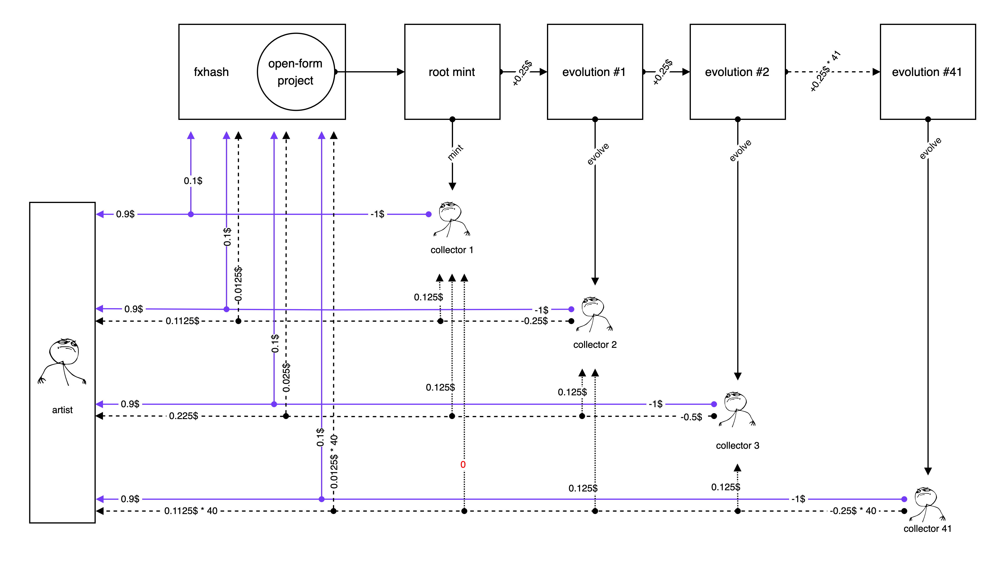

# Open-form ↔ Art Coin: Mechanics & Economics

*Art coins are project native currencies linked at the contract level. They enable new mechanics, unlock alternative value around your work, and incentivize interaction at scale.*

Open-form generative art introduces a new model for how collectors interact with generative projects on fxhash. Each open-form project is linked to its **own art coin**—a dedicated ERC20 token deployed on the Base L2 chain. This art coin powers all collector interactions with the project, including minting, burning, re-rolling, locking, and evolving NFTs.

Art coins establish onchain economic systems that reflect collector interest, scarcity, and market demand. This page provides an overview of how open-form mechanics work, the role of art coins, how fees and royalties are structured, and how artists and collectors both benefit from this flexible framework.

## Open-form mechanics overview

Open-form project editions can be **minted**, **burned**, **re-rolled**, **locked** and **evolved** 👇

### **Mint**

Minting a new edition from an open-form collection incurs two fees for collectors:

1. **Purchase cost/price in art coin**: X amount of art coins. **This amount of art coins is escrowed (temporarily deposited) in the contract at time of purchase.**
2. **Mint fee in Base ETH**: a mint fee directly paid out to the artist. This mint fee is initially set to be the same for all projects on fxhash. A minimum value applies to the mint fee.

**Both art coin price and mint fee are set by the artist.**

> [!NOTE]
> Editions collected from open-form projects are regular NFTs (ERC721 tokens) that can be traded and sold on secondary just like normal editions from long-form projects.

### **Burn**

Collected (and evolved editions) of an open-form project can be burned by their holder (unless they are locked). This **destroys the NFT** and **refunds the collector with the amount of art coins spent to mint or evolve it**.

There is no mint fee attached to burning an open-form edition.

> [!NOTE]
> Traditionally, for ERC721 NFTs, "burning" means sending the NFT to a burn(er)/dead wallet, that isn't owned by anyone, and from which the NFT can't be retrieved anymore. In essence a crypto trash-can.

### **Re-roll**

After you mint (or evolve) an edition, you can **re-roll** it to get a new one. In the background the NFT is burned and a new NFT with a different random hash is minted. This means that:

1. The collector is first refunded with the amount of art coins they spent to initially mint/evolve the NFT.
2. Then minting the new edition with a different hash will directly spend that same amount of art coins again (escrowing them in the contract again) and incur a mint fee in Base ETH.

Effectively, re-rolling only incurs a mint fee in Base ETH.

### **Lock**

Locking an open-form mint immutably locks its metadata. Once locked:

- the NFT can not be unlocked anymore.
- the NFT can not be burnt (and consequentially not re-rolled) anymore.
- the NFT can now be evolved.

Locking does not incur any fee. An open-form edition can be traded on the secondary market just like a regular NFT, whether it is locked or not has no influence on this. Locked mints remain locked even when traded.

Locking an open-form mint permanently locks the escrowed art coins in the contract.

### **Evolve**

Locked open-form mints can be evolved. Evolving a mint creates a new child NFT that is linked to its parent on the contract level. The child NFT receives its own random hash, in addition to inheriting its parent's random hash, it's parent's parent random hash, and so forth. In form of a list/array.

In essence an evolved NFT has access to all random hashes that lie between itself and the root mint that it is a descendant of. **We call this a lineage.**

> [!NOTE]
> How this evolution mechanism is defined is entirely up to how the artist has configured their generative script. [Learn more about programming an open-form generative artwork here](README.md).

- Evolving does not destroy or consume the parent NFT.
- An evolved edition can be burned, re-rolled, locked, and evolved, just like a normal open-form mint.

Similarly to minting a new edition, evolving an edition incurs both a:

1. **Purchase cost/price in art coins:** Escrowed in the contract just like before until the token is locked.
2. **Mint fee in Base ETH + evolution fee:** Paid out to the artist, fxhash, in addition to holders of the evolved token's lineage parents. Explained in more detail in the [Lineage royalties & evolution fee](open-form-art-coin-mechanics-and-economics.md#lineage-royalties-and-evolution-fee) section.

### Summary

| Action | Action Cost (in Art Coin) | Circulating Supply | Action Fee (in Base ETH) |
| --- | --- | --- | --- |
| **Mint** | -X | Escrows X Art Coins | -fee$ |
| **Burn** | +X | Releases X Art Coins | – |
| **Reroll** | – | — | -fee$ |
| **Lock** | – | Locks X Art Coins | – |
| **Evolve** | -X | Escrows X Art Coins | -fee$ |

> [!NOTE]
> Naturally, there is also a gas fee attached to all transactions above.

## Lineage royalties & evolution fee

**Evolving open-form mints adds an extra "evolution fee" on top of the base mint fee.**\
This evolution fee increases based on how many times the edition has already evolved — in other words, how deep it is in its lineage. Each new evolution adds a flat amount to the mint fee, so the deeper the lineage, the higher the cost to evolve.

**Collectors earn royalties when their editions (or their descendants) are evolved.**\
They receive a share of the base ETH mint fee paid during the evolution.

Let’s use simple numbers to illustrate how the mint and evolution fees are distributed, assume the following dummy numbers for an open-form project:

- **Base mint fee**: $1
- **Evolution fee**: +$0.25 per depth
- **Current depth**: 3 evolutions (Collector 3 holds the 3rd evolution)

When a new collector evolves the third token in the lineage to create a new, 4th evolution, the **total evolution mint fee to be paid by the collector:**

> [!TIP]
> #### **$1 (base fee) + $0.25 × 3 (depth) = $1.75**
>
> This $1.75 is distributed as follows:
>
> - **The artist receives $1.2375:** $0.90 from the base fee (90%) + $0.1125 × 3 = $0.3375 from the evolution fees (90% of 50% of each $0.25)
>
> - Each prior lineage collector receives 50% of one $0.25 evolution fee:
>
>   - **Collector 3** (depth 3): $0.125
>   - **Collector 2** (depth 2): $0.125
>   - **Collector 1** (depth 1): $0.125
>
> - **fxhash receives $0.1375:** $0.10 from the base fee (10%) + $0.0125 × 3 = $0.0375 from the evolution fees (10% of 50% of each $0.25)

Evolution fees are paid out to the previous 40 lineage collectors. If an evolved mint has more than 40 ancestral tokens, no royalties are paid out to any earlier collectors. For example, if a depth of 41 is evolved, collector #1 does not receive a royalty.

This does not cap the actual fee however, which continues to increase with further evolutions even after a depth of 40 is reached—50% of the accumulated evolution is distributed in equal to those 40 collectors.

> [!NOTE]
> For an initial period of time, open-form editions can be evolved by anyone, and not just their owner. Collectors will able to toggle this option on their collected NFTs later on, deciding if they make their collected editions available for others to evolve.

## Art coin price & scarcity dynamics

Interacting with an open-form project—by minting, burning, locking and evolving editions—has a direct effect on the associated art coin's supply.

- **Minting a new edition**, or **evolving** an already existing edition, temporarily removes that amount of art coins from the overall circulating supply. This amount of art coins is inaccessible as long as the NFT isn't burned.
- When **burning** an edition, the collector **regains the spent amount of art coins**. These coins re-enter the circulating supply and can be sold by the collector for $FXH.
- **Locking an edition permanently locks the art coins in the contract**, effectively removing them from the circulating supply.

**As more editions are permanently locked, the overall circulating supply shrinks.** This means that a smaller number of coins is left for the market, and needs to be shared among collectors and traders.

This doesn't immediately increase the art coin's value, but increases the art coin's scarcity—an indicator that there is demand for the project, which can place upward pressure on the value of the remaining coin supply.

**As the art coin's price fluctuates, depending on market activity, the effective price of a project in art coins regulates itself.** This also depends on the effective price of the $FXH token.

---

Dummy numbers to show how increasing the price per mint in an open-form edition locks a higher percentage of a fixed 1 million art coin supply (as mints are permanently locked).

| # of locked mints | art coin price per mint | % of locked supply |
| --- | --- | --- |
| 1000 | 5 $art | 0.5% |
| 1000 | 25 $art | 2.5% |
| 1000 | 50 $art | 5% |
| 1000 | 100 $art | 10% |

## How do artists profit from their art coin(s)?

While open-form projects already provide a direct revenue stream through the mint and evolution fees, a project's associated art coin enables secondary streams of revenue. Artists can earn through:

- **Sale of their art coin holdings**: artists are required to reserve a minimum starting supply when creating their open-form project and kicking off the bonding curve launch of their art coin—ranging anywhere between 10 to 30% of the art coin's overall 1M supply.

  With the success of the linked open-form project(s), the art coin's valuation will prospectively increase in value, allowing artists to capture this gain through the sale of these initial holdings. This can be done through the fxhash interface or a DEX.

- **Capturing liquidity pool transaction volume**: when art coins graduate, the invested $FXH and the art coin reserve is migrated to a primary liquidity pool on the open market, through which the art coin can be freely traded. Artists receive 0.75% of the trades that happen on this primary art coin ↔ $FXH liquidity pool (0.75% of the cumulative volume).

  > [!NOTE]
  > *This 0.75% is also captured from the trades happening during the bonding curve launch.*

Revenue earned from an open-form project and its associated art coin depends on a number of factors as well as the selected starting parameters artists choose, we cover this in more detail and share some example scenarios in an upcoming page.

## Multi-project art coins

**One art coin can be linked to multiple projects.** Artists can create an art coin:

- for a single project.
- for a series of projects.
- for an entire body of work.

**Why link multiple projects to a single art coin?** Similarly to how the supply of an art coin directly reflects interest in a single project, the same concept applies when the art coin is used as a shared currency by multiple projects.

Artists seldomly release only a single project and call it a day—art coins make it possible to group projects in a continuous, *liquid* fashion and link them in more than just a semantic manner.

- **First Project:** When launching the first project with a new art coin the artist sets how many **art coins are required to mint or evolve** an edition. This implicitly creates an edition size for the project based on the one million art coin supply.
- **For any future projects linked to the same art coin**: the artist chooses the **number of editions** they want to allocate for the remaining supply of the art coin—the **price per edition** is then automatically calculated.

This process can be repeated indefinitely, and the prices for earlier projects remain unchanged. Because the supply of art coins is fractional, the remaining supply of an art coin can always be allocated to new projects — even if most of it is already locked away by collectors minting and evolve.

An important note here, is that linking a **new project** to an existing coin is **not the same** as updating the code of the same current project.
