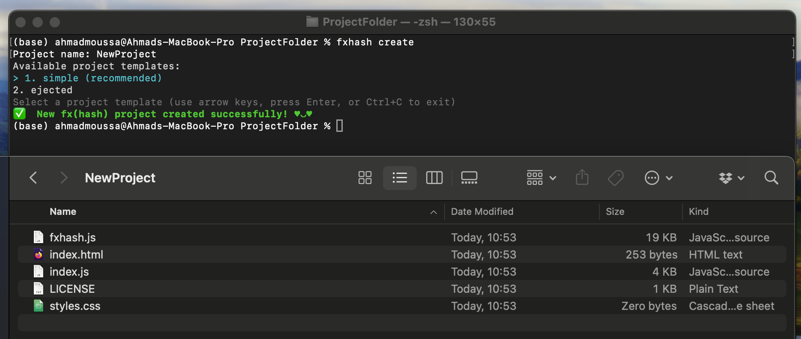
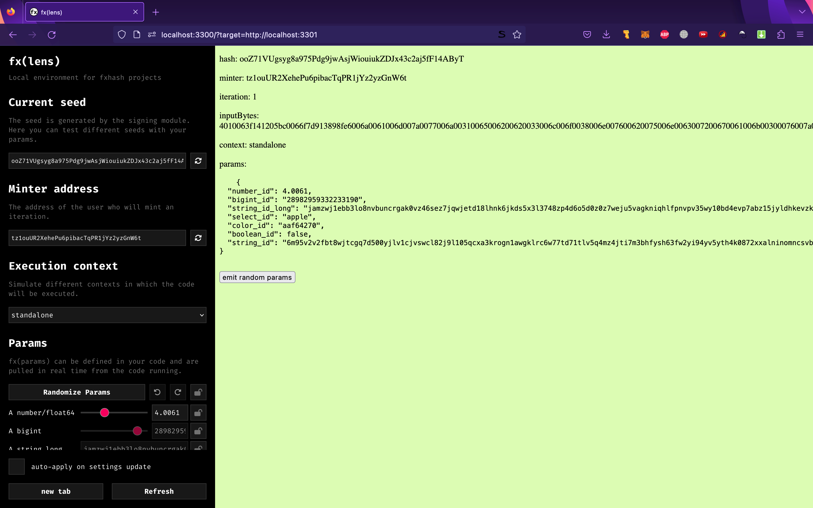
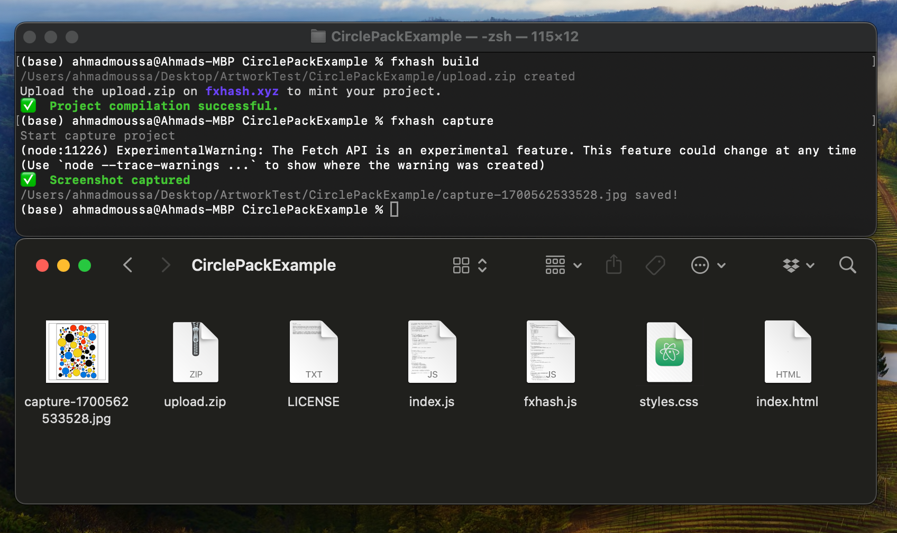
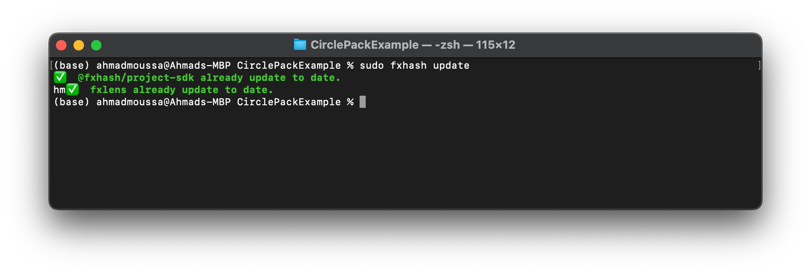

# CLI Reference

*In this section we have a brief look at how to use the CLI, and will have a more detailed look at the individual CLI commands.*

### CLI Commands Overview

| **Command** | **Options** | **Description** | Default |
| --- | --- | --- | --- |
| `fxhash create`<br>Creates a blank fx(hash) project. Allows you to choose between several starting templates. | `—` | `—` | `—` |
| `fxhash dev [options]`<br><br>Runs your project inside fxlens, the fxhash development environment. | `--portStudio` | The port fxlens is served on. | `3300` |
|  | `--portProject` | The port the project is served on. | `3301` |
|  | `--srcPath` | The path to the source of the project. This is just relevant for ejected projects that actually have a nested structure. | `/src` |
| `fxhash build [options]`<br>Creates a bundled version of the project directory. The output file will be called `upload.zip` and can be uploaded as it is on fxhash.xyz. | `--minify` | Enable minification when creating the bundle. | `false` |
|  | `--noZip` | Disable the zip file creation. | `false` |
|  | `--srcPath` | The path to the source of the project. This is just relevant for ejected projects that actually have a nested structure. | `/src` |
| `fxhash update [options]`<br>Will update the whole fxhash environment. It will download the latest version of fxlens and the fxhash-snippet. Optionally you can inject the latest snippet into your html file. | `--srcPath` | The path to the source of the project. This is just relevant for ejected projects that actually have a nested structure. | `/src` |
| `fxhash eject`<br>Will eject your project into a nested structure. It will copy all your code into a `srcPath` (Default: `/src`) and create a `package.json`file in the root of your project. This will allow you to configure any custom tooling you like while still being able to use the `@fxhash/cli` in your ejected project. | `--srcPath` | The path to eject the code into. If you set a custom path here you also must specify this path to the other commands. |  |
| `fxhash add <package@version>`<br>Installs existing libraries. Beside being a convenience feature. This ensure that you are reusing existing libraries from the ONCHFS, which reduces the costs of storing your project on-chain 😎. | `--list` | Lists all existing libraries that can be imported | `—` |
|  | `--inject` | Will also inject a `<script />` tag into your projects html entry point pointing to the downloaded library |  |
| `fxhash capture [options]`<br>With the capture command you can test your bundled project agains the fx(hash) capture module. For params token you currently **must** provide the inputBytes yourself. You can copy the inputBytes from the url when you are running the `fxhash dev` command. | `--zip` | The path (absolute or relative) to the project's zip file you want to create the capture of. | `upload.zip` |
|  | `--hash` | The hash that is injected when the capture is taken. | random hash |
|  | `--minter` | The minter address that is injected when the capture is taken. | random address |
|  | `--iteration` | The iteration number that is injeted when the capture is taken. | 1 |
|  | `--inputBytes` | The inputBytes that are injected when the capture is taken. | `undefined` |
|  | `--x` | The width in pixels. Capped at 2560. | `800` |
|  | `--y` | The height in pixels. Capped at 2550, | `800` |
|  | `--trigger` | The trigger mode. Either DELAY or FN_TRIGGER. | `delay` |
|  | `--delay` | The delay in ms for the trigger mode DELAY. | `3000` |
|  | `--selector` | The id of the canvas element to capture. | `—` |

### `fx(hash) create`

> [!NOTE]
> **Creates a new project directory that contains the fxhash template.**

Once you've installed the CLI, you can conveniently create a new and blank fxhash project with the `fxhash create` command. Running the command will spawn a new folder in the current terminal directory. This folder will essentially contain the boilerplate files.



*Running the `fxhash create` command in the terminal + the files that it spawns*

The command will ask you to provide a name for your project and additionally ask you to choose a template—currently there are two of them:

- **Simple Template:** If you are new to the platform and/or don't need any special customization, we recommend starting with the simple template.
- **The Ejected Template:** Needs an explanation of the ejected template

The `fxhash create` command has no options.

### `fxhash dev`

> [!NOTE]
> **Runs your project inside fxlens, the fxhash development environment.**

The `fxhash dev` command can be used when you navigate into the directory that is created with the `fxhash create` command. This will launch your project inside the fxhash's fxlens development environment and automatically opens up a new tab in your default browser.

If you haven’t already written some code for your artwork in the `index.js`, it will show the following default screen:



*The default boilerplate will display a bunch of text in the main area of the browser window that represent some default debug information.*

The panel on the left-hand side is fxlens, fx(hash)’s interactive project viewer that comes out of the box with the CLI. [fx(lens) is explained in more detail here](https://www.notion.so/fx-lens-8ab5e856c9054621a0796fde107aac80?pvs=21), it provides a number of functionalities for testing the determinism of your generative artwork and is an important tool for building fx(params) pieces.

The `fxhash dev` command runs two local servers, one for the project itself, and another for the development environment that displays the project in a nested manner. The options let you set the ports on which these local servers run:

- `--portStudio`:
- `--portProject`:
- `--srcPath`:

> [!WARNING]
> `fxhash dev` automatically checks and updates itself when it is run.

### `fxhash build`

When your artwork is ready for being minted it should be uploaded to fx(hash) in the form of a `.zip` file. The CLI provides the `fxhash build` command that bundles all of your project files as such a `.zip`. This will create an `upload.zip` file in your project directory, that can later be drag-n-dropped into the fx(hash) minting interface.

> [!WARNING]
> Before you upload a project to fx(hash) however make sure to read the rest of the artist guides to ensure that your project works correctly and is properly configured to be compatible with the platform. fx(hash) can not check this for you.

### `fxhash capture`

The CLI also lets you test the appearance of your project once it’s iterations have been collected on fx(hash). For this you’ll first have to bundle your project with the `fxhash build` command, to then subsequently run the `fxhash capture` command which will then generate a jpg of the artwork, here’s what this would look like:



The capture command provides a number of options to specify some of the information that needs to be fed into the token to generate specific captures, and to control how the capture should be taken. They are detailed in the overview table above.

### `fxhash update`

> [!NOTE]
> `fxhash update` command updates the CLI and all of it’s features to the latest version, in case that there is a newer version.



### **Configuring Default Options with** `.env`

When you run the CLI commands, it checks for a `.env` file inside the current difrectory. The `.env` file allows you to overwrite the default options of the various commands—for example if you want to run fxlens and your project on different ports:

```html
PORT_PROJECT=3301
PORT_STUDIO=3300
SRC_PATH=/src
MINIFY=false
```

This way you can customize how the CLI behaves for different projects.

> [!NOTE]
> **Options passed in manually to commands still always override what's set in the \`.env\` file.**
