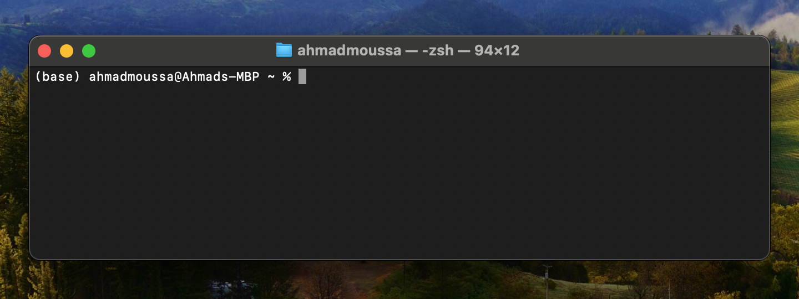
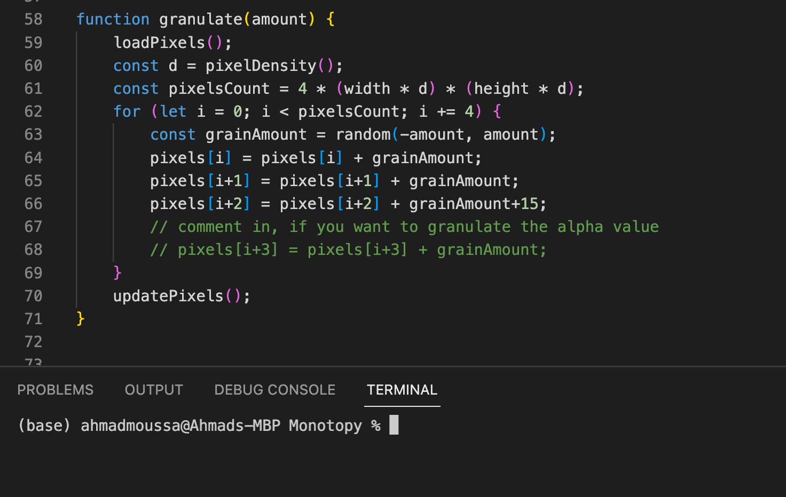
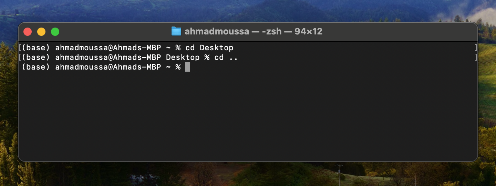
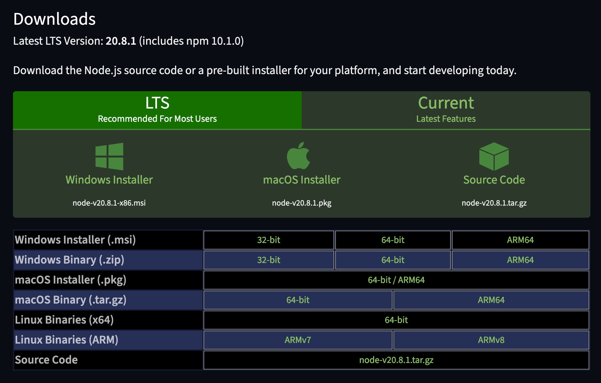
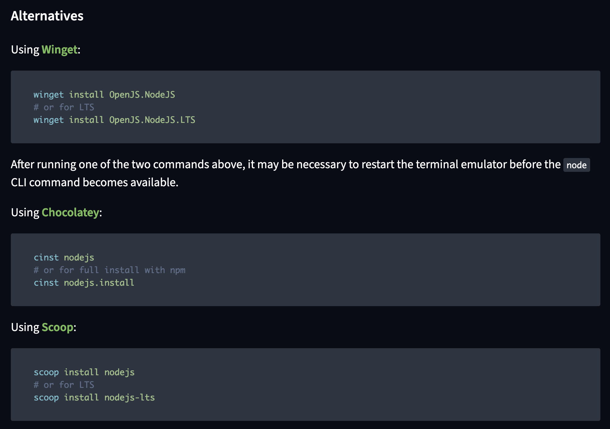

# CLI Setup

*This page provides an introduction to the fx(hash) CLI - Command Line Interface - a helper tool that simplifies the development process of an fx(hash) project.*

Whereas the Starting Template provided a simple and minimal starting point for creating new projects, the CLI will allow us to get a bit more hands on and provides a number of useful functionalities for the purpose of developing a project, running it locally, as well as testing it.

If you’re relatively new to programming, the learning curve of what follows might be a bit steep, as there's a number of new notions that we'll have to familiarise ourselves with, and will have to set up a couple of things on our machines. But we'll tackle one thing at a time. To provide a quick overview, in this section we will:

- Learn about Command Line Interfaces (CLIs)
- Learn a little about Node.js and the Node Package Manager (NPM) with which we’ll install the fx(hash) CLI
- Subsequently install the fx(hash) CLI
- Use the fx(hash) CLI to set up a blank fx(hash) project

> [!NOTE]
> Using the fx(hash) CLI is completely optional. It is simply intended for streamlining the development process of a project by providing all of the fx(hash) artist tools in a single place. You should however still give this page a read and decide for yourself if the functionality it provides might be useful for your own workflow.

### **What is a CLI?**

**A Command Line Interface (CLI) is a text-based interface for interacting with a computer via text commands.** A CLI is also often referred to with the following terms: console, terminal, command line, command prompt. These terms can be used interchangeably.

CLIs stand in contrast to graphical user interfaces (GUIs) that most are familiar with, where we navigate and interact with the computer through visual elements like icons and buttons. A CLI relies on text-based commands and responses to do so.

> [!NOTE]
> **What’s the difference between a CLI and a GUI?**
>
> The abbreviations **CLI** and **GUI** stand for the terms **Command Line Interface** and **Graphical User Interface** respectively. Modern operating systems generally make use of GUIs to allow users to navigate directories, manipulate files, and interact with applications in a visual manner.
>
> Operating systems also come equipped with a CLI that lets you perform all of these tasks via text based commands. CLIs are often preferred by developers and power users for several reasons, including efficiency, automation, and the ability to perform advanced tasks, where certain tasks can only be performed via terminal commands.

Here's an example of what the terminal looks like on a Mac:



*The terminal on Mac OS*

You can often also find a terminal integrated within certain code editors like VSCode:



*Terminal inside the VSCode editor*

Within CLIs you can write specific commands to navigate directories, manipulate folders and execute certain programs:



*For example, here we navigated to the Desktop directory via the `cd` command, and then returned back to the parent user directory with `cd ..` . These commands vary between different operating systems.*

In this section we'll have a look at the fx(hash) CLI, a tool that provides a number of commands to help with the creation and development of fx(hash) projects - we'll cover how to install this CLI, explain some of the required tech that it needs to function, as well as how to get a project started with it.

> [!NOTE]
> **What’s the difference between a Command Line Interface and a Command Line Tool?**
>
> The term **Command Line Interface** is often used interchangeably with the term **Command Line Tool**.
>
> Whereas a CLI is the overall environment or interface that allows users to interact with a computer or software via text-based commands (the text box into which you type the commands), a command line tool is a specific software application that can be executed from the CLI to perform particular tasks.

### **Node.js and the Node Package Manager**

To use the fxhash CLI we need to have node.js and the node package manager installed on our machine. If you're familiar with these tools and have used them before, you can skip to the next section for the installation instructions, if not, read on.

> [!NOTE]
> **Why do we need Node.js and the Node Package Manager?**
>
> The fx(hash) command line tool comes in the form of a node package, which can be installed with the node package manager. We're actually not going to use node except for the purpose of installing the fx(hash) CLI. Hence you don't have to worry about learning Node.js - we'll just give a brief overview before we guide you through the installation steps.

*If this is your first encounter with node, here's a brief overview.*

Node.js not a programming language, and it's also not a framework or library - but rather it's a runtime environment that allows you to run Javascript code outside of the browser. It is usually used to run Javascript code on backend servers to run javascript code server-side. Over the years it has become a popular and established tool for building various types of web applications.

NPM, is short for node package manager, and as the name suggests is used to install node packages made by third parties. These packages are bundles of Javascript code that solve specific problems or accomplish particular tasks - they're generally intended for reuse in other projects; you can think of them as lego blocks. The node package manager takes care of the distribution of these packages, and we’ll be using it to install the fx(hash) CLI that is itself a node package.

> [!NOTE]
> What's cool about npm is that it also takes care of version control - if the fx(hash) team pushes an update to the CLI, you can simply check for this update with a simple command from your terminal.

Overall, it's definitely a more advanced tool - it introduces a lot of new things that might take some practice to get used to. Although you don't actually need to know that much about Node to use the fxhash CLI (you can simply skip to the next section at this point) - if you want to learn more about what Node is and how it functions, the official node docs provide a slightly technical starting point:

- [Node.js — Introduction to Node.js](https://nodejs.org/en/learn/getting-started/introduction-to-nodejs) — nodejs.org

If you want an alternative more lighthearted introduction to node in video format, we recommend this video by Fireship:

> **Video:** <https://www.youtube.com/watch?v=ENrzD9HAZK4>

### **A quick guide to installing Node & NPM**

Let's start with installing Node - there's a number of different ways to do so, the easiest of them being through the main website with an installer, you can [find the official page here](https://nodejs.org/en/download)



Otherwise you can install node via the terminal - the instructions for this can differ depending on what operating system you're working on. Since most users are probably running Windows or macOS, we'll cover these two scenarios. [Instructions for installing Node on other types of operating systems can be found here](https://nodejs.org/en/download/package-manager)

#### Installing **Node on Windows**



#### Installing **Node on macOS**

Here we've got a couple of options, either via a curl command:

```
curl "https://nodejs.org/dist/latest/node-${VERSION:-$(wget -qO- https://nodejs.org/dist/latest/ | sed -nE 's|.*>node-(.*)\.pkg</a>.*|\1|p')}.pkg" > "$HOME/Downloads/node-latest.pkg" && sudo installer -store -pkg "$HOME/Downloads/node-latest.pkg" -target "/"
```

Or with via homebrew:

```
brew install node
```

In both cases simply copy paste the command to your command line and hit enter.

#### **Checking your Install**

To check if node has been installed correctly, run the following command from your terminal:

```
node -v
```

If it prints a number such as `21.0.0` to the console then you're good to go. If it tells you that the node command is not recognized, then something went awry.

> [!NOTE]
> You're always more than welcome to consult the fxhash discord - the team members and community are always more than happy to help your troubleshoot any issues that you might be running into. Also make sure to consult the FAQ page to check if you’re running into a common issue.

#### **Node & NPM Version Requirements**

On last thing here, for the the fxhash CLI make sure that you have a node version higher or equal than `18.0.0` and and npm version higher or equal than `9.0.0`. You can check this via `node -v` and `npm -v`.

> [!NOTE]
>  **Installing node also automatically installs npm on your machine.**

### **Setting up the fx(hash) CLI**

If you’ve completed the previous steps, it means that you’re all set and you've successfully installed node.js and npm on your machine. We can now proceed to install the fx(hash) CLI with npm. This can be done with the following command:

```jsx
npm i -g fxhash
```

The letter `i` here simply stands for `install`, and you could also equivalently write `npm install -g fxhash`. Moreover, the `-g` flag stands for `global`, meaning that the package is installed globally on your system, making it such that the fx(hash) CLI tool can be run from anywhere on your system, without you having to reinstall the package every time you start a new project.

> [!WARNING]
> The terminal might throw an EACCES error when you run this command, which is related to permissions issues and is typically triggered when you're trying to install things with the global flag. Running the command again with with admin rights by prepending `sudo` to the command should fix this. This will prompt you to enter your password.

If you've completed the above steps you're done setting up - the fx(hash) CLI should now be installed on your machine and ready for you to use. In the next page we'll talk in more detail about using the fx(hash) CLI, use it to create a new project, and have a look at the other terminal commands it provides.

### **Running CLI commands with NPX**

One last thing to point out here, is that once you've installed node.js you also get access to the npx command. In contrast to npm that installs packages on your system, npx lets you execute node packages directly without having to install them - meaning that you can directly set up a new fxhash project with:

```jsx
npx fxhash create
```

By prepending the `npx` command you can now run the the fx(hash) CLI command without having to install it with the `npm i -g fxhash` command first, but this is simply a matter of preference.
