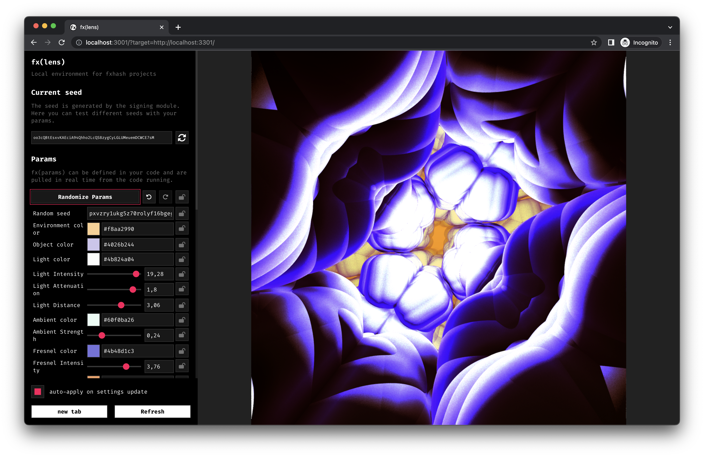
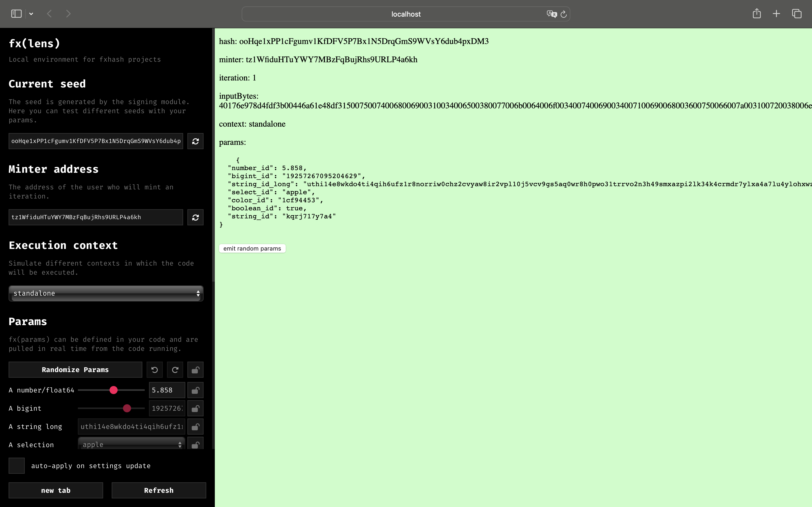
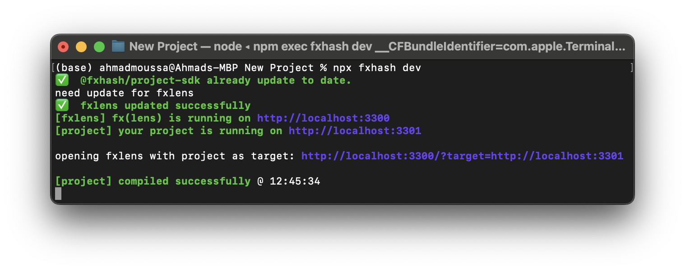
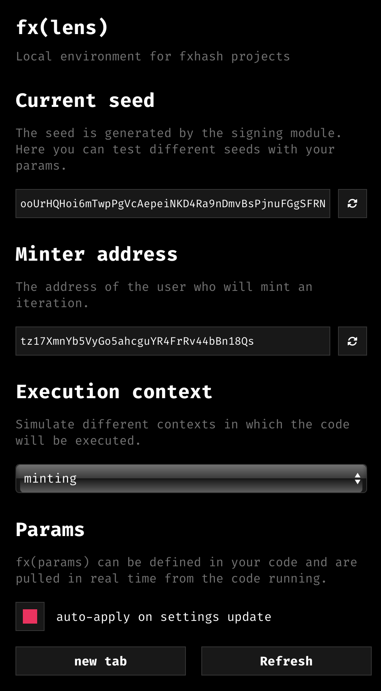
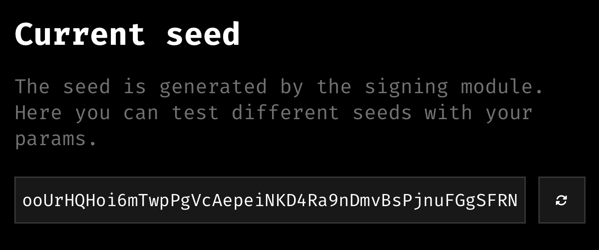
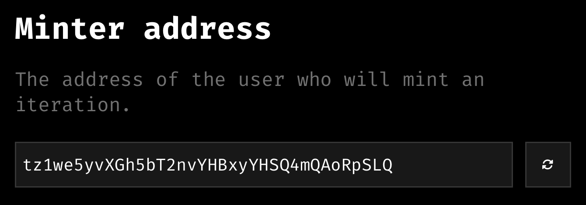
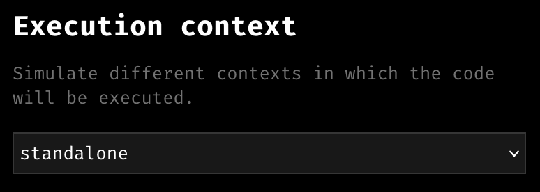
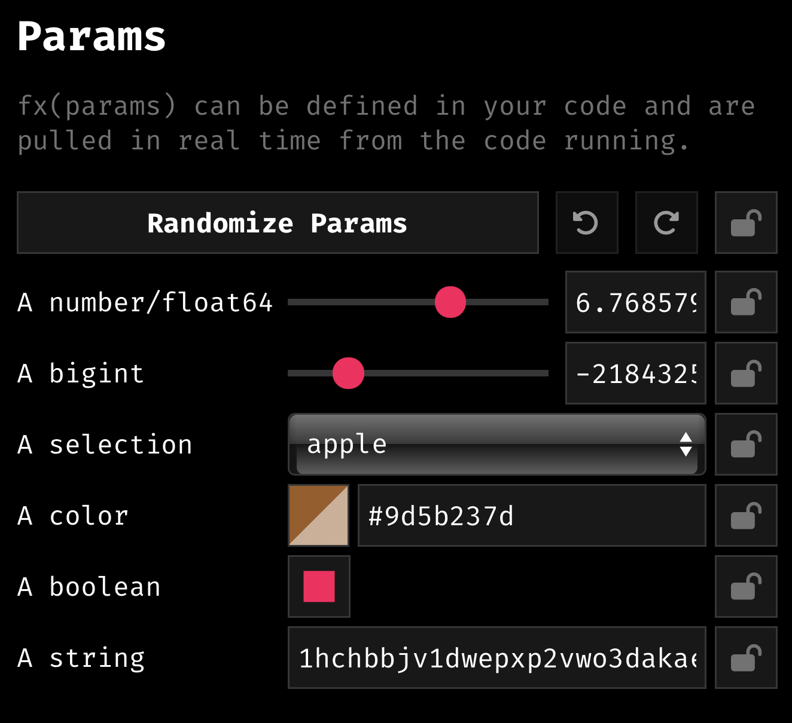
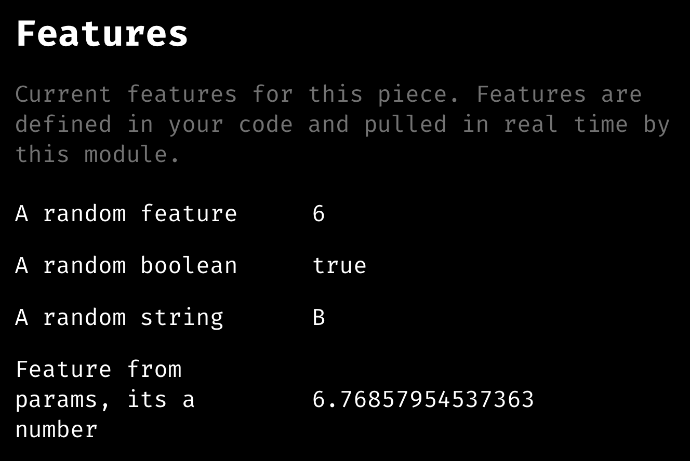
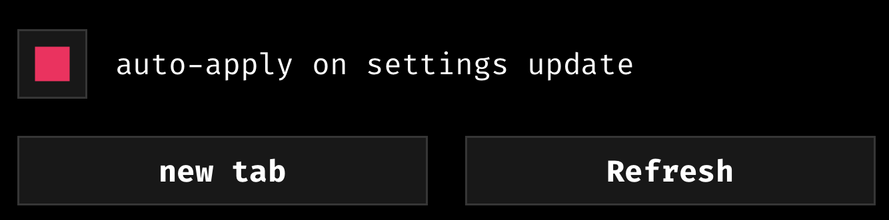

# fxlens

*A closer look at the fx(lens) interactive project viewer.*

fx(lens) is a web page designed to load and allow the interaction with fx(hash) projects in your local development environment. In a nutshell, fx(lens) is an interactive fx(hash) project viewer. Via a minimalistic user interface it provides a number of controls, toggles, sliders, and buttons that make it possible to interact with, tweak, and test a generative token while it is being developed.

Building a generative token for fx(hash) is often a big and complicated undertaking. Prior to fx(lens), artists would often create their own testing interfaces for the purpose of making sure that all aspects of the project’s code are functioning as intended.



*Example of a project running in fx(lens)*

fx(lens) also helps artists get a feel for the breadth of the parameter and output space of a generative token.

### **Running fx(lens) via the CLI**

If you’ve already installed [the fx(hash) CLI](cli-setup.md), you can launch fx(lens) with the `fxhash dev` command. This command needs to be executed from within your project directory and requires an `index.html` file to run.

Running this command will automatically open up a new tab in your default browser, showing a control panel on the left-hand side of the browser window, with the generative token next to it on the right. Depending on whether you’ve already written some code for your generative artwork or not, this new tab will display the default generative token that the boilerplate comes with out of the box, or your own artwork:



Using the fxhash dev command also automatically checks for updates, if you get an error you might have to prepend this command with \`sudo\`. fx(lens) will still work nevertheless, it is merely indicating that it couldn't check for the update.

Again, you can also achieve this with npx.



### **Standalone fx(lens) via npx**

You can also run a standalone version of fx(lens) without installing the CLI, also through npx. This would still require Node.js to be installed (refer to the [CLI Setup](cli-setup.md) section for installation instructions) for us to run fx(lens). The only difference here is that we can now manually run fx(lens) without using the fxhash dev command.

We can get fx(lens) with the following npx command:

```jsx
npx degit fxhash/params-boilerplate your_project_name
```

Make sure to give your project a meaningful name by replacing your_project_name with a title of your choice. After that, navigate into the newly created directory and run:

```jsx
npm install
```

This will install all of the necessary modules required for running fx(lens). Installing these dependencies finalizes the setup of the standalone version of fx(lens), and it can now be run with:

```jsx
npm start
```

This will open up a browser tab with fx(lens) running inside of it just like before.

### **How does fx(lens) work?**

Booting up fx(lens) runs not one, but two local servers on your machine: one that serves your generative project, and another one that serves fx(lens) itself.

> [!NOTE]
> **What is a Local Server?**
>
> A *local* server refers to a server that runs on the same machine or device where the programming code is being developed and tested. This local server is often used during software development to test and debug code before it is released.

After running fx(lens), open another tab in your browser, and in your search box paste in this address `http://localhost:3301`. This will open a page that simply runs your generative artwork by itself. If you enter the following address `http://localhost:3300` it should show you fx(lens), with a blank screen instead of the artwork next to it. This is because we didn't indicate where the project should be fetched from. We actually need to point the local fx(lens) server to the server on which the project is running.

This is done by passing in the generative token's server address as a URL parameter:

```jsx
http://localhost:3300/?target=http://localhost:3301
```

### Overview of t**he fx(lens) Interface**

*What can we do with fx(lens)?*

Not only does fx(lens) let us run our code, it also lets us pretend as if these tokens were running on fx(hash) in different contexts. This means that fx(lens) exposes certain parameters inside our code that would otherwise only be available once uploaded to fx(hash). All of these input parameters can be configured via the left-side UI:



Moreover, we can tweak and control these parameters - let's have a brief look at the different sections of this interface.

#### **Current Seed**

With the current seed we refer to the hash that fx(hash) injects into project’s code for it to generate a specific output. In fx(lens) we can simulate and control this exact seed via the *current seed* field, where we can manually input specific alphanumeric strings, or generate new ones at random:



This is very useful when testing the determinism of the generative artwork since the randomness in the generative artwork should be derived from that hash, and given the same hash/seed, your code should always generate the same output. Hence, while testing your artwork and rerunning your code in fx(lens), it should generate the exact same output when this hash/seed is fixed. If not, you need to revise your code and figure out which parts of it are introducing variance in this behaviour. You can read more about this in the [Using Randomness Correctly](../genart-in-the-browser/deterministic-randomness.md) section.

#### **Minter Address**

The *minter address* simulates a wallet address, as if the currently displayed output has been collected by a collector. Some of the randomness in the project can also be derived off of the collector’s wallet address (via it’s own PRNG), which makes it handy to be able to fix and regenerate this simulated address, just like the hash.



#### **Execution Context**

The execution context is a flag that is passed into the code as a URL parameter and indicates in which context it is run, there are three possible values for this context:

- **standalone**: (default) when the final output should be displayed, on the main project page for instance
- **capture**: when the code is executed in the capture environment, to get an image preview of an iteration
- **minting**: when the code is executed during the minting flow of the collector



Sometimes it can be useful to run special parts of the code only in a specific context, for instance if we want to configure the image previews in a certain way and execute a function only during the image capture.

#### **Params**

 fx(params) is a large topic, we cover it in the [fx(params) module](../fxhash-api/fxparams-module.md) section of the docs.

Params, short for parameters, are essentially certain variables in the code that the artist chooses to expose for the collectors to tweak at mint time, giving them the ability to modulate certain aspects of the generative token and create custom iterations completely to their liking. All of these exposed parameters will appear under this section, and will look differently from project to project:



#### **Iteration**

The iteration number is a special value that is unique for each collected iteration of a project, and as its name suggests, indicates the index of the collected output relative to the entire collection. For example, the iteration number for the very first collected iteration of a project will be `0`, the second will be `1`, and so on. If any parts of the code take this value into consideration, we can tweak and test this behaviour with this field.

#### **Features**

Features are special, artist chosen attributes that describe the randomly chosen qualities of a collected iteration. They are entirely optional, and have to be declared from within the code. If the artist chooses to use features, the will appear in this bracket of the interface:



#### **Live Reload**

Last but not least, the interface also provides a way to automatically update and refresh the generative artwork displayed on the right-hand side whenever any other controller/value in the fx(lens) interface changes:


