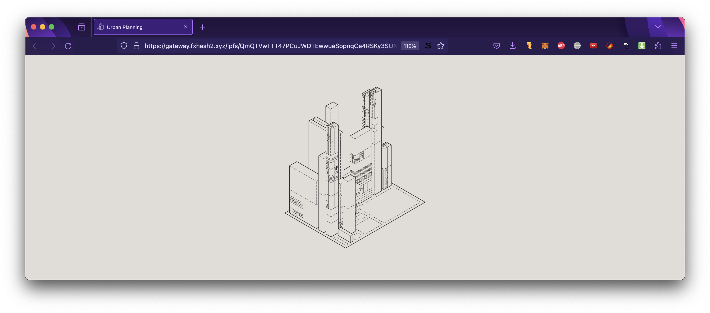

# Project Structure

*This page explains the structure of an fxhash project, providing an overview of the individual files and their purpose.*

Generative artworks on fxhash are self-contained web projects that run in the browser. In other words, fxhash projects are mini web pages that display generative graphics, which are served inside an iframe whenever they are requested by a user in the interface.

> [!WARNING]
> If your project is not working in the sandbox or the mint preview, the most common reason is that you are likely trying to make networked requests or load in external script files. All assets required for your project need to be contained within the source directory.

An fxhash project needs to follow a specific structure—at the bare minimum it needs to consist out of:

- An `index.html` file that the browser uses to display the artwork.
- A `styles.css` stylesheet that helps display the HTML file properly.
- And a `script.js` JavaScript file that contains the artist's code and is responsible for generating the artwork/graphcis.

> [!NOTE]
> Additionally, fxhash provides a script file `fxhash.js` (or `fxhash.min.js` as a minified version) that provides the functionality to make the project compatible with the platform.

If you're familiar with these technologies, here's a quick example of what each file should contain:

**index.html**

Every web project typically has a primary HTML entry point, also known as the index file. This file usually represents the initial view of a webpage, and in the case of generative art project on fxhash is the page that will display your generative artwork. In essence it's the page that fxhash serves to the client whenever a project is viewed.

Here is an example of what a minimal index.html page looks like:

```html
<!DOCTYPE html>
<html>
	<head>
		<title>Title of the Project</title>
		<meta charset="utf-8" />
		<script src="./fxhash.min.js"></script>
		<link rel="stylesheet" href="./styles.css" />
	</head>
	<body>
		<script src="./index.js"></script>
	</body>
</html>
```

> [!WARNING]
> It is necessary that every fxhash project has this index.html file. And it needs to be titled `index.html` . This HTML file will either contain all of the necessary code, including the CSS and the JavaScript, or reference them as other files in the same directory.

**index.js**

This JavaScript file contains the artist written code that makes the generative artwork happen. Most, if not all of your code should go here.

> [!NOTE]
> It actually doesn't matter what this file is called, it just needs to be referenced correctly within the index.html file. Alternatively, the script could also be placed directly inside the index.html within a `<script></script>` tag.
>
> Moreover, it is often the case that larger projects split their code over several script files, which is also perfectly fine. In that scenario the index.html file just needs to reference all of these files.

**styles.css**

The stylesheet will generally only contain a few styling instructions for the purpose of correctly displaying the generative artwork in the browser. In that sense, this file is optional, but is useful for centering and containing the artwork within the browser window responsively, or resize the artwork when the dimensions of the browser window change, if it is meant to be a dynamic piece.

In the scenario of centering a static artwork within the browser window, the content of the stylesheet would look something like what follows:

```css
body {
  /* override the default margin of the html body */
  margin: 0;
}

#canvasContainer {
  height: 100vh;
  width: 100vw;

  display: flex;
  align-items: center;
  justify-content: center;
}

#myCanvas {
  max-width: 100%;
  max-height: 100vh;
}
```

We talk in more detail about what these CSS rules do in the Responsive Webpages Section.

**fxhash.min.js**

A necessary script file provided by fxhash - every project needs to include this file. This script exposes a number of functions that make your project compatible with the fx(hash) platform.

- [fxhash-boilerplate/fxhash.min.js at master · fxhash/fxhash-boilerplate](https://github.com/fxhash/fxhash-boilerplate/blob/master/fxhash.min.js) — GitHub

*You can find the latest and up to date snippet here.*

These functions are geared towards aiding artists in turning their generative artworks into deterministic generators - we will have a detailed look at the contents of this file in the Project SDK & API section, where it'll be properly introduced

If you're not familiar with the general structure of a webpage, here's additional information to get you up to speed:

<details>
<summary>HTML</summary>

The three core technologies that generally make up a webpage are:

**HTML (Hypertext Markup Language)**: This is the backbone of nearly every webpage and the standard markup language of the internet. A markup language uses symbols inserted in a text document to control its structure, formatting, or the relationships between its parts. HTML's primary purpose is to structure content on a web page.

HTML primarily functions on a basis of tags that define and structure the content of the web page. These tags come in the form of specific keywords that are enclosed in angle brackets `<>` . Tags usually come in pairs: an opening tag and a closing tag containing some text, or other tags in between. The opening tag indicates the beginning of an element, and the closing tag indicates the end of that element. These tags are then used as instructions by the web browser to structure the content between these tags.

In the case of fx(hash) projects we're usually not going to write much HTML code, usually none at all - except maybe in a scenario in which the artist is creating a generative artwork with HTML and CSS. The index.html that comes with the boilerplate is a very simple web page that references the two js files, the fxhash.js file and index.js file, that are also found in the boilerplate folder.

*Why is the **fxhash.js** script referenced in the* `head` *tag, whereas the artist's index.js script is included in the* `body` *tag?*

It is common practice to include important scripts required for the proper execution of a web page in the head tag - scripts referenced in the `head` tag are loaded in before the page is actually run by the browser - this makes sure the fx(hash) functions are available when the time comes to execute the artist script. If you include third party libraries in your project, you should also reference them in this `head` tag.

A few other tags that also exist in the index’s head are:

- `title`**:** the title tag is the title of the webpage, and should contain the name of your project. When your artwork is opened in live view, this title will appear as the title of the tab it is open in.
- `meta`: some metadata information about the document, this is a standard tag that is included in every webpage. Usually it is left as is.
- `stylesheet`: a reference to the css stylesheet that takes care of formatting the html document. This will simply bring in the styling instructions, if any.

Additionally, you can include a special tag in the head of your project in case you'd like the page to display a favicon when it is opened in live view - you'd simply drop the favicon file (a **PNG** or **SVG** file) in the project directory alongside the other files and link it as such:

```html
<link rel="icon" type="image/x-icon" href="/favicon.ico">
```

A good example for this are loackme's projects—that always include a custom favicon:



</details>

<details>
<summary>CSS</summary>

**CSS (Cascading Style Sheets)**: This style sheet language describes the presentation of documents written in markup languages. Used with HTML, CSS makes webpages visually appealing. It controls page layout, visual properties of elements, typography, and more. In essence, CSS gives webpages their visual aesthetics.

</details>

<details>
<summary>JavaScript</summary>

**JavaScript (JS)**: Now arguably the most popular programming language, JavaScript is the primary language used on the Web. It adds functionality and interactivity to webpages. JavaScript can also generate graphics in the browser, making it increasingly popular for creating generative art. It's commonly used in fxhash projects.

</details>

> [!TIP]
> Although these are the main 3 technologies that you need to have a grasp of for making a project on fxhash, there are other approaches that you can

In the next section we'll have a look at the fxhash boilerplate - a starting template that already includes all of these files and essentially constitutes the quickest way to get started building a generative token for fxhash, without you having to manually create these files.
