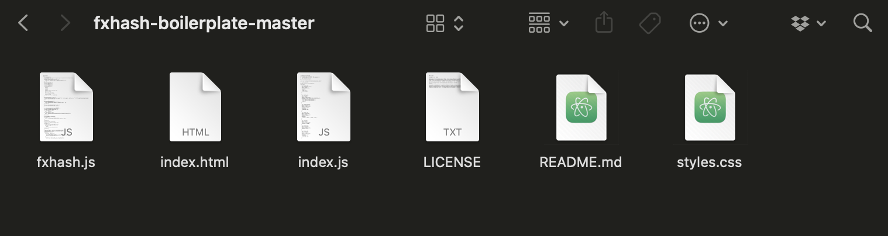
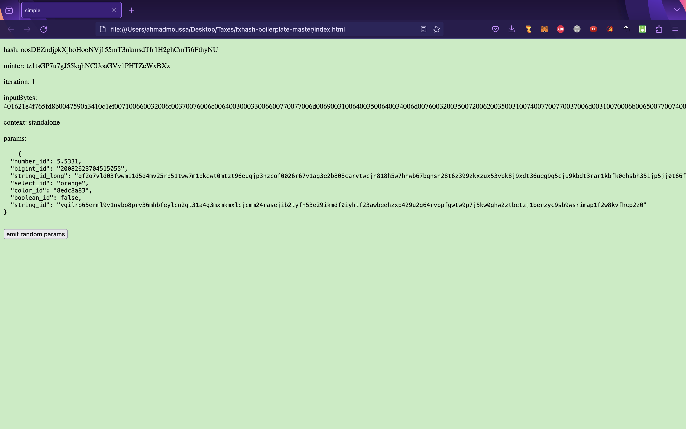

# Project Template

*An introduction to the fx(hash) boilerplate, a starting template to kickstart new projects.*

The boilerplate is essentially a minimal, self-contained starting template that serves as a simple starting point for creating an fx(hash) project. It comes out of the box with all of the required files, and you|d just have to fill in the blanks to create an fx(hash) compatible generative artwork. You can download the starting template from this Github repository:

- [GitHub - fxhash/fxhash-boilerplate: A boiletplate with webpack to develop generative Tokens on fxhash](https://github.com/fxhash/fxhash-boilerplate) — GitHub

> [!NOTE]
> **What's a Boilerplate?**
>
> In the context of software development the term "boilerplate" often refers to a template or starting point for a project that includes a set of standardised code or files. These templates are designed to provide a foundation for building software applications quickly and efficiently.
>
> Boilerplates help developers avoid starting from scratch and ensure that best practices and common functionality are already in place. For instance, a web development boilerplate might include a basic HTML structure, CSS styles, and JavaScript libraries to kickstart the development of a website. In the case of the fx(hash) boilerplate, it additionally includes the fxhash.js script file.

In the early days of fx(hash), artists needed to include a short snippet of code in their projects for them to be compatible with fx(hash) and function properly once uploaded. This snippet could be found on the fx(hash) site and had to be manually copy-pasted into the artist's project.

With fx(hash) evolving as a platform, and new features being added on a regular basis, this snippet quickly grew in size and had to be frequently updated to account for these changes. For the convenience of the artist, fx(hash) made a boilerplate available - a starter kit that already included this code snippet, becoming the go to method for kickstarting new projects.

Cloning the boilerplate from Github will download a zip file onto your machine - unzipping it will produce a folder with the following content:

This directory essentially contains the necessary files for creating a simple web page, just as we described in the previous section. It contains:

- An **index.html** file that will act as the project entry point.
- An **index.js** file \*\*\*\*that will contain the artist’s code that powers the generative artwork. This file should be completed by you, the artist, and should contain the code that creates the generative artwork displayed by the index.html. Right now, the boilerplate contains a bunch of code that produces the screen that we've shown above, you don't have to worry about what this information is at this point - it’ll make more sense after reading the Artist Tools section.
- An additional javascript file titled **fxhash.js** that contains the helper functions provided by fxhash. A standalone script provided by fx(hash) that exposes several functions required for creating platform compatible projects. The contents of this script file and its purpose are discussed in more detail in the [fxhash API](../fxhash-api/README.md) section.
- A **styles.css** file for styling purposes. The styles.css in the boilerplate is empty - meaning that it applies no styling to the HTML. This file isn’t necessary, but often used for the purpose of displaying tokens correctly within the browser window, we address this in more detail in the [Responsive Projects](../genart-in-the-browser/responsive-browser-projects.md) page.
- A **LICENSE** file in which you should declare usage rights of your code. This file should contain the License that you wish to apply to your project. Because files that are uplaoded to IPFS or OCNCHFS can be viewed an accessed by anyone, it is important to include a legal document that can help protect your intellectual property. A License is essentially a document that details the usage rights for the code and the generated artworks; whether the code can be used and modified by others or not, and the specifics of it. You can read more about it and find suggestion for some common licenses in the [Licensing](../releasing-your-project/licensing-your-project.md) page of the docs.
- A **README.MD** file, which can safely be ignored. It's simply the file that provides the description of the boilerplate on its Github page.

You can actually go ahead and open the index.html in your browser now - although it won't much sense at this point, the page shown below is an indication that the boilerplate is working correctly:

> [!WARNING]
> But make sure to read the rest of the Artist Tools chapter first before you start building your generative token—there are actually a couple of different types of generative tokens for which it is recommended to use some of the more advanced artist tools instead of the simple boilerplate.
