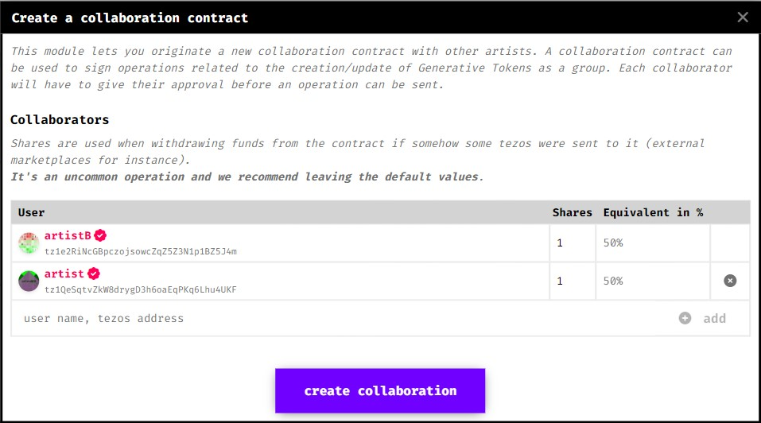
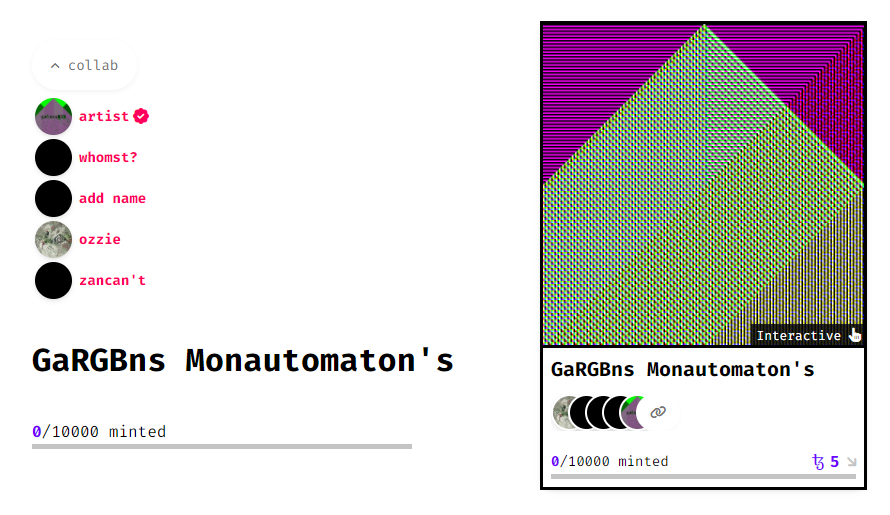
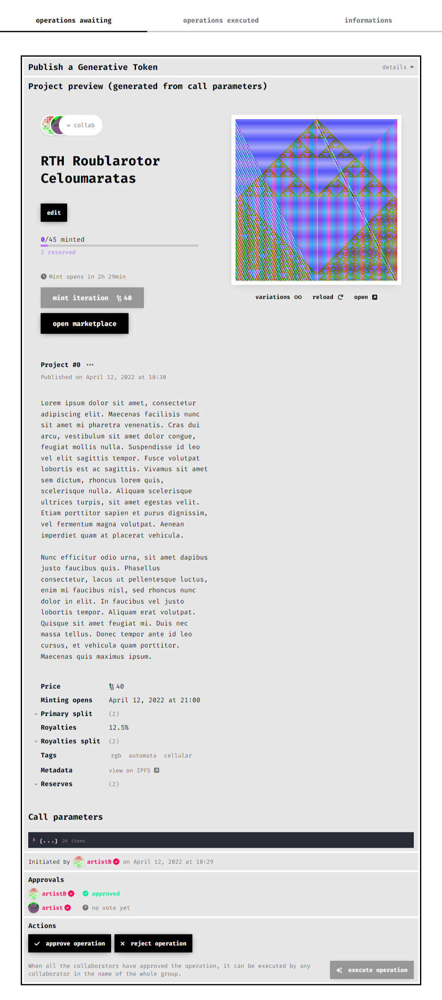
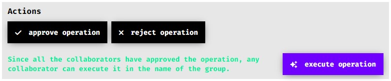

# Collaborative Projects

*An overview of how Collaborations function on fxhash*

fxhash comes with built-in tools so that the work that is the fruit of a collaboration between many artists can be released in the best possible conditions and such that profits generated from the sale of the project can be distributed fairly and automatically. We provide a collaboration factory contract which can be used to originate collaboration contracts between any number of entities.

### What is a collaboration contract ?

A collaboration contract allows entities to create, approve and send operations to the blockchain as a group.

Creating a collaboration contract doesn't bind the different parties together, but sending operations through the collaboration contract is binding. An operation can be sent through a collaboration contract if and only if all the parties have approved the transaction. Only then the transaction can be executed by any member of the collaboration. Not all the transactions are made available through the collaboration contract but only a list of operations provided by fxhash. This ensures that the transactions that are sent through the collaboration contract are safe to be sent.

### How to create a collaboration ?

Anyone can create a collaboration by going to the [collaborations page](https://www.fxhash.xyz/collaborations). You need to add all the collaboration members to the form.

The shares will be used in case some funds are sent to the contract (if other marketplaces were to pay royalties directly to the collaboration contract for instance). We recommend leaving the default shares, so that the funds are equally split between all the members of the collaboration.

Please note that the shares of collaboration contract itself don't guarantee that the proceeds made by publishing the token through the collaboration will be split between all the parties. You still need to define how the proceeds will be split on the primary and secondary market at the creation of the generative token. By default if you author the piece as a collaboration, the UI will pre-fill the splits on primary and secondary so that each collaborator gets the same amount.

You can setup different splits if you author different pieces with the same collaboration contract for instance.

### Integration on the Platform

When fxhash detects that a work was published with a collaboration contract, it assigns all the members of the collaboration as authors. We tried to provide a seamless integration of the collaboration contracts as we feel that they play a major role in the development of our artist community.

If a work is published as a collaboration, it will also appear on all the profiles of the collaborators.

### How to send operations as a collaboration group?

We tried to make the usage of the collaboration as transparent as possible for you. For instance, you can edit the settings of a token as you would do if you were its only author, but instead of sending the update operation directly it creates a proposal in the collaboration contract itself.

### The collaboration manager

When you go to your [collaborations page](https://www.fxhash.xyz/collaborations), you will see all your collaborations. Clicking on each will take you to a page where you can manage the collaboration. There are 3 tabs on this page:

- **operations awaiting**: operations not sent to the blockchain yet
- **operations executed**: operations previously approved **and** executed
- **informations**: extra informations about the collaboration, such as the shares, the contract balance and a button to withdraw the funds

### Inspecting an operation

Operations can be inspected before approval. By clicking on the operation type, you can toggle a preview which will show what the operation will do in an elegant manner:

You can also check the exact call parameters if you want to be sure of what you are approving.

You must be very careful when approving an operation on a collaboration contract, and make sure that you agree with its application. Our UI makes it easy to inspect those operations, and you should review those thoroughly.

**By approving an operation, you give your formal agreement for its execution**. It's as if you sent the operation yourself.

### Approving and executing

By default, the initiator of the operation will be marked as approving it. All other members must approve before it can be executed. You can approve or reject an operation with the corresponding buttons. These actions are not final, and you can change your vote as long as the operation hasn't been executed. Once all members have approved, the `execute operation` button is enabled, and any member can execute the operation.

By clicking this button, the operation is executed, and voilà!

### Projects authored as a collaboration

When a project is created through a collaboration contract, the address of the contract is stored as the author onchain. And since the members of a collaboration own the collaboration contract, they are indirectly co-authors by definition.

On the fxhash website, when you edit a project co-authored, it will automatically create proposals in the collaboration contract (displayed in the *operations awaiting* section of the manager). Because we don't yet have a notification system, you will need to inform your collaborators that they need to approve the operation.

### Extra costs

There are some extra costs that come with using a collaboration contract. First, the contract needs to be originated. Then, each operation needs to be stored *twice*, for the creation of the proposal (where the parameters are stored onchain) and for its execution (same cost as if you were to send the same operation by yourself).

We recommend splitting those costs by having different members creating and executing an operation. Moreover, collaboration contracts can be reused.
