# Minting Interface Walkthrough

*An overview of the fxhash minting interface and a walkthrough of the minting process.*

The minting interface is the portal that takes you through the necessary steps to upload your project to fxhash. The interface will guide you through some final checks to make sure that things are working properly, help you set up the appearance of the final project page on fxhash and allow you to set distribution options such as the edition size, pricing, royalties, reserves and allow lists.

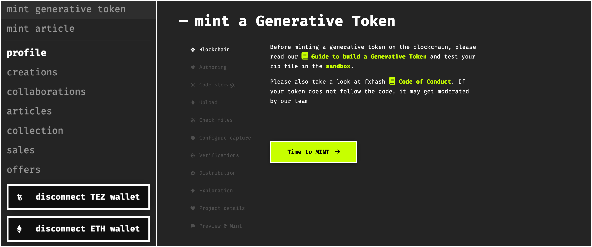

> [!NOTE]
> The minting interface can be accessed from the drop down menu that expands from your profile button in the top right corner by clicking on the ‘mint generative token’ option.

Once you’ve made sure that your token works properly and created a zip file that contains all of your project files (either through the fxhash CLI or manually), then you’re ready to get started.

### 1. Blockchain Selection

The first step in the minting process is selecting which blockchain you want to mint your project on, you can choose between Ethereum, Base (Ethereum L2), and Tezos:

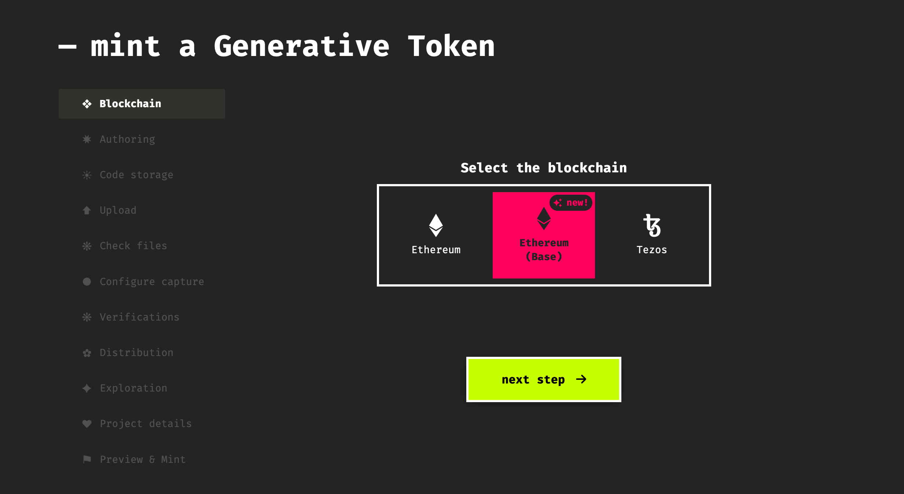

### 2. Author Selection

Next you’ll be asked whether your project is an individual original work, or if it is a collaboration with one or more other artists:

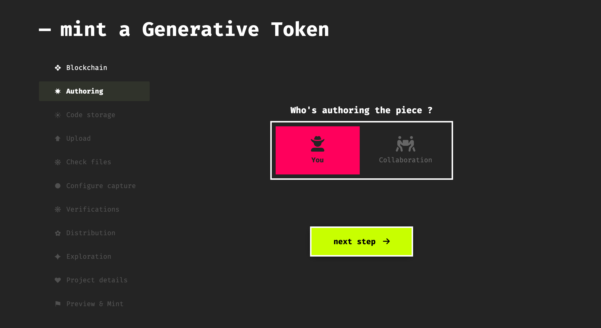

For the purpose of this walkthrough we’ll assume that you are the sole author. The subsequent steps don’t actually vary much when a project is a collaborative one, you simply need to create a collaboration contract beforehand and then indicate the contract during this step. You can learn more about collaborations and collab contracts here:

[Collaborations](https://www.notion.so/Collaborations-5bff487d7dc049feb7b125bd08ca90e9?pvs=21)

### 3. Storage Selection

Next you’ll be asked how you’d like your project to be stored - either on IPFS or Onchain:

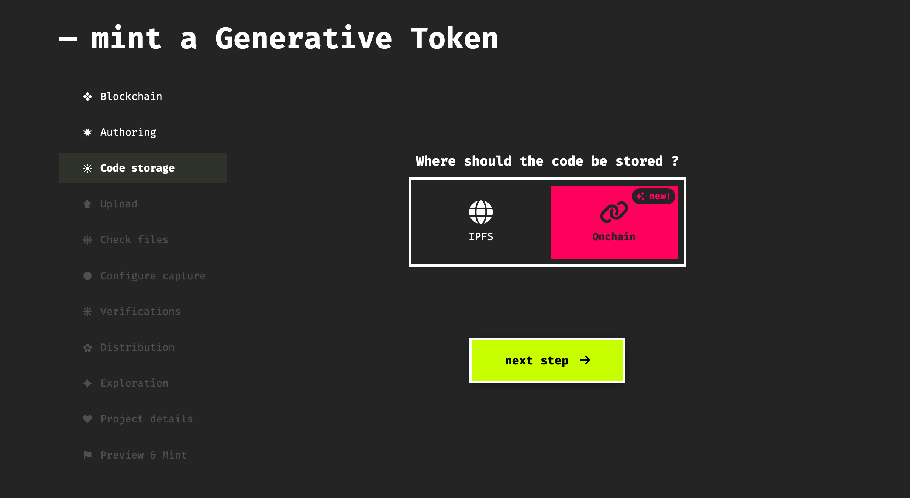

You can read more about the differences between IPFS and On-chain storage [here](../../knowledge-base/quickstart/web3-storage/README.md).

### 4. Project Upload

Next, you’ll upload your project's .zip file that contains all of your project files. This zip file can be created manually or with the fxhash CLI via the `fxhash build` command:

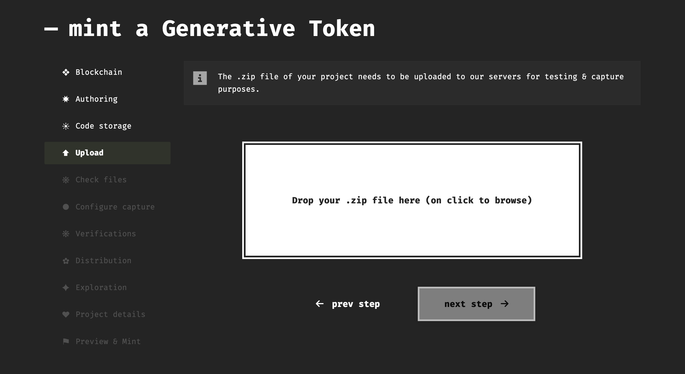

If there is a problem with the fxhash.js script, it will show you an error in red here - for instance, this happens when the fxhash script is outdated. When publishing your project onchain, green checkmarks next to files indicate that these files already exist on the blockchain and are indexed with fxhash’s file system, hence don’t need to be re-uploaded:

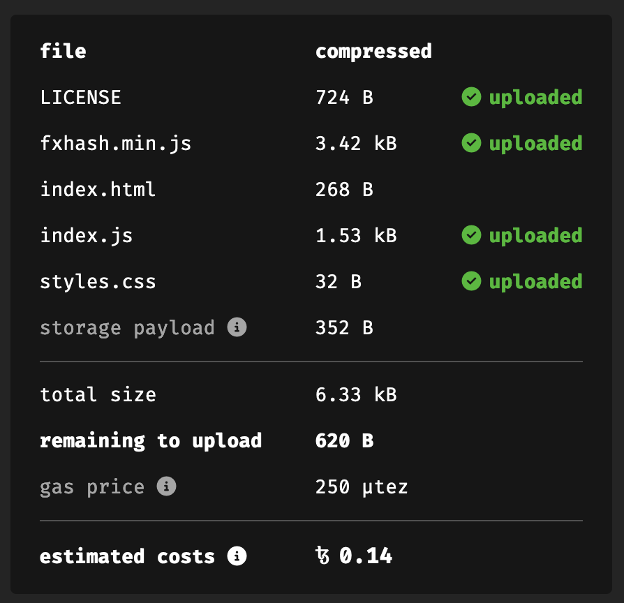

Here it will also show you an estimate of the storage costs to deploy your project onchain, this varies between the different blockchains available. Make sure to also include any additional license files in this project directory: [Licensing your Project](licensing-your-project.md)

> [!WARNING]
> **What’s the size limit on projects?**
>
> Currently the cut-off point is 500MBs - if you require more you can get in touch with us on discord.

### 5. Determinism Check

In the next view you’ll go through a final check to ensure that your piece is deterministic by rerunning the code for the same and different hashes. In this step you also decide on the preview image that will front your project page, this is done by fixing a specific preview hash:

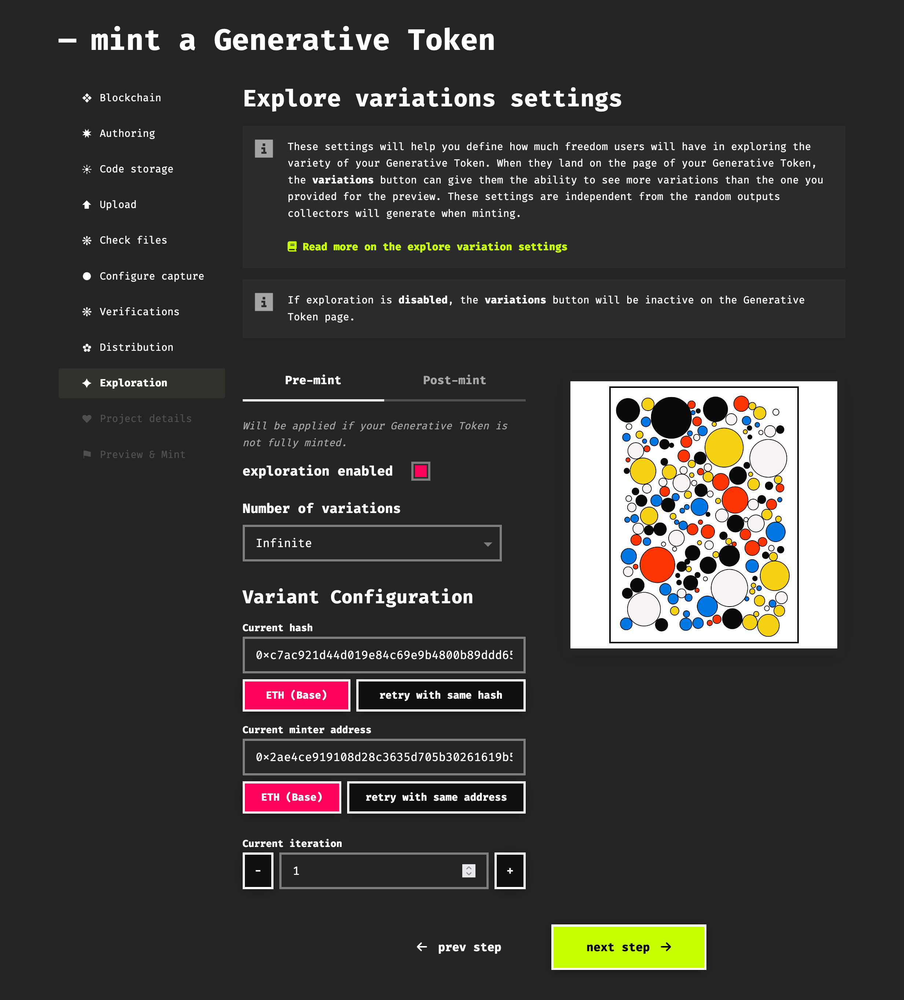

Here you can also set the iteration number and/or minter address if those influence some aspects of your artwork. In case your token implements parameters and/or features, they will show up here as well. After you’ve checked that everything is working properly you can go ahead and mark the two boxes to proceed to the next step - this will also lock in the hash that determines the preview image of your project.

### 6. Preview Capture Settings

In this step you’ll configure how fxhash generates the previews of the collected iterations via the capture module:

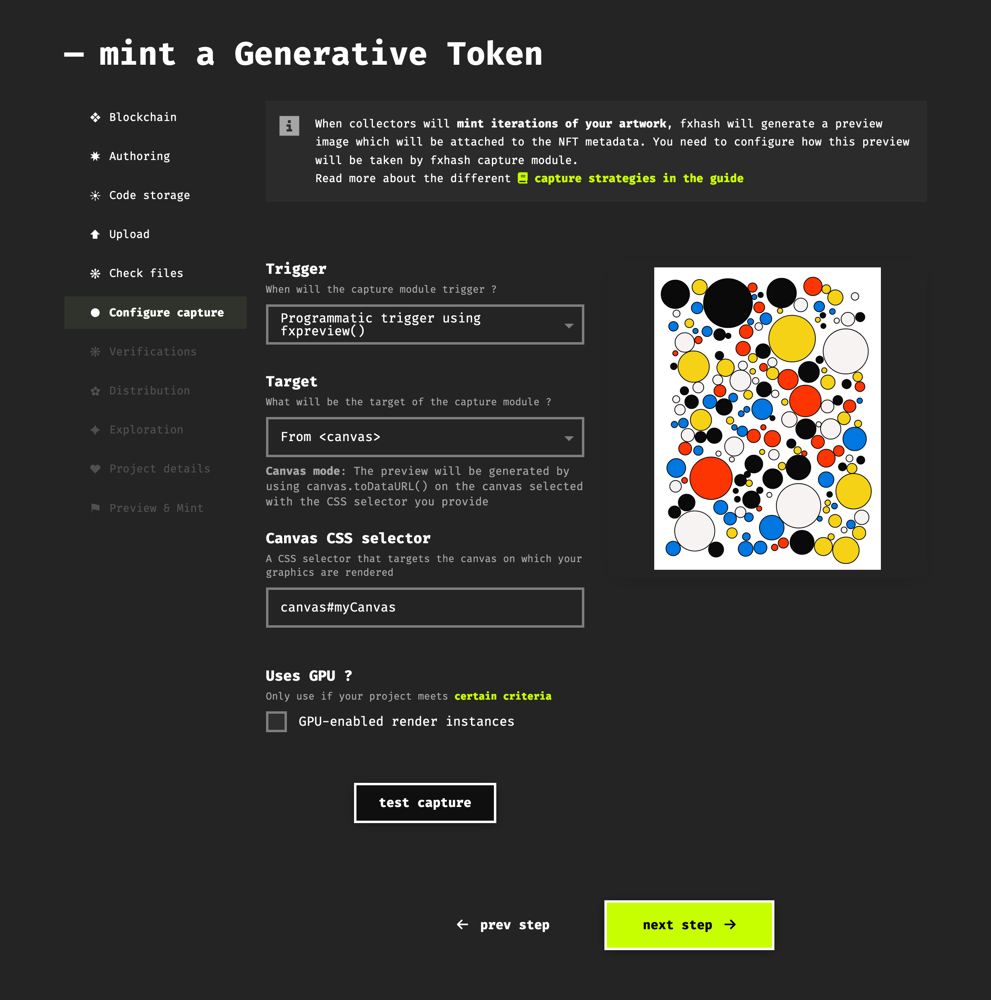

There’s two different methods for triggering the capture module:

- **Programmatically with** `$fx.preview()`**:** The capture module will wait until your code calls the `fxpreview()` function. As soon as it is invoked, the capture will be triggered. The placement of this function in your code is up to you, but usually it should be placed towards the end of your code, when all of the graphics have been rendered. If the piece is animated you might want to trigger it after the initial frame has been drawn.

  **The capture module will automatically take a capture after 300 seconds have passed after your project was loaded in the browser. Hence it is important that the rendering of your graphics completes within this timeframe, otherwise it might lead to undesirable preview images.**

- **Automatically after a Fixed delay:** a fixed time delay indicates that the capture module should trigger automatically after a certain amount of time after the project is loaded. Selecting this option will make a slider appear where you can set how many seconds the capture should wait before triggering, up to 300 seconds.

In the case of our example token we’re using the programmatic trigger since it is a static artwork where we want to trigger the capture after all shapes have been rendered to the canvas. After setting the capture trigger we also need to indicate the target of this capture; this can be a canvas element, or the entire viewport of the window:

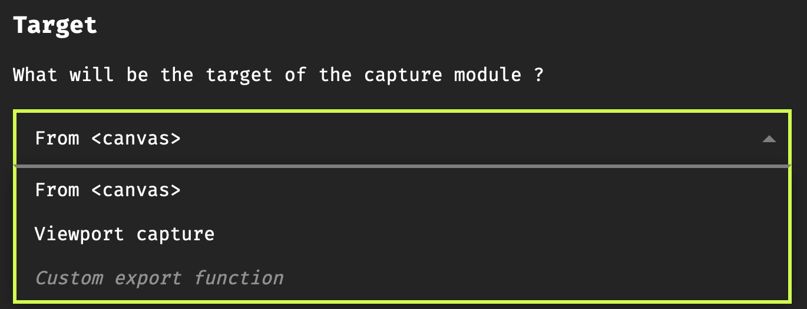

In our case we only want to capture the canvas, and not the entire viewport. Selecting `From <canvas>` will reveal a third input field where you need to specific the CSS selector that defines this canvas - make sure to select the correct one if you are using multiple canvases in your project.

Furthermore, you’ll see a toggle to enable a GPU rendering instance for generating the token previews. By default a CPU instance will be used and is suitable for the majority of projects. A GPU instance should only be used if your project necessitates it - if you’re uncertain about this, reach out on discord. The caveat with GPU instances is that they’re way slower to bootstrap which increases the time it takes to generate the captures.

 In a nutshell, if your project requires a GPU to render, you should \*\*use a GPU-enabled instance\*\*. Since these types of projects are not very common, \*\*we currently only have 4 GPU instances available, as a result the metadata assignment will be slower for projects using these GPU-enabled instances\*\*. We can however scale to a very high number of CPU instances without bloating the rendering queue.

If you don't use WebGL and only the regular canvas API, it's also possible that your project doesn't render properly on the CPU instance because the canvas API uses GPU acceleration. If you observe differences between the capture and your live version, then try using GPU-enabled rendering.

If your project is loading asynchronous requests from the project's folder, **always consider that one of those resources may be slow to load**. In that regard, if you load resources please always use `fxpreview()` to trigger the capture.

### 7. Preview Check

To verify that the capture actually works properly, the captured preview image should be identical to the generative artwork running in your browser:

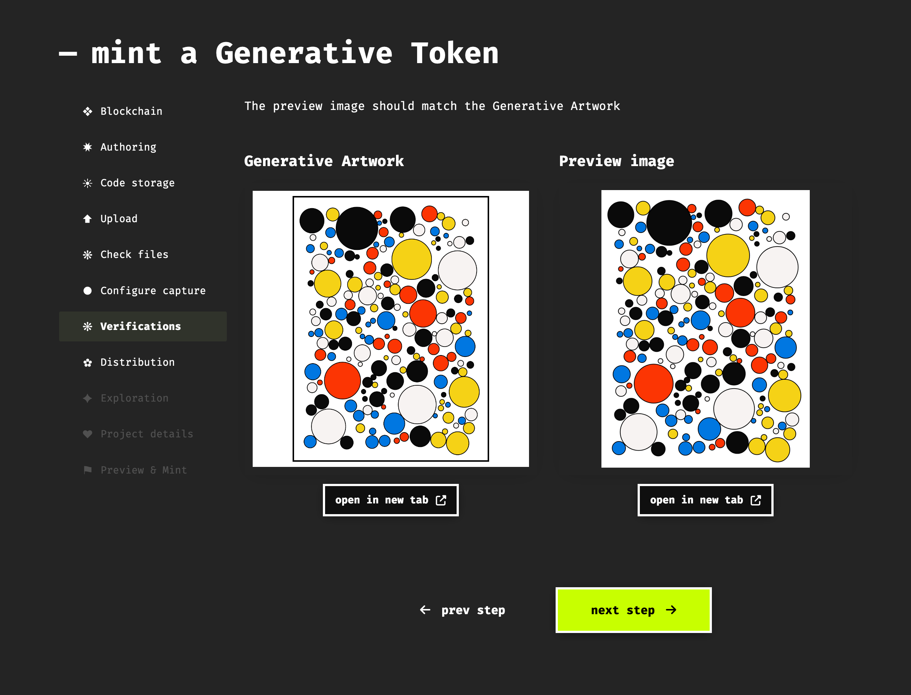

Although the artwork is identical you can see a slight difference between the preview and the generative artwork - the CSS border that we applied to the canvas is actually not a part of the canvas graphics itself.

### 8. Distribution Settings

Next you need to set up how your project will be distributed, pricing your project and deciding on supply is a tricky topic:

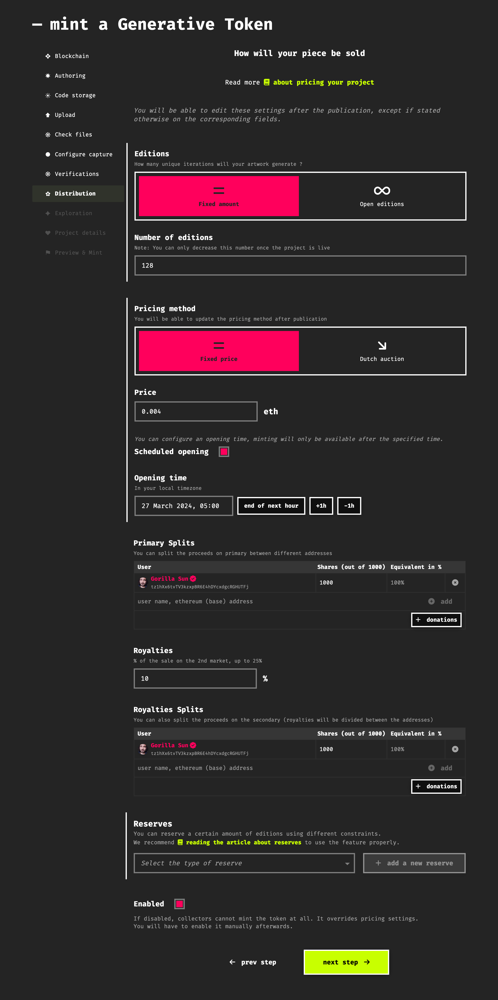

Here you essentially need to specify the following:

1. **The Edition Size:** there’s two options for this, either a fixed edition size or an open edition. And open edition means that an indefinite number of tokens can be minted from your project within a given time-frame, whereas a fixe edition size makes only a specific amount available.

2. **The Pricing Mechanism**: fxhash currently supports two pricing mechanisms:

   1. **Fixed Price**: as the name indicates, each iteration is sold at a fixed price.
   2. **Dutch Auction**: the price of iterations is reduced over the course of a number of time steps, until it settles at a fixed minimum price. Additionally a Rebate toggle is available that will refund collectors in the difference of price when the project mints out.

3. **Opening Date**: regardless of which pricing method you select, a release date for your project is required. This field defaults to an hour from the current time.

4. **Primary Splits**: primary proceeds refer to the revenue generated from collectors minting available iterations. If you would like to send a portion of these proceeds to another wallet, like a charitable organisation you can specify an additional wallet address here.

5. **Royalties & Royalty Splits**: royalties refer to a percentage of the revenue generated from secondary proceeds, when collectors buy and sell your artwork for instance. You can specify this royalty percentage here. Furthermore, you can indicate other wallet addresses if you want a portion of royalties to go towards other wallets.

6. **Reserves:** reserves are essentially allow lists that let you reserve iterations for specifiy wallet addresses.

7. **Enabled Toggle**: this toggle controls whether or not your project is available for minting directly at the release date. If it is unchecked your project will be published on fxhash, but it will not be possible to mint iterations from your project. To change any of the other settings later on (post-publishing) you will also need to first disable your project via this toggle.

If you aren’t certain about how to choose these settings, we provide more detailed explanations on all of these settings here: [Pricing and Supply](pricing-and-supply.md)

### 9. Variation Settings

In this step you will configure the interface options for previewieng variations generated by you project:

As the artist, we want you to have control over the freedom viewers will have when exploring variations of your project on the token page. Under the display frame, a `variations` button can be used to explore different variations, if enabled when you minted the Generative Token:

*[Image not preserved in the archive: variations-button.png]*

*https://www.fxhash.xyz/images/articles/guide-mint/variations-button.png*

For projects using fx(params), the `explore params` button allows users to navigate the parameter space of your Generative Token.

*[Image not preserved in the archive: explore-params-button.png]*

*https://www.fxhash.xyz/images/articles/guide-mint/explore-params-button.png*

You can configure the following settings, for both **during the mint** period and **after fully minted**:

- **enabled**: Determines if the `variations` and `explore params` buttons are active. If disabled, these buttons will be unclickable and visibly deactivated. Note that pre-mint exploration cannot be disabled for fx(params) projects.

- **number of variations:**

  - **infinite**: viewers can explore any amount of variations and so randomly
  - **limited set of hashes**: define a list of hashes the viewers will cycle through when clicking on the button

These settings should give enough control to define a strategy during the lifetime of your token. You can for instance disabled infinite exploration after token is minted, so that the front end only display a finite number of states through the minted collection of the token.

 Please note that the variation settings have no effect on the iterations which will be generated from your project.

### 10. Project Details

In the penultimate step you’ll add a quirky title, a description for the project, optionally a different description for the collected iterations, a list of tags that are geared towards discoverability of the project on the fxhash website and other 3rd party exploration tools, as well as some labels that can indicate a special behaviour of your project:

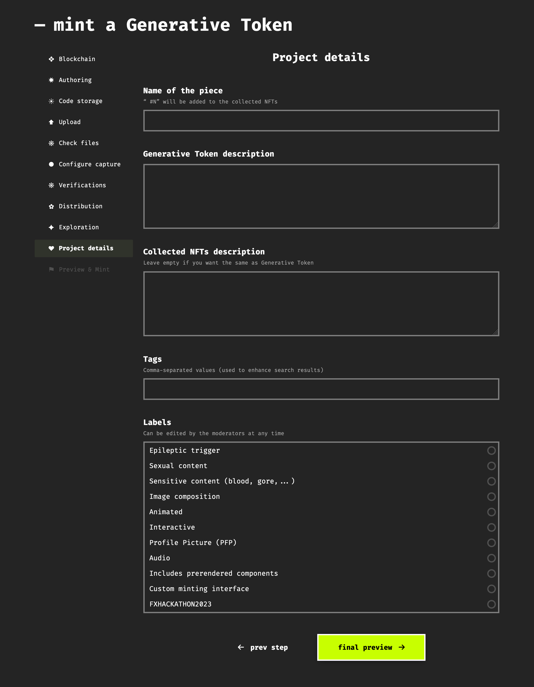

One step that many artists struggle with, is writing a description for the generative artwork. This description will live on the GENTKs project page and is frequently the first point of contact that collectors have with the artwork. In a way, it's your sales pitch in which you tell your potential collectors a little about the artwork and try to capture them.

This can be a romantic backstory, the discovery of a bug that led to an interesting visual composition, or even the recount of a quick coding session that led to a new algorithmic method. However, artists make art simply for the love of making art, it is often the case that there isn't a romantic backstory, especially in generative art that often ends up being a very exploratory endeavour. In this case it is also perfectly okay to reflect on the provide retrospective insights into the art-making process.

It is also a nice gesture to give a little shoutout to the libraries that you might have used and their creators, as well as the people that contributed and helped you in the ideation and development process of the code. And it is also a good idea to provide an overview of the different ways that users can interact with the GENTK, for instance the keys that map to certain user interactions.

To summarise, a good description provides:

- A short backstory on the inspirations that led to the project
- Highlights the primary/prominent techniques and methods used in the piece
- Mentions the libraries and individuals that contributed to the process
- Gives an overview of the interaction options

### 11. Final Preview

This is the final preview of your project, and essentially indicates what your project will look like once published:

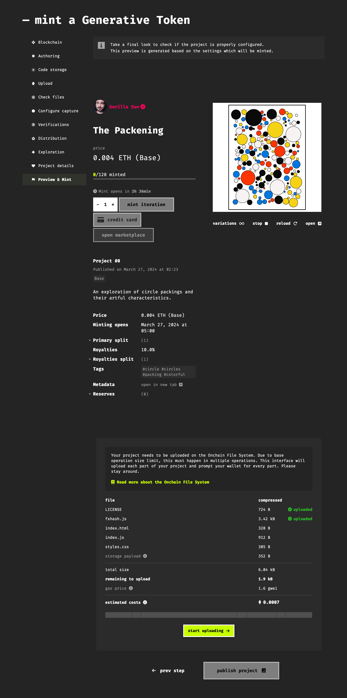

Additionally if you selected that your project should be stored on-chain it will indicate how much this storage transaction will cost, and you’ll have to perform this operation to unlock the **publish project** button. If you chose IPFS you can directly go ahead and publish the project.

If it happens that you need to break off this minting process, fxhash will save your progress and you can always return later and resume from where you left off, simply hit the ‘continue’ button when it asks you to:

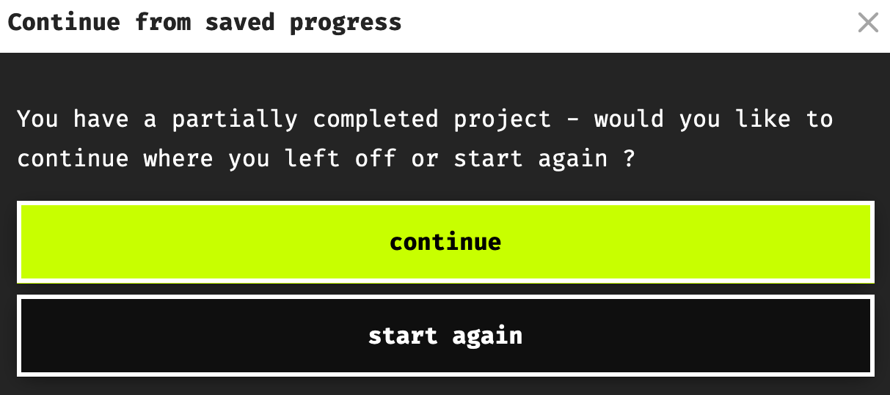

After you complete all of these steps you’ll have to do another confirmation in your wallet, cover the transaction costs. After a few seconds the project should then show up of your profile page and in the fxhash feed.
