# Pricing and Supply

*Over view of step 8 of the mint flow, including supply and pricing methods, primary and secondary splits, and allow lists. Additionally considerations on how to chose appropriate settings.*

Here’s a quick overview of the distribution settings section of the minting interface:

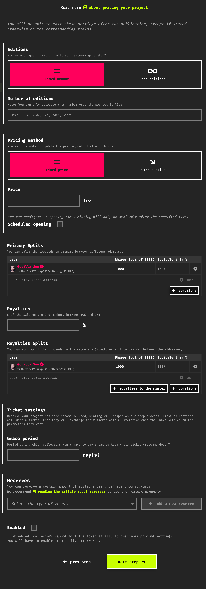

 These settings need to be chosen carefully as they have a direct impact on the success of your project!

### 1. Supply Methods (Editions)

fxhash currently supports two supply models: **Fixed Limited Edition** and **Open Editions.**

In a fixed limited edition a set number of editions is specified allowing for that many unique iterations to be minted. These editions can be minted for an indefinite amount of time either until all available editions are acquired by collectors, in this scenario we refer to collection as being ***minted out.*** Alternatively, after a longer period of inactivity if not all available editions are collected, the artist can choose to either disable the project (more on how to enable/disable a project later in this page) or burn the remaining editions.

In this scenario you must specify a number to indicate how many editions are to be minted - considerations on how to choose this value can be found towards the end of this page. It largely depends on your audience size and the amount of variety your generative project can produce.

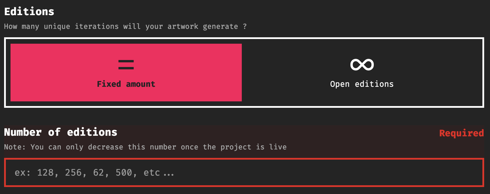

**Open Edition**: an open edition indicates that a project doesn’t have an upper limit on how many iterations can be minted by collectors - this is useful for special projects and special occasions where there might be a much larger number of collectors.

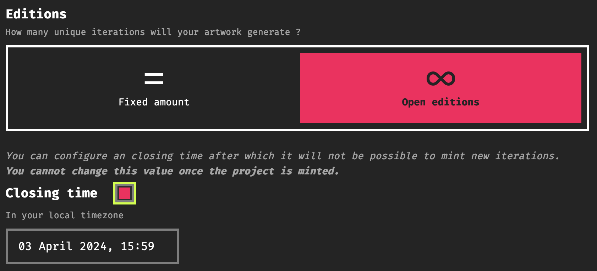

> [!NOTE]
> When Setting up and Open Edition you can also specify a closing time after which the project can no longer be minted. If not specified then the project can be minted forever. It’s important to note here that this can not be changed anymore after the project is published

### **2. Pricing Methods**

When publishing a project on fxhash, artists can choose between two pricing methods: **Fixed Price Sales** and **Dutch Auctions**.

As the name indicates, setting a **fixed price** for a project is a straightforward and the more common method to distribute individual iterations generative token. Individual iterations are essentially sold at a fixed price.

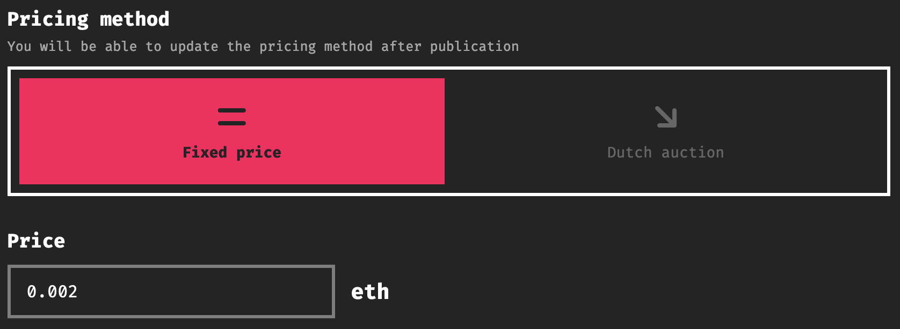

 The price of a project can be changed manually by the author(s) of the project. This only affects un-minted iterations and not ones that have already been collected.

**Dutch Auction** are more involved\*\*.\*\* A dutch auction is a type of auction in which GENTKs can be collected at a gradually decreasing price over a specific period of time before settling at a predetermined minimum. Setting up a Dutch Auction involves specifying the start time, price decrement steps, and time intervals:

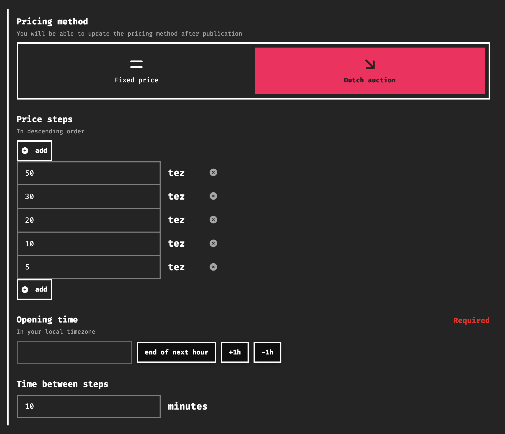

How does this work? The Dutch Auction begins at the `opening time`, with the first price of the list. After every `time step`, the next price in the list becomes active. This is repeated until the last price of the list is met, ie the **reserve price**. For instance, if you set the following settings:

- **opening time**: 01/01/2100 at 00:00
- 50 / 30 / 10 / 5 / 2
- 10 minutes

Your project will only become mintable (even by yourself) on the 01/01/2100 at 00:00. The starting price will be 50. After 10 minutes, the price will become 30. So on so forth until the reserve price of 2 is met at 00:40. Then the price will never change.

 \*\*Important Notes:\*\* - Pricing methods and details are flexible and can be updated anytime, except for Dutch Auction settings in projects released before March 20, 2023. - Not all pricing mechanisms are currently available for all supported chains. For instance, our Base integration currently doesn’t support Dutch auctions.

### 3. Opening Time

The opening date refers to the exact time your project becomes available for minting. This is different from the publishing date where the project appears on the fxhash feeds, and obtains its own proper project page.

One thing of note when setting an opening for your project, is that there needs to be at least an hour between the moment your project is created and it officially becomes available for collectors to mint editions from it. This time buffer is put in place for the moderators and the community to verify that the project is legitimate, not a copy-mint, and also doesn’t have any other issues.

Generally it is recommended to publish your project a couple of days ahead of an official opening date that you’ll convey to your collectors and fans so that they can be ready for the launch of the project. It is also important to choose an appropriate time for the release of your project, that doesn’t coincide with any other major events that might overshadow your project. We discuss this in the “Before releasing your Project” Section.

### 4. Primary Splits

When publishing a project, you can configure how revenue will be split both from primary & secondary proceeds. Smart contracts offer a lot of flexibility in this regard.

With primary splits we refer to the collect transaction that collectors perform when they mint an individual GENTK from an fxhash project, essentially creating this GENTK:

> [!NOTE]
> **What are Primary Proceeds?**
>
> Primary proceeds refer to the initial sale of a GENTK, when a collector purchases a GENTK directly from the generator. As a creator, you can specify a percentage of these proceeds to be automatically sent to other wallet addresses when creating your project. This is useful in the case of collaborations with other artists, as well as donating to library creators, or charities.

As the creator of a project you can choose if you’d like some of these primary proceeds to go to another wallet, this can be maybe the wallet address of someone that helped you develop your project, the wallet address of the creators of a library that you’re using in your project, or even a charitable organization. You’d simply have to add in their wallet address and indicate what percentage of the primary proceeds should go towards that address:

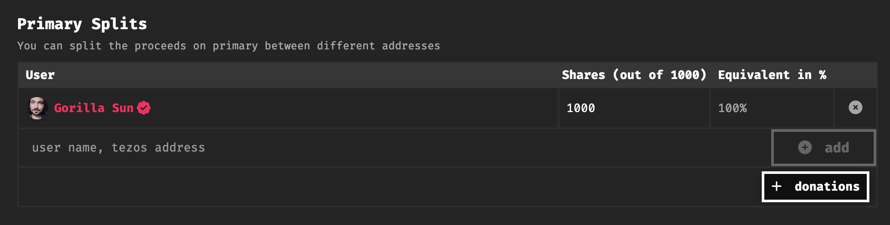

fxhash also provides a list of endorsed addresses that you can donate to if you choose to do so:

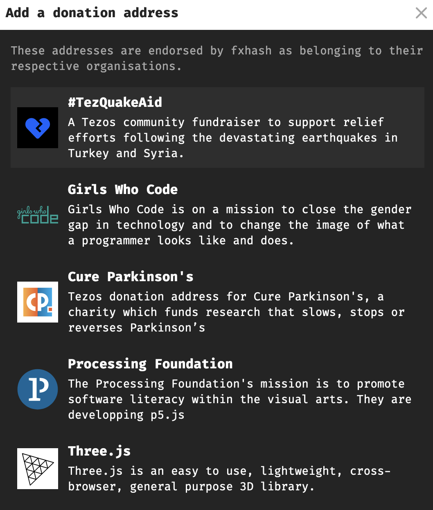

### 5. Royalties and Royalty Splits

Secondary proceeds are artist royalties that are received whenever a GENTK from one of the artists’ projects gets resold on the secondary market:

> [!NOTE]
> **What are Secondary Proceeds?** Secondary proceeds are royalties from resales. A resale in this setting refers to the action of a collector selling a GENTK on the secondary market to another collector. When creating a project, the artist can specify a royalty percentage between 10% and 25% - whenever a secondary sale occurs, this percentage amount of the resale price will automatically be sent to the artist’s wallet.

This royalty percentage can be set at mint time when creating a project:

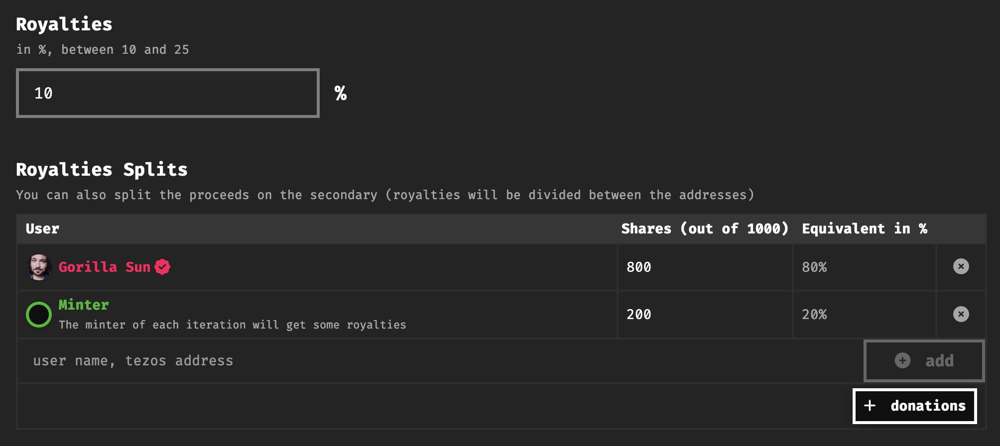

Additionally, the artist can choose to reward initial collectors with a share of this royalty percentage. Meaning that they will receive a share of the secondary proceeds whenever a secondary resale occurs. You can also add other wallet addresses to receive a share of secondary proceeds, however we recommend keeping the number of splits under 10, because otherwise it will make any transaction where the splits have to be distributed slightly more expensive for the initiator of the transaction.

> [!NOTE]
> N**ote on Updating Royalties**: When updating the royalty settings of a project, this will not affect the royalty percentage of already minted GENTKs from that project - they will retain their original royalty percentage. This change will only affect future minted iterations.

> [!TIP]
> f**xhash honors artist royalties**: fxhash honors artist royalties, ensuring that the splits set for a GENTK remain unchanged throughout its lifetime.

### 6. Reserves & Allows Lists:

Setting allow lists is an intricate topic in of itself - hence we cover the relevant notions in a page of its own, in the next page of the docs. In brief, allow lists are a feature that enable artists to reserve a number of editions from their project for specific list of wallet addresses. These reserved editions are not publicly available and can only be minted by the wallet addresses included in the allow list.

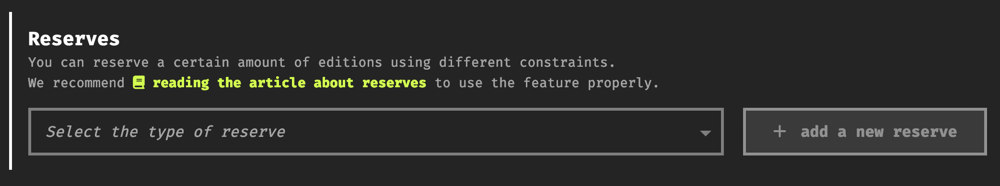

Refer to the other resource to learn more about allow lists.

### 7. The Enable Toggle:

The “Enable” checkbox allows you to disable minting of your project. If you want your project to be mintable by collectors, you need to select this toggle. Sometimes it is useful to disable a project, for instance when you need to change some of its settings.

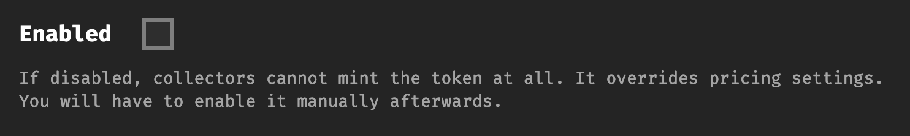

#### **Pricing Considerations**

Deciding on a price point for your work is a challenging yet necessary step before releasing your project on fxhash. Some general considerations for both emerging and established artists in this regard are:

- **Human Factors**:

  - **The size of your social media following (potential collector base):**
  - **Apparent interest in your project from teasers and WIPs:** are your WIPs garnering a lot of engagement on social media? Are people talking about your work? Have people asked when you’re going to mint?
  - **How long have you been active in the generative art/creative coding space?** Are you a veteran generative art wizard or just starting out on your generative art journey?
  - **The success of your previous projects (if any)**: did your previous projects mint out instantly?

- **Project related factors**:

  - **How varied is the output space of your project?** Does your project have the ability to generate a large variety of different styles? Or is it limited in that regard? After how many iterations do generated outputs become repetitive?
  - **The edition size of the project:** adding on to the previous point, there is a soft correlation between price and edition size, usually a larger edition size warrants a lower price point, but that’s just a rule of thumb.
  - **How innovative your project is**: does your project stand out aesthetically and/or technically from the project that currently exist on fxhash?
  - **The amount of work/time that went into your project:** how long did it take to complete the project? What would you consider a fair price for the amount of effort that went into your project?

- **Market Conditions**:

  - You also need to consider the state of the market, if it’s currently a bear market or a bull run, and whether collectors are currently in a state of mind for collecting or not.

These are some of the aspects that you should keep in mind to find a good pricing/edition ratio, ultimately you need to strike a balance that considers all of these aspects. Beyond these general considerations, there’s also some different considerations depending on your state as an artist; if you’re just starting out, or already have quite a few projects under your belt.

### **Considerations for New Artists**

If you’re a new artist and are about to publish your first couple of projects your pricing is crucial. Without an active collector base, you’ll find it easier to attract collectors with lower prices, offering a low barrier to entry to new and established collectors. Besides the general considerations above, you can ask yourself some other questions and examine what other artists are doing on fxhash:

- What prices did other established artists use for their first projects?
- What are some of commonly used pricing/edition size schemes on fxhash
- If you’ve sold previous work on fxhash or elsewhere, what was the average selling price?
- Do you anticipate releasing often or seldomly?
- From an external perspective, how much would you be willing to spend to collect an interation of your project?

Once you've answered these questions, you should have an idea of where you’d like to price your upcoming project.

### **Considerations for Established Artists**

If you have an active collector base and are ready to release a new project on fxhash — pricing becomes much more complicated and may require extensive consideration. Below is a list of recommendations to employ while determining the price of your work.

**Median floor price** What is the median floor price of your work across your collection of projects? For example, if your median floor price is 250 XTZ across two previously minted projects on fxhash — 250 XTZ may be the ideal starting price (fixed or DA) for your next release.

**Hype and botting consideration** Established artists are typically targeted by bot networks that have the potential to mint out projects instantly. With this in mind, it’s recommended to price your upcoming project at a price that will deter bots while allowing real collectors a chance to purchase your work. To do so, fxhash enables artists to harness Reserve Lists (Allow Lists) and Dutch Auction.

Dutch Auctions generally favor a very high starting price, decreasing over time to more attractive prices for collectors of all levels. Although bots may still present a problem at a Dutch Auction's lower levels, more collectors are likely to purchase your work than if you had yet to employ the DA mechanic.

**Example 1:** You want to avoid an instant mint of your new 256 edition project that’s receiving a lot of hype on Twitter and Discord. Instead of using a fixed price mechanic of 250 XTZ, you can set the DA to 1,000 - 750 - 500 - 250 - 100 XTZ. In this example, the artist provides a range, and the market participants (collectors) determine the fair and final value. Suppose you want to avoid utilizing the DA mechanic but want to ensure your work gets into the hands of previous collectors. In that case, the Reserve List is an excellent method to generate a list of prior supporters’ wallets. Whether you choose to produce a 100% Reserve List or a 50% AL/50% Public FCFS (or any other ratio) is your decision. **Example 2:** You want to reward your collector base by ensuring they have unencumbered access to your upcoming 500 edition project. You can generate a list of wallets that hold at least one of your previous works and then use a lottery system to pick 500 winning wallets. Once the mint is live, only these 500 Allow Listed wallets can access the project. After a predetermined time, you can open the project to the general public on a FCFS basis if the project is not minted out. In this example, pricing is flexible due to the absence of bot networks.

**Example 3:**

Similarly to Example 2, you could also over-allocate the allowlist, meaning that more collectors are allowed to mint than the project's edition size. This encourages minting, as supply is less than demand. After a predetermined time, you can open the project to the general public on a FCFS basis if the project is not minted out. In this example, pricing is flexible due to the absence of bot networks.Read more on reserves in the [Reserves documentation](https://www.fxhash.xyz/doc/artist/project-settings#reserves).

### A Note on **Market Dynamics**

Overall, artists should understand the constant shift in market dynamics. In general, *instant mints* are detrimental to new and established collectors alike. Higher prices are generally known to slow minting speed but also produce a barrier to entry of its own to new collectors. Established artists should understand that fluctuating market dynamics make it incredibly challenging to find the ideal price to satisfy *everyone*. However, fxhash offers a wide range of useful tools that allow the market to determine a fair value (Dutch Auctions) and the ability to show your appreciation to previous collectors with Reserve Lists.

Ultimately, it’s your decision to price your work as you see fit, but hopefully, this document helps you find the ideal balance while pricing your work on fxhash. If you’re still experiencing issues regarding pricing, please head over to the `# | artist-support` channel on [\*\*our Discord](https://discord.gg/fxhash).\*\*

### Platform Fees and Royalty Fees

Because Tezos and Ethereum are two different chains with their own characteristics, each one requires its own approach to fees — so you will find two different fee structures on fxhash depending on the chain.

**A pillar of the fxhash vision is ensuring artists take home as much of their earnings as possible,** we want you to make a living from your art, no matter who or where you are. We believe our fee structure is a reflection of that vision, and hope you find it fair as well. As far as collectors are concerned that engage with the secondary market, we seek to achieve a balance that enables them to enjoy the proceeds from a sale as well.

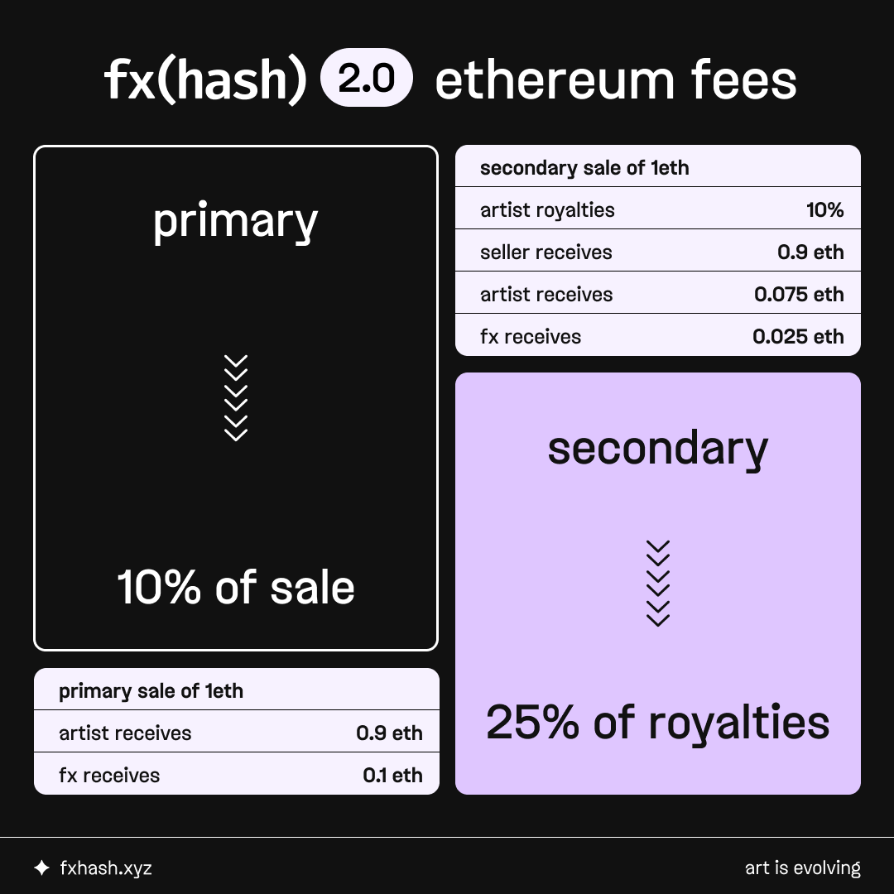

Hence our fee structure aims to minimize platform fees while maximizing the takeaway for everyone using fxhash:

- **Ethereum fees:**

  - primary sales: 10%
  - secondary sales: 25% of royalties, no marketplace fee

- **Tezos fees:**

  - primary sales: 5%
  - secondary sales: 2.5%

**Please take a moment to understand the ethereum fee structure**. There is no traditional fixed marketplace fee — instead, the only amount taken from a secondary sale is 25% of the royalties set by the artist. Let’s have a look at an example and see how this is broken down - in a 1 eth secondary market sale for an artwork set with 10% royalties:

- The **seller** receives .9 eth from sale
- The **artist** receives .075 eth from royalties
- **fxhash** receives .025 eth from royalties

This dynamic fee structure enables us to forego having a traditional fixed secondary marketplace fee and takes artists, buyers, and sellers into account. All the while **fxhash retains the lowest fees of any generative art NFT platform today.**
