# Withdrawing Earnings on ETH/Base via splits

*This section provides an overview of how to withdraw earnings received from ETH & Base fxhash projects, as well as an overview of the Splits smart contract app that’s used for this purpose.*

***With the integration of mainnet ETH and the Base L2, fxhash started using a solution call Splits to optimize the fund distribution. TLDR: To receive your project earnings, log into*** [***the splits app***](https://app.splits.org/) ***with the wallet that is supposed to receive the funds.***

## About [Splits.app](http://Splits.app) & Withdrawing Funds on ETH

When publishing a project on mainnet ETH or the Base L2 network, funds received from the sale of the project’s editions do not directly/automatically get sent to your wallet, as you might be used to from releasing your projects on the Tezos side of fxhash - but rather get sent to a special contract that pools these funds from which they have to be manually withdrawn.

fxhash leverages [Splits.app](http://splits.app/) as an out-of-the-box solution to this end: Splits is a smart contract suite that provides all of the necessary functionality to optimize fund distribution on Ethereum based networks:

> [!TIP]
> **About the Split Contracts:** Split acts as an equity instrument by letting you define the percent of future value each recipient will earn. It's a payable smart contract that distributes all ETH & ERC20 tokens it receives among recipients according to pre-set ownership percentages.

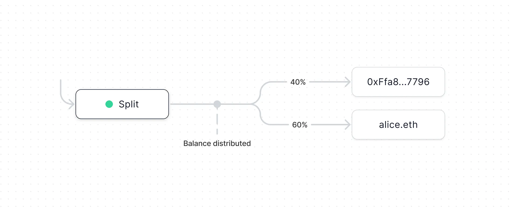

*If you’re curious to learn more about the technical details of these smart contracts work, you can explore the official [Splits](https://docs.splits.org/core/split) docs here.*

If you have an fxhash project on ETH/Base, your fxhash profile should show you a button under your connected Eth wallet address, from which you can withdraw the received funds:

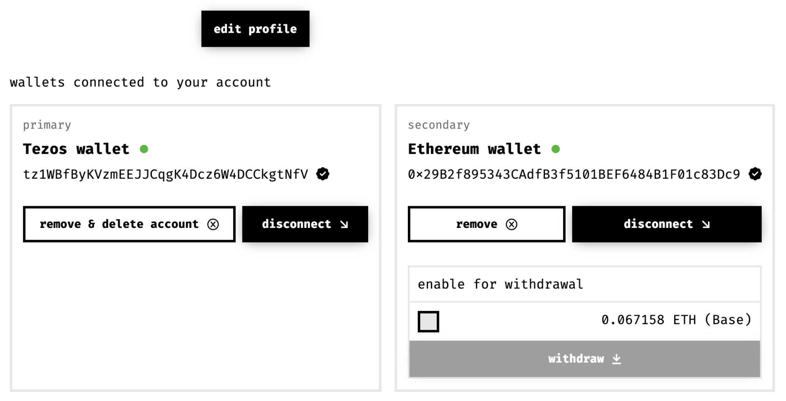

I should also show up in the your [Splits Dashboard](https://app.splits.org/) when you sync with the same wallet that you released the project under, where you can initiate the same withdrawal action.

## Splits for Collaborative Projects

Splits is also very convenient for collaborative projects, as it essentially streamlines the distribution of earnings between the involved parties - here’s an example for this, the project Week after Week, a collaboration between the WTBS team and the generative artist Alessandro Fiore:

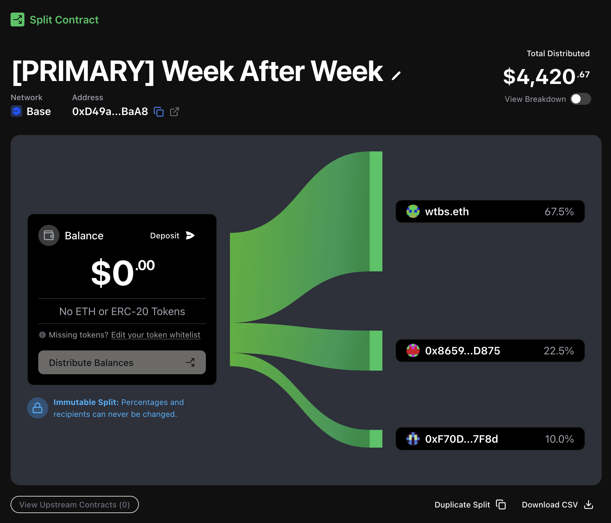

Each collaborative fxhash project on Eth will have its own page/view over on the Splits app that visualizes how the funds are distributed among the recipients, and wether or not there currently are funds to be withdrawn.

The same is true for royalties generated from secondary sales of the minted editions, they are pooled under their own Split and can be viewed separately:

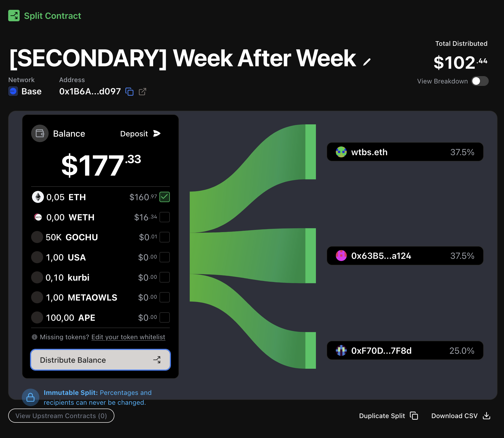

Clicking on the “Distribute Balance” will then prompt if you want to send the pooled funds to the involved parties, and optionally if you want to also directly withdraw them:

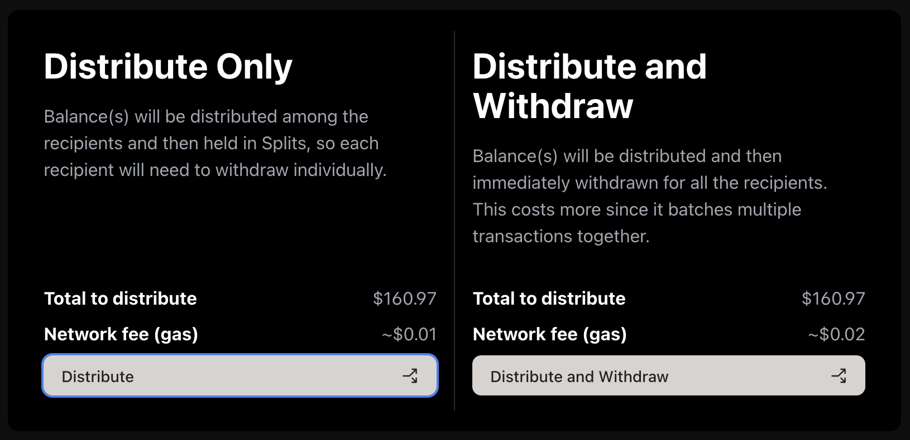

Some noteworthy points about the Split contract here:

- **Withdrawal of the funds can be initiated by any party**. It can be either one of the involved creators, or even another third party [is this accurate?]. Naturally, the funds will always only be sent to the addresses that are stored by the smart contract.
- **Splits are payable contracts.** This means that splits \*\*\*\*can received funds and tokens similar to how a regular wallet can receive assets. Withdrawing them is optional.

> [!WARNING]
> Always be cautious when handling unknown assets, the sale thereof might be malicious. Check the Safety and Security section of the docs for more info.

## Manually Withdrawing from Splits

In the case of an outage of some sort, it is also possible to withdraw the funds manually from the contract, which has to be effectuated from the [Etherscan.io](http://etherscan.io/) website (Etherscan is the primary blockchain explorer for ethereum).

**The steps for this on mainnet ETH are the following:**

1. Navigate to [Etherscan.io](http://etherscan.io/)

2. In the search bar paste one of the following fxhash minter contract addresses - depending on which sales method you have used:

   1. **dutch_auction_minter_v1:** 0x1bC736a2b144096a4752534C557D7E6C311CcAF1
   2. **fixed_price_minter_v1:** 0xB645cFfD9bFB93c2c181d5Be0D6a8C1d81C2aEf3

3. It will show you a dedicated page for the contract address, under which you should see a number of actions.

   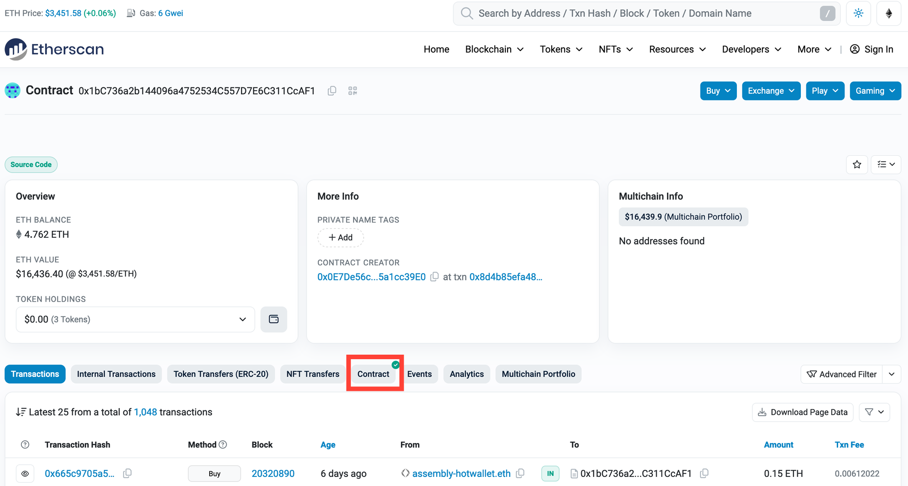

4. Click on the “Contract” button.

5. You should a new view that has an option called “Write Contract”

   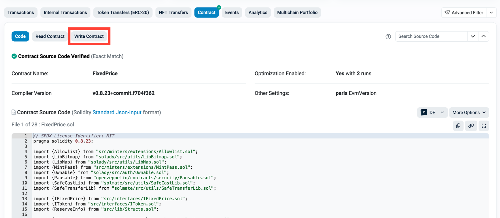

6. This will reveal a list of actions that you can perform - in this case we care about the very last one #12, titled “withdraw”

   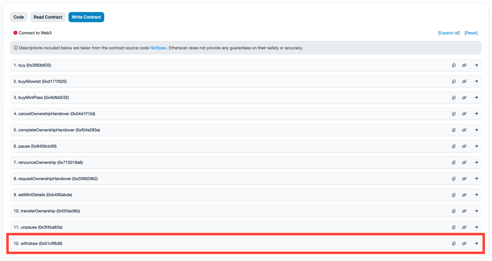

7. Clicking on withdraw will then reveal a field into which you need to paste the token address of the project’s funds that you want to withdraw:

   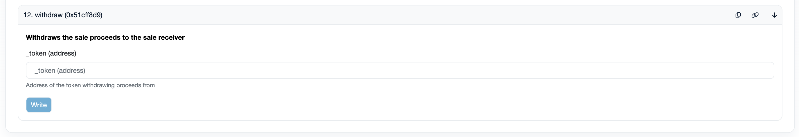

8. You can find your token’s address over on its fxhash page - example:

   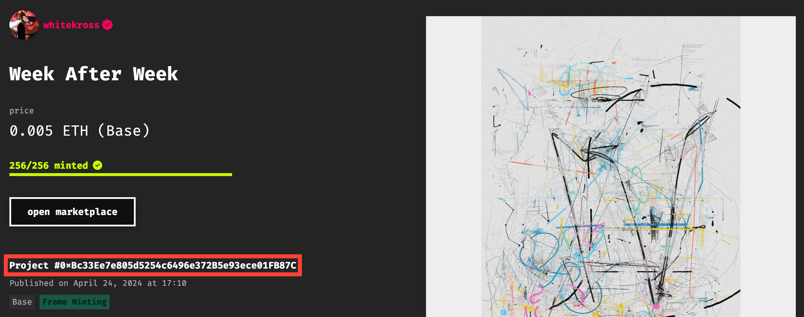

9. You also need to sync your wallet with [Etherscan.io](http://etherscan.io/) before you can effectuate the withdraw action - there’s a little button titled “Connect to Web3” that lets you do this:

   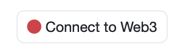

   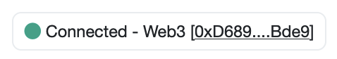

> [!WARNING]
> For tokens on the Base L2 you need to do these same steps, but via the \[Basescan.io](http://basescan.io/) website rather than Etherscan.
>
> The contract addresses for the fxhash minters are different in this case:
>
> - **dutch_auction_minter_v1**: 0x9667a1Cf26223c9de22207DD93cfEEc9237b8f4E
> - **fixed_price_minter_v1**: 0x4bDcaC532143d8d35ed759189EE22E3704580b9D
