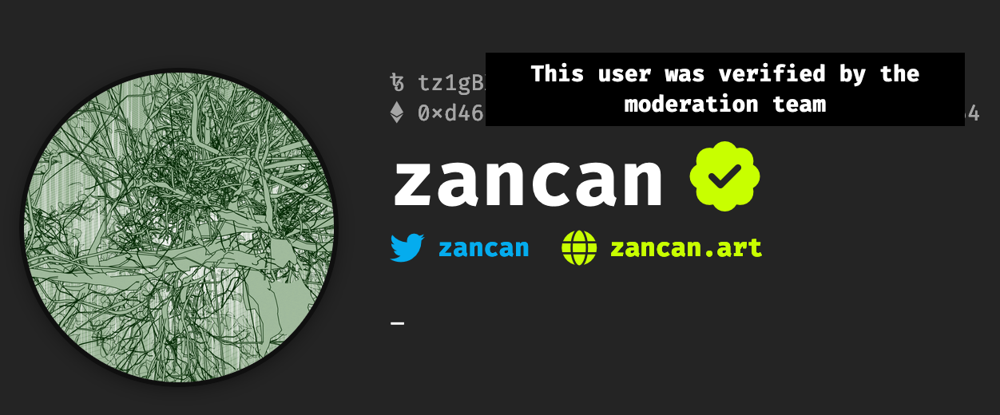

# Account Verification

*Details about the verification badge on fxhash and how to apply for verification.*

Verification systems and verification badges displayed next to users profiles on various platforms have established themselves as an important feature, they serve several purposes:

- **Authenticity and Trust:** They confirm that an account/profile belongs to the real person, brand, or organization it claims to represent. This helps to build trust and credibility with users, as they know they are interacting with a legitimate source.
- **Combatting Impersonation:** Verification badges can help to prevent impersonation and fraud, as it becomes more difficult for someone to create a fake account and pretend to be someone they are not.

On fxhash the verification system is put in place to indicate the legitimacy of artist profiles on the platform, which is crucial for collectors to verify prior to purchasing a token. Being verified on fxhash has two benefits:

1. Verified artists automatically bypass the 3 hour safety lock that’s imposed on projects set with an immediate release. As the name suggests, the three hour lock prevents projects from being collected in the initial three hours of their release where projects that are set to release immediately are disabled for the initial three hours to prevent them from being collected. (such that they can’t be collected in this 3 hour time span) between submitting a project, and the project becoming live (if it is set to release immediately).
2. A badge next to the artist’s name/profile picture on the platform to reflect the verification status.

At this point in time, there are no other benefits to verification. Verification essentially signals the moderation team that they can trust that your work is yours, follows the CoC and that the intentions of the work are sound. That's it. Those simple measures help in preventing scammers from reaching the front-end of the application.

> [!NOTE]
> **Verification on the fxhash platform and Discord are manually applied to applicable applicants, public figures and companies that are at risk of being impersonated.**

> [!WARNING]
> **Verification is not a right, and the lack of verification does not limit the chances of your work being minted.**

### Verification Criteria

Since verification is a manual process, whose main goal is to prove authenticity of the account, there are a few things which greatly help us to easily and quickly verify you. These are:

- Correctly linked fxhash account, wallet address, and Discord
- Proof of existence and work outside of fxhash. This means a twitter account that has some history, instagram etc.
- A history of work, either on fxhash or another platform - that makes sense in context (e.g. a history of generative/code based practice)
- A personal website with extra information about you, or an active GitHub, codepen, openprocessing or equivalent.
- No history of shady activity (e.g. previous moderations or unverification)

Having multiple minted works, being an active member of the community, having a strong body of work external to fxhash, being a model community member and having socials linked to your account all strongly aid a successful verification.

If you believe that you're applicable for verification, but do not wish to share any of the above - it makes it very hard for us to spend time on your case. If you want to share extra details with a moderator regarding verification, please DM them

### How to get Verified

Getting verified simply boils down to filling out the following form: [fx(hash) verification application](https://docs.google.com/forms/d/e/1FAIpQLSdhtplXEaT_77gSZSyXjjlYg9j4VIg9sWkKBiwkrnmxSCtMRA/viewform)

> [!NOTE]
> **NOTE**: this form **DOES NOT** require an email address, and we **WILL NOT** be able to see your email address if you are signed into google.

If you have already requested verification, but feel like you have been overlooked, missed, or otherwise haven't received verification as of yet, feel free to fill it in again. **Make sure you have an fxhash account before verifying, if your address results in a 404, we cannot verify you.**

### The verification process

Once you have submitted your verification a moderator needs to review your account to see if your profile is in line with our criteria. **We check these once per week and process the approved accounts in batches.** Due to the number of applications we will not notify you individually if you are approved or not. But feel free to reach out in the Discord and a moderator or community support member may be able to give you an explanation.

If you are told that you have failed, or after a week have not been verified, you are free to try again.

### Losing your verification

If you act in a way which is against the [CoC](https://www.notion.so/Code-of-Conduct-f9c4eb27214841b6a6e90348f904da8d?pvs=21), do harm to the community, or become untrustworthy, the moderation team reserves the right to revoke your verification. Since the verification is essentially a way for the community to instantly know who is and isn't trustworthy in the eyes of the moderation team, we cannot allow untrustworthy members the privilege of verified status.

Before you lose your verification we will likely reach out to you in case we have come to the wrong conclusion surrounding your status - it is unlikely that you will randomly lose your verification without priorly being made aware of it. In some rare instances you may have been verified without actually meeting the correct criteria, much like before we will reach out to you to let you know.

### Collector Verification

Verification is mainly for the purpose of preventing bad actors from creating works that don’t comply with fxhash’s [Code of Conduct](https://www.notion.so/Code-of-Conduct-f9c4eb27214841b6a6e90348f904da8d?pvs=21). Therefore collector verification is not commonplace yet, but might be subject to change in the future. If you are a prominent large collector with an extensive collection you can however still fill out the form or reach out to moderators for verification purposes.
