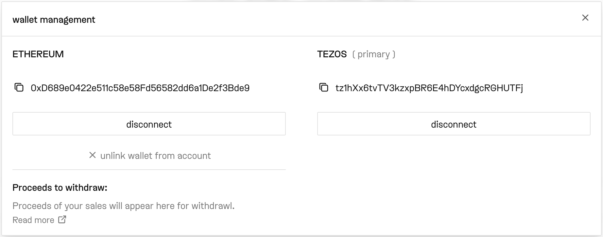
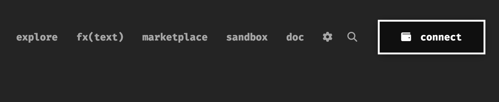
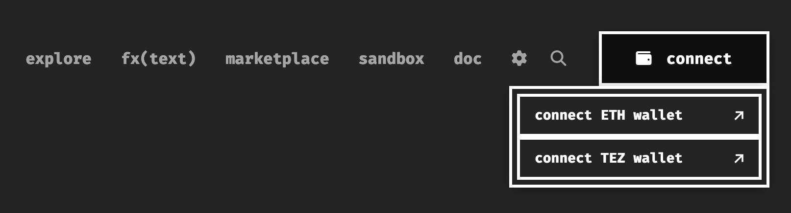
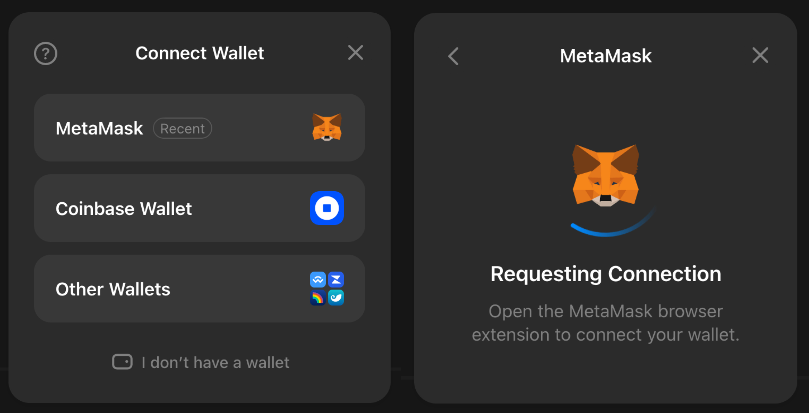
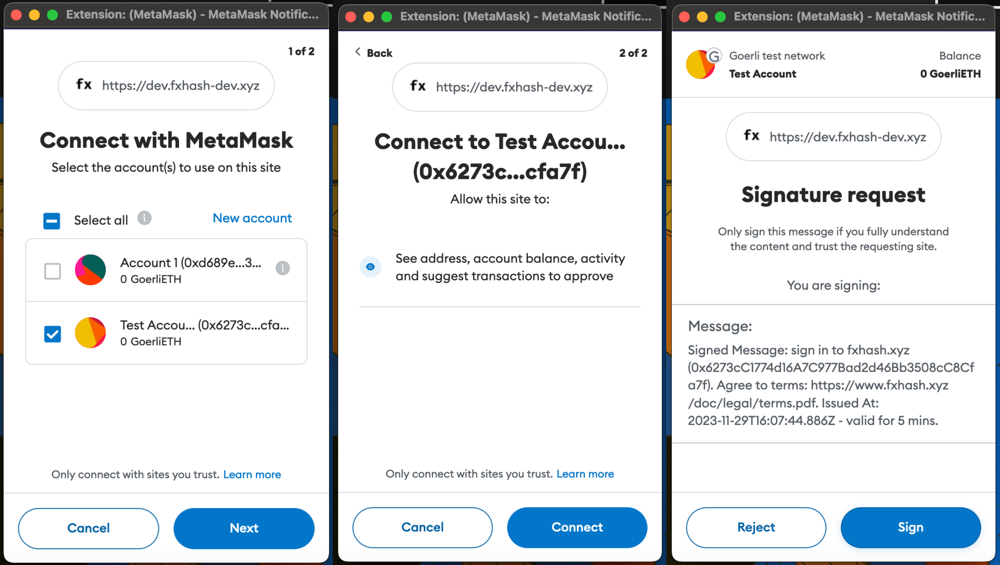
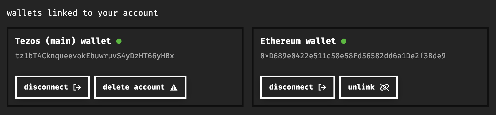
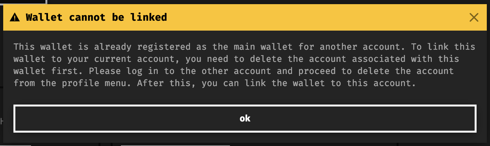
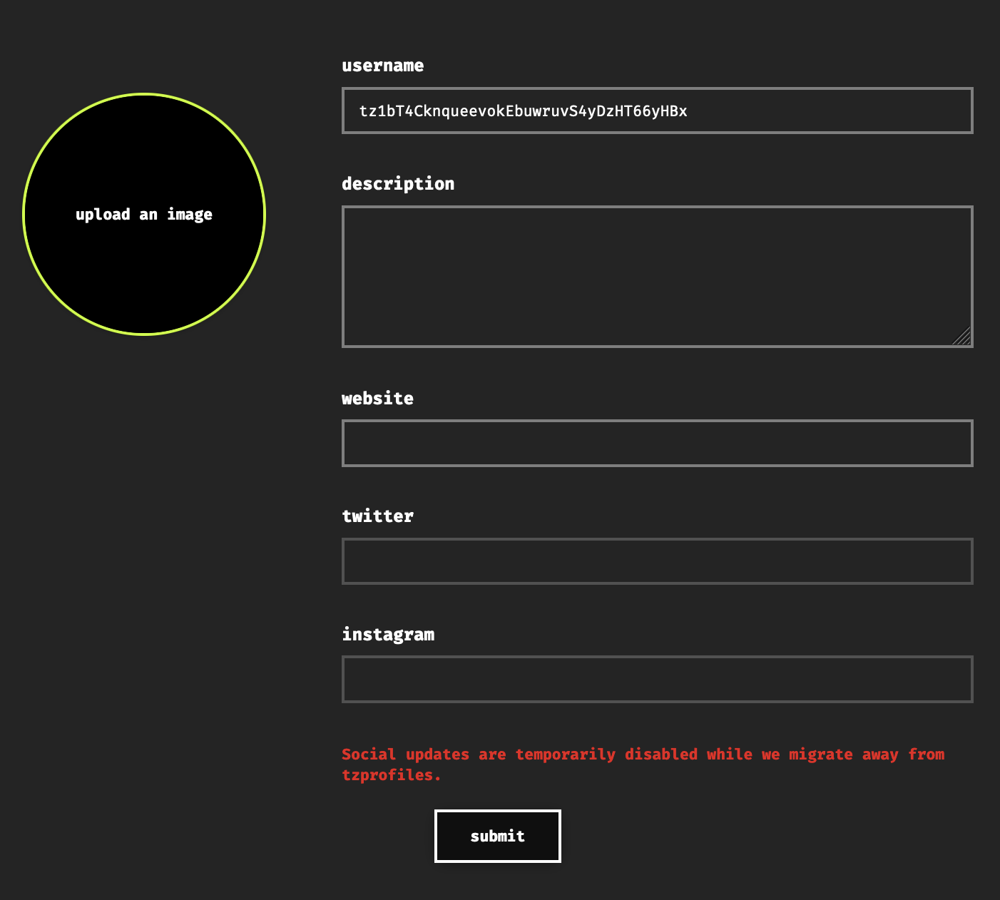

# Creating an Account

*How to connect your wallets to fxhash and setup your profile information*

Because fxhash supports both the Tezos and Ethereum chain, it needs to support wallets that can connect and interact with those chains. For this purpose a system has been created where users can link two wallets at the same time - a primary and secondary wallet:

> [!NOTE]
> **What is a wallet?**
>
> A cryptocurrency wallet, often simply referred to as a wallet, is a digital tool that allows users to store and manage their cryptocurrency holdings as well as their digital tokens that exist on the blockchain.
>
> Essentially, a wallet is a software (often in the form of a browser extension) that stores the cryptographic keys (private and public keys) needed to access and manage the owned assets on the blockchain. Usually it also provides useful functionality to create multiple addresses and to manage their corresponding keys.
>
> If you don’t have a wallet yet, you can find a detailed guide to setting one up for each chain here:
>
> [Creating a Wallet](https://www.notion.so/Creating-a-Wallet-6210b8b2987444f1bedbe78cf6943b68?pvs=21)

Once you’ve set up one or both wallets for the chains that you’d like to create or collect art on, come back here to set up your fxhash account and profile.

### Creating an Account

Creating an account on fxhash requires an Ethereum or Tezos wallet. When navigating to the fxhash website, you will see a large ‘Connect’ button in the upper right corner next to the other navigation items:

Pressing that button should reveal a drop down list with two options:

There you can then choose which wallet you would like to connect. If you have both an Ethereum and Tezos wallet, the one that you choose at this point will become your primary wallet.

> [!NOTE]
> **Primary Wallet**: If it’s the first time connecting to fxhash make sure to connect with the wallet that you intend to use most often, from which you want to create your main projects or hold your main collection - the first connected wallet will become your primary wallet.

Pressing the Connect button will open a new view showing all supported wallets, choose the one that you would like to connect with:

Selecting your desired wallet will then trigger it, requiring you to verify this operation through a number of steps:

1. Make sure to select the appropriate wallet address that you want to connect with.
2. Approve the connection request.
3. Approve the signature of the request - this only has to be done the very first time.

After completing and verifying the required steps from your wallet you can already notice a change in the interface, where the connect button has changed into a circle - in the future you will see your profile picture here once you update your profile settings.

Clicking your profile circle will reveal a drop down list of link to pages from which you can manage your creations and collection, and all of the other features that fxhash provides. At the very bottom it also shows the connected wallet - here we connected with a Tezos wallet, we could now additionally connect an ethereum wallet.

We can now navigate to our profile (via the profile button) where we can see your connected wallets, and also equivalently connect a wallet for the other chain.

### Linking a Secondary Wallet

Besides the primary wallet that has been connected, we can now also link a wallet for the other chain, Ethereum or Tezos depending on which one was connected first. In this example we connected a Tezos wallet first and an Ethereum wallet second:

Linking a secondary wallet for the other respective chain is important if you want to interact, create, or collect with projects minted on that chain.

### Wallet Management

There is two operations for each wallet. For the Primary wallet:

- **Disconnecting your primary wallet**: this is equivalent to logging out of your account. Reconnecting your primary wallet will grant you access to your profile again.
- **Deleting your account**: this essentially deletes all off-chain information associated with your account. The respective projects created with this wallet address are not deleted, they will always stay linked to that wallet address. Deleting the account simply means that the fxhash profile of this account is deleted.

For the Secondary wallet:

- **Disconnecting your Secondary Wallet**: logs out of your secondary wallet, but doesn’t log you out of your profile. It makes the secondary wallet unavailable for usage, and you would have to reconnect it to use it.
- **Unlinking your secondary Wallet**: essentially removes this secondary wallet, which would also remove all project created and collected with this wallet from your profile. You can always re-link it as well.

## Linking an Existing Wallet

If you are trying to link a wallet as a secondary wallet, while this wallet is already connected or linked as a primary or secondary wallet in another account, you will obtain the following warning:

If this is the case you will have to unlink the wallet (if it is linked as a secondary wallet) or delete the account associated with that wallet (if it is connected as a primary wallet) to make it available for linking.

## Editing your Profile

Editing your profile is simply done by clicking the edit profiel button, that will take you to another view where you can enter all of your details:

Temporarily linking social media profiles is disabled due to the migration that fxhash is currently undergoing.
