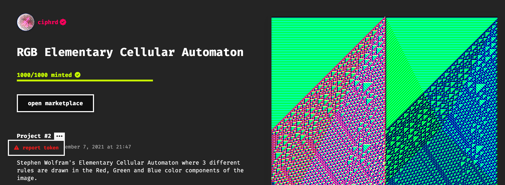
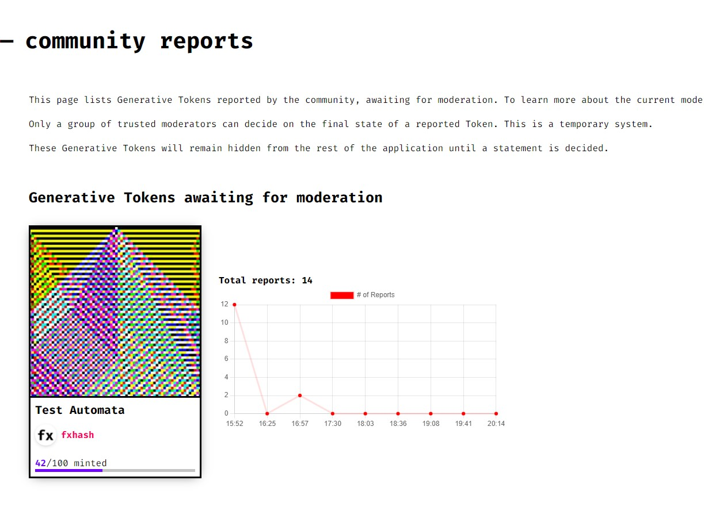
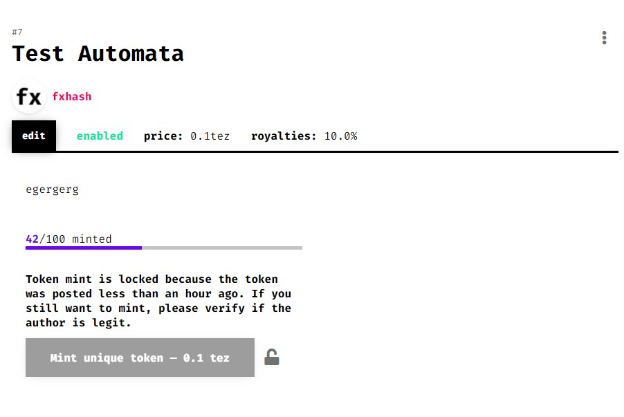
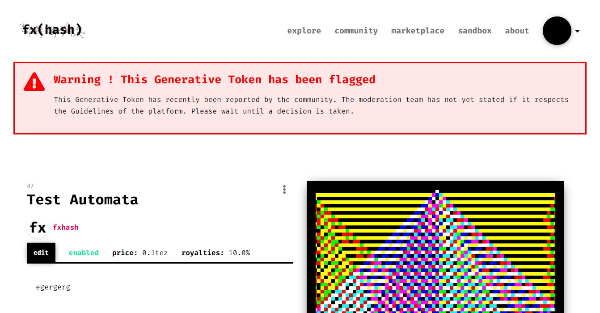
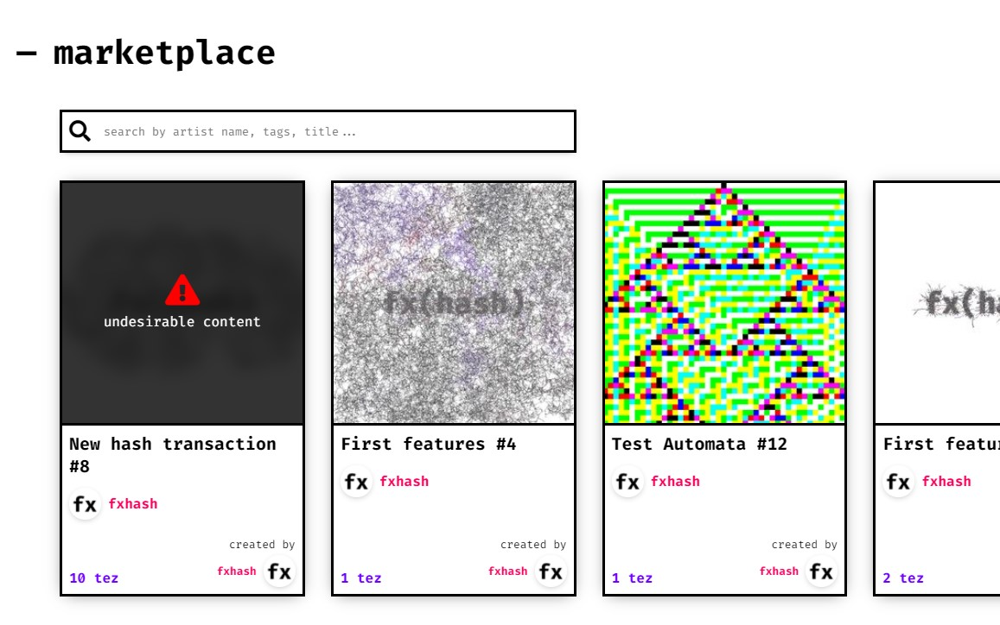

# Platform Moderation

*An overview of fxhash's moderation system, guidelines, and procdeures*

While fxhash embraces an open model, this open nature also makes it a perfect target for malicious individuals and bad actors. Back in 2021 when fxhash was still at the start of its journey, copyminters took advantage of the momentum and the good energy in the community to scam enthusiastic collectors.

> [!NOTE]
> **What is a Copymint?** A copymint is a project published by someone other than its original author, that doesn't have the right. This is done with the malicious intent of profiting from someone else’s work.

Because of the open nature of fxhash, no curation of the content is made prior to projects being minted. Regulating such malicious behaviour becomes difficult. And although verification is a first step in the prevention of malicious mints, more tools have been deployed since - one of them being the “Report and Moderation System". A set of features added to the front-end to protect collectors from malicious projects.

### The Report System

Members of the community can report suspicious projects on their respective pages:

*The three dots next to the project number reveal a report button.*

> [!NOTE]
> **Note**: You need to be connected with a wallet to report a project.

Reporting a project in this manner is considered a “vote” for the moderation of this project. This vote from a member will only count if it meets certain criteria:

- The reporting member posted at least one Generative Token OR owns at least one GENTK
- Only one report/account/project was made
- The project was not flagged as `CLEAR` by a moderator

The report is sent to a Smart Contract which is indexed by fxhash, and the reports are processed when they reach the blockchain. If 10 votes are counted in the span of one hour, the project will be flagged as `REPORTED` by the indexer.

Once a Generative Token is flagged as reported, it will be hidden from the main, explore, and user creations pages. It will then enter a moderation stage, during which only trusted community members will have the authority to decide if the Generative Token can remain on the platform.

### The Moderation System

When a Generative Token is flagged as “REPORTED”, it will appear in the [**/community/reports**](https://www.fxhash.xyz/community/reports) page. On this page, moderators will have the ability to update the flag of the token to:

- **CLEAN**
- **MALICIOUS**

If a token is moderated as `CLEAN`, it will become accessible again, and reports will **no longer be counted**. It will never be flagged as `REPORTED` by the system again.

If a token is moderated as `MALICIOUS`, then it will **remain inaccessible on the main, explore, and user creations pages**. If some Gentk were already generated using the Generated Token, **they will be flagged as “undesirable content”**.

The moderation system does not set a finite flag on a Generative Token. A manual operation can update the state manually. Also, if a moderator sees an undesirable Generative Token, they can remove it from the UI manually, and so by calling a Smart Contract.

#### 3-Hour Lock

One issue remains with the system described above. There is no way to establish if a Generative Token can be minted safely in the moments following its release. If no moderator is present, at least 10 reports are required for the token to be flagged, and it can take some time. *This next feature helps in that regard*.

The mint button of a Token will appear as **locked** for three hours after the project is published on fxhash. This lock acts as a reminder for the collectors to assert the validity of a project before minting from it.

> [!NOTE]
> The lock can be removed by clicking on it, and by doing so acknowledging the risks of minting from a recent token which did not go through the community/moderators approval.

### Warnings on flagged Projects

Finally, a warning will appear at the top of all the Generative Tokens flagged. It will also appear at the top of GENTKS minted from flagged projects. It acts as a last-resort warning to inform members.

On the marketplace (and anywhere a Project Card is displayed) a warning will be displayed.

### Purpose of the Moderation System

This system was designed to meet certain criteria:

- Protect collectors from collecting copymints or otherwise malicious projects
- Keep the platform open to all artists
- Give the community the ability to self-moderate Generative Tokens
- Aid the moderation team to quickly identify malicious projects

fxhash is a constantly evolving platform, this system can potentially change in the future to best adapt to the community’s needs. We are always more than happy to hear your feedback in the discord.
