# Genart on the Blockchain

*An introduction to Generative Tokens and GENTKs.*

In contrast to traditional NFT marketplaces, where the purchase of a digital asset simply involves a transfer of ownership between seller and collector, fxhash introduces a new paradigm for the distribution of code generated artworks. Instead of having generative artists mint individual outputs from their generative systems as NFTs, they can now mint the code itself such that it acts as a generator for digital collectibles. On fxhash we refer to these artist created generative systems as **Generative Tokens**.

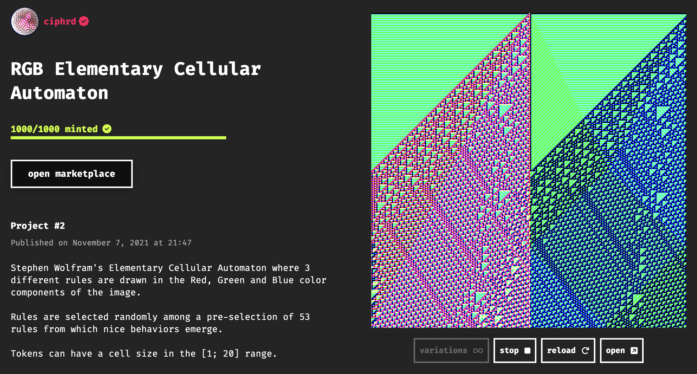

Collectors can then acquire ownership over individual outputs produced by these Generative Tokens. We refer to the collected outputs as **GENTKs**.

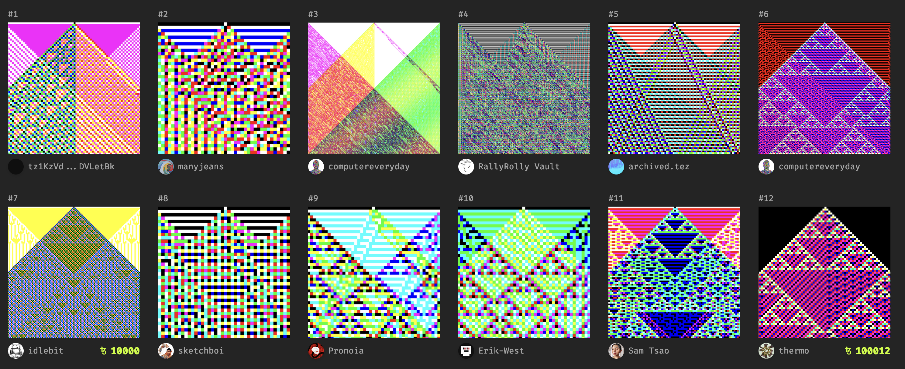

By providing the technological infrastructure and a web based interface, fxhash facilitates this tokenization process and streamlines the distribution of generative art in form of digital tokens on the blockchain. In this section we'll have a closer look at the intricacies of how fxhash handles the distribution of code generated artworks.

### **What are Generative Tokens?**

Taking a step back, we defined generative artworks as code based systems that have the ability to generate different kinds of media artifacts. Depending on what the code artist aims to express, these systems can come in many shapes and forms. Most popularly they are designed to generate static, sometimes animated, computer graphics drawn to a digital canvas. The key-concept here is that these code based generative systems have the ability to generate a variety of outputs by leveraging random processes:

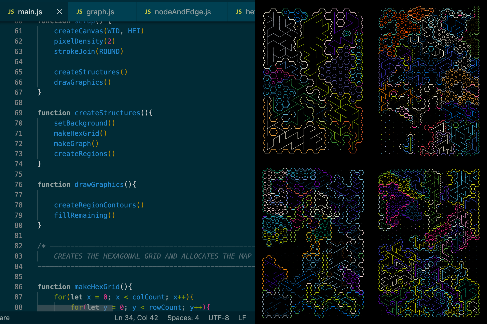

*A generative artwork is a label for a piece of code that can generate a variety of different outputs.*

A generative artwork is a label for a piece of code that can generate a variety of different outputs.

On fxhash generative artworks become Generative Tokens. To fully understand how Generative Tokens function and how collectors can actually acquire ownership over individual outputs of a Generative Token, we need to talk a little about randomness, how it is achieved in programming, and how fxhash leverages it for this purpose.

In many applications and computer programs it often is the case that the programmer wants to make a random decision, like simulating the roll of a dice for instance. This can be achieved with random number generators, frequently abbreviated as RNGs. If you're a fan of video-games you might already be familiar with the term:

> [!NOTE]
> **What is an RNG?**
>
> RNGs, or Random Number Generators, are algorithms designed to produce sequences of numbers that lack any discernible pattern. These numbers appear to be random and are commonly used in various applications, such as computer simulations, cryptography, and gaming.

RNGs are also incredibly useful in generative art where they're leveraged to introduce randomness into the algorithmic procedures that create the ultimate graphics. Using RNGs has the consequence that generative artworks produce a different output every time their code is executed. *That's why we call it generative art* *after all*.

Generative Tokens need to behave a little differently however. We don't only need them to be able to generate a variety of outputs via random processes, but also need them to be able to re-generate specific outputs, which is very important when it comes to assigning ownership over individual outputs - we want to be able to query and retrieve specific outputs from the Generative Token again in the future. How can this be achieved? By leveraging a special type of RNG, called Pseudorandom Number Generators:

> [!NOTE]
> **What is a PRNG?**
>
> Just like an RNG, a Pseudorandom number generator is also an algorithm that has the ability to generate sequences of random numbers that appear to be random. The difference is that these generated sequences are actually generated in a deterministic manner. Meaning that they are in reality predictable and reproducible - which is an important property in the context of Generative Tokens.

The exact sequence of "random" numbers generated by a PRNG is usually determined by an initial **seed** value:

> [!NOTE]
> **What is a Seed?**
>
> An initial input value passed into a pseudorandom number generator. This input seed is used by the PRNG to generate a specific sequence of random numbers. The PRNG will always generate the same sequence of numbers given the same input value.

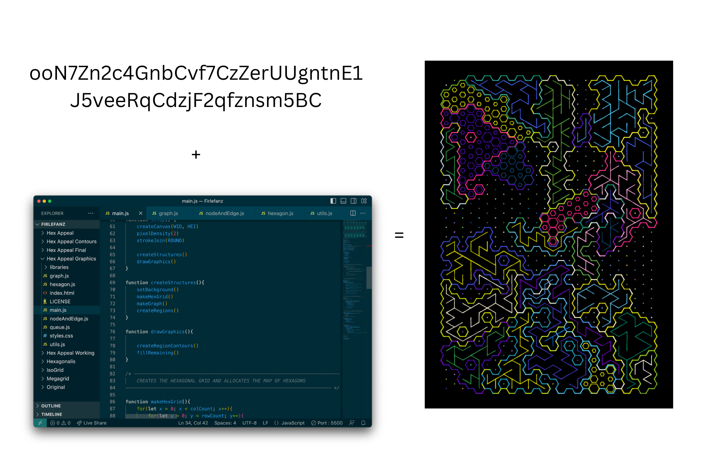

*The same seed should always generate the same output.*

This is in essence how Generative Tokens work. They are code based systems that leverage PRNGs to deterministically generate specific outputs. Generative Tokens are in this manner deterministic systems:

> [!NOTE]
> **What is a Deterministic System?**
>
> "Deterministic" is an adjective used to describe systems, processes, or events that are predictable and governed by fixed rules or deterministic algorithms. In a deterministic system, given the same initial conditions and inputs, the outcome or behavior is certain and follows a specific, predefined path.

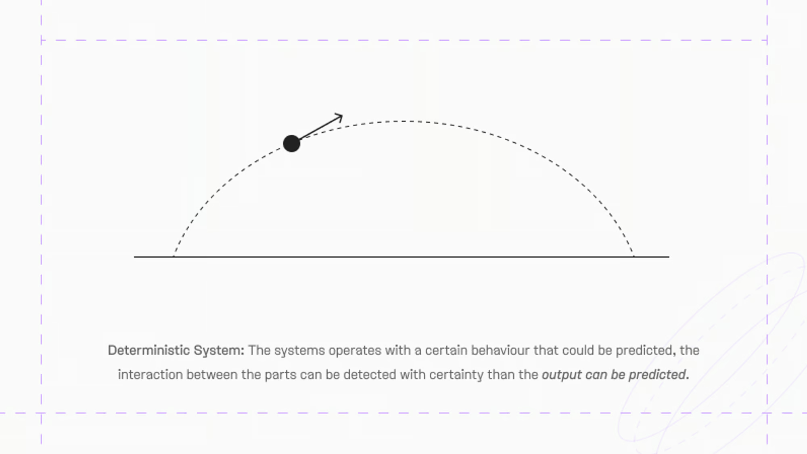

Now we still need about how to generate these input seeds and how to attribute them to individual owners. And this is where blockchain technology comes into play: when a collector collects an output from a Generative Token, a blockchain transaction gets registered which comes with an associated transaction hash. This hash simply being an alphanumeric string is perfectly suitable for seeding a PRNG.

> [!NOTE]
> **What is a transaction hash?**
>
> A blockchain operation hash, often simply referred to as a "transaction hash" or "tx hash". It is a unique identifier for a specific transaction on a blockchain. It is a long string of alphanumeric characters that is generated through cryptographic algorithms, and serves as a digital fingerprint for that transaction.
>
> In the context of Generative Tokens on fx(hash), it's the initial input value that determines the specific iteration a GENTK will produce.

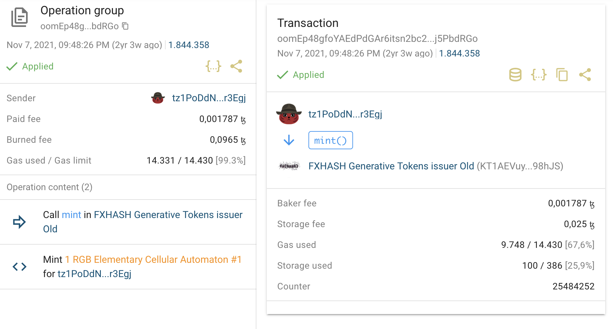

*There are various websites that allow the inspection of transactions on different blockchains. Here’s an early fxhash transaction on the Tezos blockchain as seen on [tzkt.io](http://tzkt.io)*

**Now it should also makes sense why the platform is called fx(hash)!** Since the transaction hash originates from the blockchain, it is immutable and can be used a reliable source for seeding Generative Tokens. This is essentially how the fx(hash) paradigm comes to life - immutable blockchain transactions make it possible to distribute unique outputs of deterministic generative artworks to collectors.

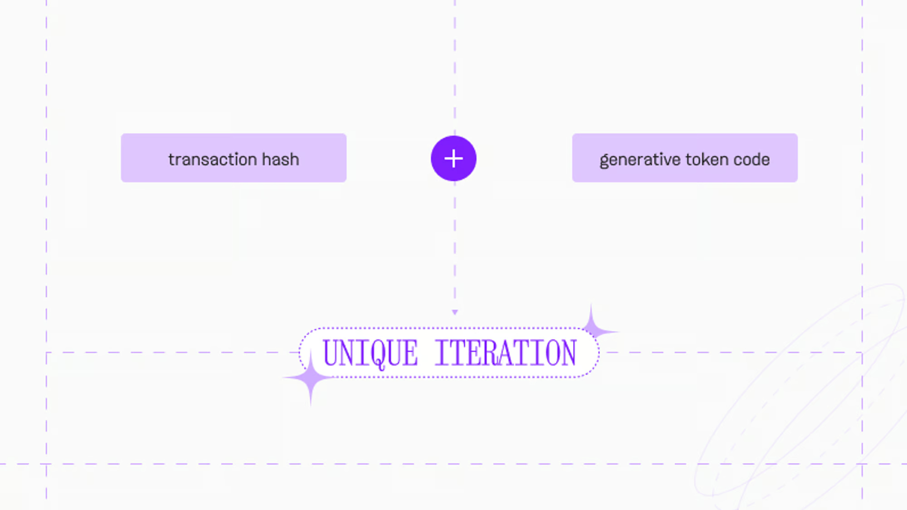

> [!WARNING]
> It's important to point out here that artists hold the responsibility for creating and correctly implementing the code behind these deterministic generators—if not done with care and according to platform specifications, it can lead to a plethora of issues.
>
> Although fx(hash) provides the tools to create and publish generative tokens, it can not be guaranteed that these generative tokens always work correctly, hence collector discretion is advised.

> [!NOTE]
> fxhash provides a number of different tools and features aimed at assisting artists in the development of their Generative Tokens - detailed explanations about these tools as well as instructions for properly configuring Generative Tokens in an fxhash compatible manner can be found in the **fxhash Artist Guides.**

### How are Generative Tokens stored?

When an artist creates a new Generative Token on fxhash two things happen:

1. A metadata file is written to the blockchain holding descriptive information about the project. This is essentially a Non-Fungible Token that represents the Generative Token on the blockchain and attributes authorship to its creator, and in this sense, a Generative Token is itself an NFT.
2. The project/code files are stored either off-chain on IPFS or on-chain with ONCHFS. The artist can choose their preferred storage solution at mint/upload time. The metadata file on the blockchain holds a pointer to these project files, which are retrieved and used for the purpose of generating new and old outputs whenever someone interacts with the Generative Token via the fxhash web interface.

> [!NOTE]
> **What is Metadata?**
>
> Metadata is essentially data that describes other data. For instance Generative Tokens on fxhash have an associated metadata file that holds information such as an ID, the publishing date, the number of iterations that can be collected, the location of the project files on IPFS or ONCHFS, etc. This information is required for smart-contracts to interact with Generative Tokens and GENTKs.

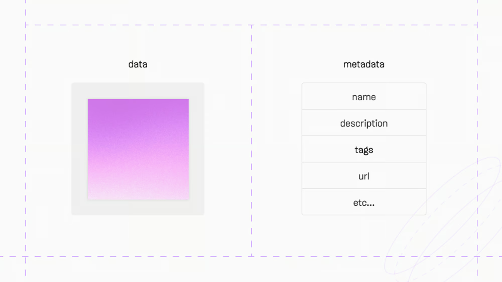

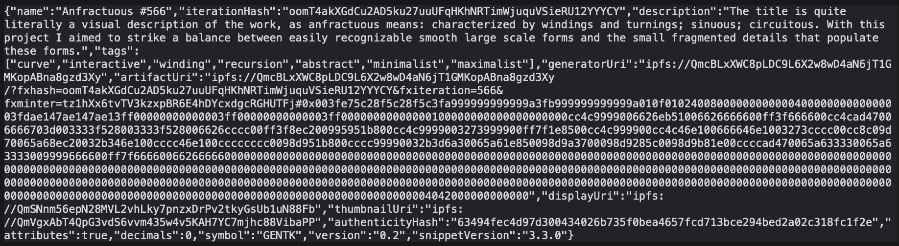

*What raw metadata looks like*

Traditionally, due to the high cost of storing files directly on the blockchain, decentralised storage solutions like IPFS are more commonly preferred to store files in Web3. This was the default storage method for the first two years of fxhash's lifecycle. With the introduction of ONCHFS however, it is now also possible to store projects in their entirety on the blockchain. You can learn more about the specifics of both IPFS and ONCHFS over in the Decentralised Storage Solutions page of the docs.

The project files that are stored essentially represent the code written by the artist. Moreover, because fxhash is a web-based platform that serves content over the internet, one requirement is that Generative Tokens need to be packaged in the form of small, self-contained web projects such that they can be served properly on the interface. In other words, this means that the stored project files for a Generative Token are little bundles of code that represent a tiny websites which display generative graphics.

### **GENTKs vs Generative Tokens?**

GENTKs are the collectible digital tokens that are spawned by Generative Tokens. You can think of Generative Tokens as little factories that produce artwork tokens. **Sometimes the two terms ‘Generative Token’ and ‘GENTK’ are used interchangeably for both the generative system and the output, but it should usually be clear which one is meant from context**.

There’s a couple of other terms with which we refer to GENTKs - sometimes we refer to them as an iteration from a specific project or as an edition:

> [!NOTE]
> **Iteration(s) and Edition(s)**
>
> Alternative terms to refer to GENTKs. *With the term **iteration** we're indirectly alluding to the notion of repetition in programming - we often use the term **iteration** or **iterating** in the context of instructions that are repeated a certain number of times. This is because Generative Tokens have the ability to generate many GENTKs.*
>
> Likewise the term edition is used, which stems from the world of publishing, where it is used to refer to a specific instance of a published work.

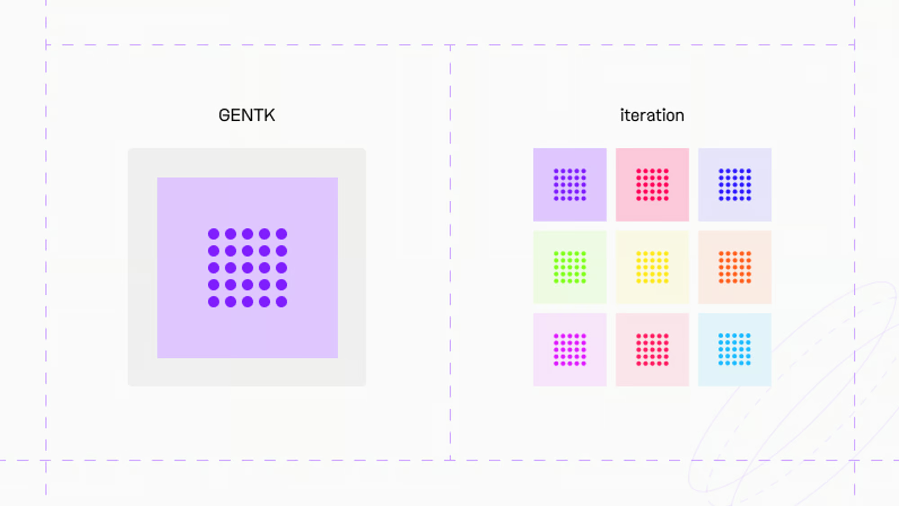

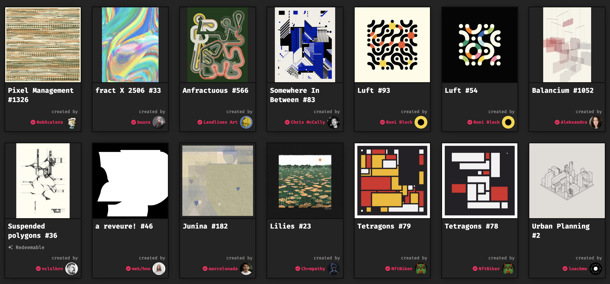

*Under the collection tab on your fxhash profile you can see all collected GENTKs.*

### What are GENTKs and how are they stored?

GENTKs are themselves NFTs. When a collector collects an edition of a Generative Token, **they obtain ownership of a metadata file that is written to the blockchain that represents this GENTK.**

This metadata file immutably links back to the parent Generative Token and also holds the necessary information that needs to be input into the Generative Token code to produce the collected output, such as the seed for instance. Additionally it also holds a pointer to an image preview of the output that is stored on IPFS, such that we don’t necessarily have to run the code to view the output and can simply fetch it from IPFS.

Here’s a brief breakdown of what happens behind the scenes when a collector clicks the `collect` button on a Generative Token's project page. Essentially two procedures take place - firstly, a transaction is registered on the blockchain and the input seed is generated:

1. The fxhash platform fires a smart-contract call and a new transaction is registered on the blockchain which subsequently creates a transaction hash.
2. The fxhash Ramdomizer module gets triggered, supplementing this transaction hash and preparing it to be passed into the Generative Token. Why not simply use the transaction hash as is? Although that is possible, there are certain security considerations that make this undesirable, which is why fxhash devised randomizer module for this purpose. You can learn more about the Randomizer module here.

After this initial transaction, the output is technically already accessible since the input seed exists, but the GENTK still needs to be created and written to the blockchain as a self-contained token - essentially, the GENTK NFT still needs to be created. The fxhash signing module takes care of this with a follow-up procedure:

1. The fxhash signing module gets triggered when it notices that a new transaction has been effectuated on the fxhash contract.
2. The respective project files are retrieved, then the previously generated input seed is used to create a preview image (by feeding it into the generator) as well as the metadata for the GENTK.
3. This metadata is written to the blockchain to represent the GENTK. Colloquially we say that the GENTK is “signed”. The preview image is stored on IPFS so that the collected GENTKs can be displayed on the fxhash interface without having to run the project code every single time.

After this second procedure is completed, the GENTK is successfully created and becomes it’s own standalone NFT.

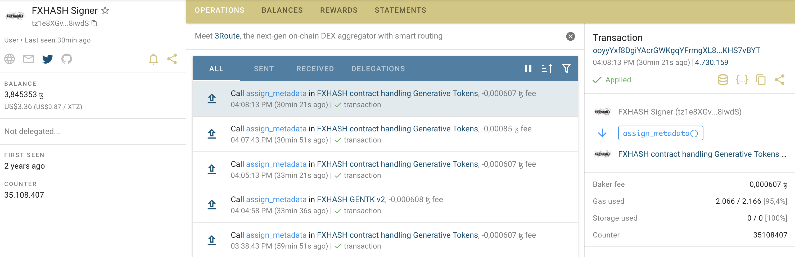

*The signer module in action as seen on [tzkt.io](http://tzkt.io)*

### **Summary**

With this we’ve already covered a lot of ground, and hopefully you have a much better idea of how fx(hash) works at this point. It’s important to understand how these different technologies tie into each to bring to life this new paradigm in digital art.

Let's recap the important notions that we've covered in this section:

1. Generative Tokens are packaged under the form of web based projects that display generative graphics in the browser.
2. Generative Tokens are NFTs. Their code/project files are stored on either IPFS or ONCHFS.
3. Generative Tokens are factories for unique collectible digital tokens called GENTKs. This is made possible by leveraging blockchain technology and Pseudorandom Number Generators.
4. GENTKs are collectible NFTs, each one is unique.

This is essentially how Generative Tokens work in their most basic form. It’s important to note here that new features like fx(params), where the collector assumes the role of a co-creator, has opened many opportunities for artistic expression and introduces some nuances to this process. There are also differences between Generative Tokens on the Tezos and Ethereum blockchains. Exploring the other pages of the documentation will elucidate some of these nuances.
