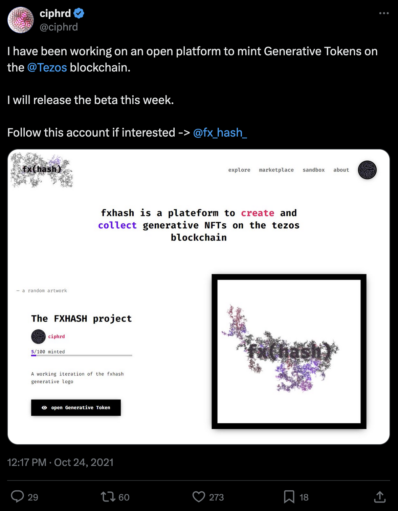
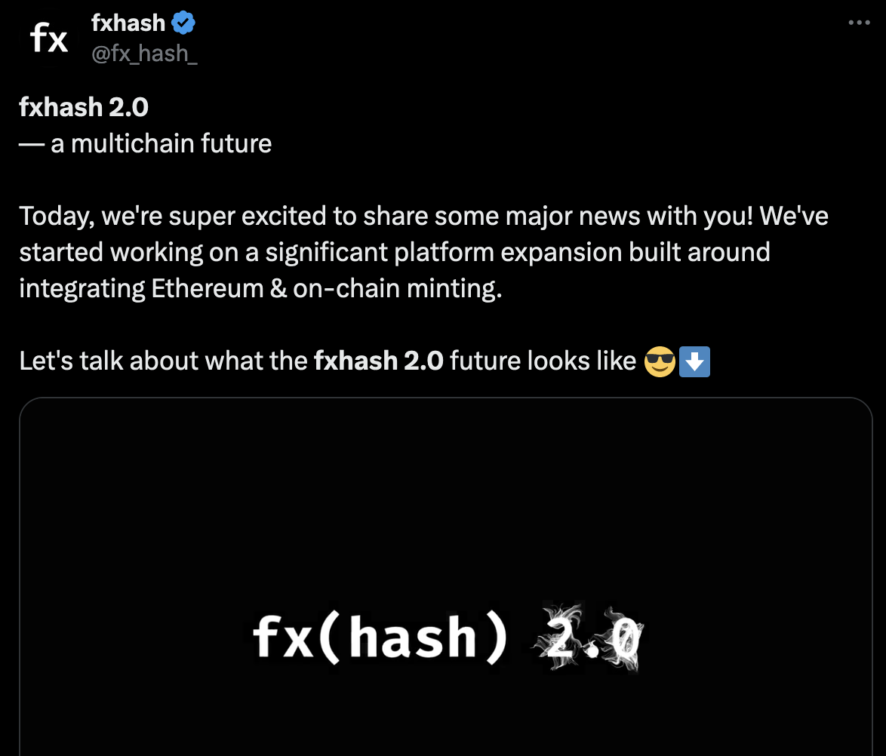

# Multi-Chain Integration

*This section explores the various blockchains supported by fxhash and delves into the rationale behind their adoption, highlighting the unique advantages each blockchain offers for the platform and it*

Fxhash has always been a platform that embraces openness. Since day one, we've fostered a thriving artistic community where creators of all levels can share their generative art. We understand that the world of blockchain technology is constantly evolving, and that it currently plays a crucial role in distributing generative art.

That's why we're consistently working towards supporting a wider range of popular blockchains. For these reasons it only makes sense to embrace a multi-chain approach. This allows us to tap into the strengths of each platform, and provide a varied, vibrant eco-system, whatever your preferred chain for creating or collecting might be.

Fxhash currently supports the following blockchains:

- **Tezos (XTZ)**: Following a surge in adoption by many artists in 2021, and as a user-friendly, low cost alternative to other smart contract chains, Tezos is an attractive platform for the creation and trading of generative NFTs.
- **Ethereum (ETH)**: Designed to address limitations inherent in Bitcoin, Ethereum established itself in 2015 as the first blockchain to incorporate smart contracts. This technological innovation served as a fundamental cornerstone for the overall popularisation of NFTs, and later equally for the distribution of generative art.
- **Base (ETH L2)**: developed by Coinbase, Base is an Ethereum Layer 2 scaling solution, with the objective of enhancing accessibility to the Ethereum blockchain while preserving the core benefits of the original Ethereum chain.

`*(A timeline graphic here could be cool, November 2021 Launch -> Then proper launch in 2022 -> Announcement of Ethereum Integration in 2022 + seedraise -> Ethereum integration in December 2023 -> Base Integration in 2024)*`

### fxhash 1.0: Foundations built on Tezos

fxhash was initially developed on the Tezos blockchain; due to its accessibility and minimal gas fees, it posited itself as an ideal environment for experimenting with smart contract technology. The emergence of the hicetnunc NFT platform in March of 2021 played a significant role in attracting a large influx of artists to mint their work as NFTs - ever since, Tezos has been recognized and celebrated as the "Art Chain".

Shortly after the platform's inception, pioneering efforts were made to embed Javascript code within SVG files, enabling interactive code-driven artworks to now live on the blockchain. This paved the way for HEN to directly support mints in the form of HTML files. The fact that Web-native NFTs were now a possibility proved to be a major draw for the creative coders and generative artists that previously relied on sharing their work as captures in non-native image and video formats. This innovation also allowed collectors to directly acquire code-based artistic creations, fostering a novel space for "code as art" exploration.

At that point in time the idea for a blockchain based distribution model for generative art had already been pioneered by Art Blocks on the Ethereum blockchain. Art Blocks' curatorial model however only allowed a select few artists to publish their generative systems on the blockchain, in addition to the high transaction fees of Ethereum that were virtually unaffordable and required a significant investment from the artists to simply get started without any promise of a return on investment. In other words, there was a significant number of hurdles to overcome with Ethereum, with Tezos these barriers to entry were lifted.

The foundations for fxhash were laid in November 2021 as an experiment by Baptiste Crespy, aka Ciphrd. The platform immediately attracted the interest of many of the generative artists that had already been dabbling in the NFT eco-system but were looking for a better and more accessible way to share their generative art.

*[Link to Tweet](https://x.com/ciphrd/status/1452217584028430345)*

### fxhash 2.0: Ethereum Integration

Ethereum transitioned away from an energy-intensive Proof-of-Work (PoW) consensus mechanism to Proof-of-Stake (PoS) on the 15th of September 2022. This marked a significant shift in how the network validates transactions and secures the blockchain, but also made a massive impact on the overall energy consumption of the chain - turning it into a much more environmentally friendly and greener platform. Previously the large Carbon footprint associated with Ethereum was a big reason for hesitance from many artists to mint their works the chain.

Throughout 2023 fxhash's efforts were primarily dedicated towards integrating the Ethereum chain into the platform, with a successful release in December of the same year. With a significantly larger **market capitalization** when compared to Tezos, a wider adoption rate, and considering that it has a couple of years of a head-start, the chain has a more established ecosystem with an average of 12M active wallets per month (at the time of writing), and therefore is a particularly attractive blockchain for collectors and artists alike.

> [!NOTE]
> **Market Capitalization (Cap)**
>
> Within the blockchain industry, the term market capitalization (or market cap) refers to a metric that measures the relative size of a cryptocurrency.

Besides that, Ethereum was also the first chain to pioneer smart contract technology, and currently enables a massive number of decentralized applications (dApps). For all of these reasons it only makes sense for fxhash to expand beyond Tezos and also support ethereum for a more varied eco-system.

Ethereum’s transition to Proof-of-Stake also enabled a new kind of scalability solution known as rollups. Rollups are essentially secondary chains that are built on top of a network’s mainnet, and process transactions off the primary chain in a more affordable manner before ‘rolling them up’ - batching them - and then writing them to the main chain. This solution greatly improves transaction speed and the associated gas fees. We often refer to these rollup solutions as L2s, or Layer 2 solutions, and generally the gas fees on them are a fraction of those on mainnet. fxhash now also supports Base, one of the current popular L2 chains that’s being developed by Coinbase.

- [Base | Ecosystem](https://www.base.org/ecosystem) — base

### Tezos vs. Ethereum

While explaining all of the minute facets of either one of the chains is beyond the scope of this resource, we want to at least highlight some of the major similarities as well as differences between Ethereum and Tezos that are talking about, wether or not these factors might influence your decision on creating and/or collecting art on that chain.

#### Consensus Mechanism

In decentralized ledgers consensus on the validity of transactions is crucial - currently there are two popular models for achieving this: PoS, short for Proof-of-Stake, and PoW, short for Proof of Work. Tezos and the new version of Ethereum are similar in that both rely on a Proof-of-Stake consensus mechanism:

> [!NOTE]
> **Proof of Stake**
>
> Proof of stake (PoS) is a democratic approach to ensuring transaction validity. Users holding cryptocurrency can stake their coins, essentially putting up a deposit, to become validators. The more crypto staked, the higher the chance of being chosen to validate transactions and add new blocks to the blockchain. Dishonesty is heavily disincentivized as validators risk losing their staked crypto.

#### Governance

Although both chains rely on Proof-of-Stake for security, they differ in how governance is handled. Unlike traditional systems with a central authority calling the shots, blockchains by nature are spread out, meaning there's no single entity making unilateral decisions. This distributed nature presents a unique challenge: how do various stakeholders (users, developers, etc.) come together to ensure the smooth running, adaptation, and advancement of the blockchain network? This is where governance comes in:

> [!NOTE]
> **Governance**
>
> In blockchain technology, governance refers to the system in place for making choices regarding the operation and evolution of a decentralized network.

While both chains have decentralized governance models, they are implemented differently:

- **Tezos has On-chain Governance**: “*The methodology for deciding and implementing upgrades to the Tezos blockchain is on-chain, and is directly incorporated in the code of the underlying protocol itself; the blockchain software automatically goes through every proposed upgrade and voting steps without a centralized director*” - from [Tezos (XTZ): Superior Governance and Use Cases](https://www.gemini.com/cryptopedia/what-is-tezos-xtz-governance-use-cases) by Kathleen Breitman
- **Ethereum has Off-chain Governance**: “*The governance model of Ethereum is largely informal and community-driven. This model relies heavily on the broader community, including developers, miners (now validators post-Ethereum 2.0), and users, to propose and debate changes*” - from [Cardano and Ethereum: Governance models](https://www.lidonation.com/en/posts/cardano-and-ethereum-governance-models)

#### Scalability

These governance models have a direct impact on the scalability of the two chains. Today, scalability is one of the biggest issues with blockchain technology, as it predicates the speed of transactions and their effective cost as the number of users grows and the traffic on the blockchain increases:

> [!NOTE]
> **Scalability**
>
> Scalability refers to a blockchain network's ability to handle and adapt to an increasing number of users and transactions, without sacrificing other important aspects like security and decentralization.

Tezos unique on-chain governance model allows the seamless incorporation for network wide improvements and upgrades, whereas other blockchains, such as Ethereum, require forks whenever significant changes need to be made:

> [!NOTE]
>  **Blockchain Fork**
>
> A fork essentially refers to a blockchain splitting up into two diverging paths, often as the consequence of a change in the chain's protocol. There are two types of forks, soft-forks where the new chain is still backward-compatible with the previous iteration, whereas this is not the case for hard-forks.

The new Proof-of-Stake version of Ethereum strives to minimise hard-forks however.

### Overview and Comparison

Here’s a quick overview of everything we’ve covered so far:

| Feature | Tezos | Ethereum | Base (Optimism) |
| --- | --- | --- | --- |
| Consensus Mechanism | Proof-of-Stake (PoS) | Originally Proof-of-Work (PoW), but migrated to Proof-of-Stake (PoS) in 2022 | Inherits security from Ethereum (PoS) |
| Transaction Speed | Faster transaction speeds than Ethereum | Slower transaction speeds, but improving with upgrades | Faster transaction speeds than mainnet Ethereum |
| Transaction Fees | Negligible transaction fees | Frequently very high transaction fees due to network congestion | Much lower transaction fees than on mainnet Ethereum |
| Smart Contract Language | Michelson | Solidity | Solidity |
| Governance | On-chain governance | Off-chain governance | Inherits governance from Ethereum (Off-chain) |
| Scalability | Designed for scalability with regular upgrades | Struggling with scalability limitations, undergoing upgrades | Aims to improve scalability of Ethereum |
| Focus | Scalability and future-proofness | Decentralization and programmability | Faster transactions and lower gas fees that mainnet Ethereum |

### A Multi-Chain Present

Regardless of the blockchain, fxhash pledges its support to the artists and collectors and aims to provide a varied eco-system for all participants. The current multi-chain approach of fxhash provides the following benefits:

- By supporting the Tezos chain, the original art community that came together in the haydays of fxhash can continue creating and collecting on the popular low cost art chain.
- Support for Ethereum plugs fxhash into a much more established eco-system, and exposes artists to a much wider collector pool.
- On-boarding collectors from one chain to the other expands the overall audience of fxhash.
- Ethereum opens the doors for h L2 chains, that further expand the eco-system and make things more affordable.
- Both artists and collectors ultimately have more options to choose from.

> [!NOTE]
> **Seamless Integrations**
>
> fxhash takes care of everything, we ensure a smooth experience for artists and collectors alike. Creating and collecting on any of the supported chains happens seamlessly from the user's perspective, with a couple minute differences.
